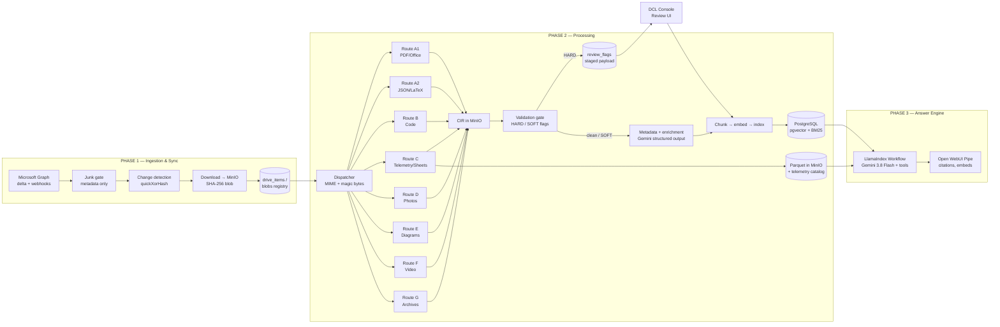
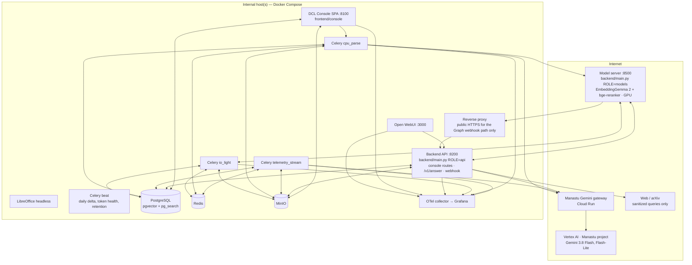

# 01 — System Overview & Tech Stack

## 1. What the system is for

Engineers at Manastu Space ask questions like:

- "What was the peak and steady-state chamber pressure in Test Plan 7, and what was the maximum catalyst bed temperature?"
- "What happened to the catalyst bed in the Injector 14 failure, and what did the post-firing photos show?"
- "Do our cooling-duct FMEA and C-103 material data satisfy the ECSS thermal margin requirement for Test Plan 37?"
- "How does our Python nozzle script compute expansion ratio, and does it validate pressure columns?"
- "Design a 15 N green thruster, Isp > 230 s, under 20 W pre-heat, from what we have, and tell me where we need outside components."

The answers live in ~5,200 heterogeneous files on OneDrive: PDFs (some scanned, some with handwriting), Word/PowerPoint, LaTeX and JSON report sources, Python tooling, LabJack and LabVIEW telemetry, Excel workbooks, 2,000 hardware photos, draw.io P&IDs, test videos, and archives. Alongside the team's own material, OneDrive holds an **external library**: vendor brochures and datasheets, journal and conference papers, articles and book excerpts, some of them in German, French, Japanese or other languages. The system must keep those apart from measured in-house data, rank them accordingly, and still make them findable from an English question.

The system must (a) keep an always-current, deduplicated, machine-readable copy of those files, (b) compute numbers deterministically instead of letting a language model guess them, (c) answer with citations an engineer can click, and (d) put a human in the loop exactly where an unverified value would corrupt an answer, and nowhere else.

## 2. Non-goals

- Not a general enterprise search over all of OneDrive. Only the four shared folders.
- Not a document editor. It reads; it never writes back to OneDrive.
- Not a replacement for engineering judgment. The Answer Engine presents evidence and derived numbers; it does not sign off designs.
- Not real-time telemetry. Ingestion latency of minutes is acceptable.

## 3. Design principles (each one is enforced somewhere concrete)

| Principle | Where it is enforced |
|-----------|----------------------|
| **Reject before download.** Junk never costs bandwidth or API quota. | Phase 1 junk gate on Graph metadata (file 02 §5) |
| **Content-addressed storage.** Identity is SHA-256 of bytes, not a path. | `blobs` table + MinIO key layout (file 05 §1) |
| **Parse once, chunk many.** Every parser writes a CIR; chunking/embedding read the CIR. | `dcl-cir` bucket, `documents.cir_uri` (file 03 §2) |
| **Numbers are computed, not recalled.** | Telemetry → Parquet → DuckDB; physics → RocketCEA/SciPy; unit conversion → `pint` (file 07 §3) |
| **Units are normalized at ingestion, with provenance.** | `telemetry_channels.raw_unit` + `si_unit` + `conversion` (file 05 §4) |
| **Halt only what would corrupt.** | HARD vs SOFT flags (file 06 §2) |
| **Idempotent everything.** Any task can be re-run safely. | State machine with `pipeline_version`, upserts keyed on hashes (file 02 §8) |
| **Every answer is traceable.** | `answer_traces` table + OpenTelemetry spans (file 05 §8, file 07 §8) |
| **IP never leaves in a search query.** | Outbound sanitizer in front of every web call (file 07 §6) |
| **New format = new adapter, nothing else changes.** | Adapter registry + `UNSUPPORTED_FORMAT` flag (file 03 §1) |

## 4. The three phases at a glance

## 5. Tech stack (verified October 2026)

Every row states what the component does here, why it was chosen, and the verified facts that matter for implementation.

### 5.1 Source connectivity

| Component | Role | Why | Verified facts you must design around |
|-----------|------|-----|----------------------------------------|
| **Microsoft Graph v1.0 + MSAL for Python** | Enumerate and download OneDrive content | Only supported API for OneDrive for Business | Delta query returns `@odata.nextLink` pages then one `@odata.deltaLink`; deleted items carry a `deleted` facet; **track items by id, never by path** — `parentReference.path` is not populated in delta and renaming a folder does not re-emit its children; on OneDrive for Business delta **omits `cTag`** on create/modify, so content change is detected with `file.hashes.quickXorHash` (the only hash guaranteed for Business); a stale token returns **HTTP 410 Gone** with a `Location` header holding a fresh enumeration link; **429/503 must honor `Retry-After`** and pause all threads; `?token=latest` yields a delta link without enumerating |
| **Graph change notifications (webhooks)** | Trigger delta runs instead of polling | Microsoft's own scan guidance: crawl with delta, then subscribe, then re-run delta on notification; at most one scheduled full delta per day | Subscriptions expire and need renewal; acknowledge with 202 within seconds, then enqueue the delta run |

### 5.2 Orchestration & execution

| Component | Role | Why | Verified facts |
|-----------|------|-----|----------------|
| **Celery 5 + Redis** | Task queue for sync, download, per-route processing, enrichment, embedding, resume-after-review | Mature, supports routing to dedicated worker pools, retries with backoff, rate limiting | Three queues minimum: `io_light`, `cpu_parse`, `telemetry_stream`, plus `gpu_or_vlm` if any local model runs (file 10 §4) |
| **LlamaIndex Workflows** (`llama-index-workflows`) + **DBOS runtime** (`llama-agents-dbos`) | Event-driven state machine for the Answer Engine and for the multi-step parts of ingestion (triage → extract → verify); DBOS persists every step transition in PostgreSQL so a crashed or paused run resumes by run id | Typed events, branching, fan-out/fan-in, streaming, human-in-the-loop, durability without snapshot code | Standalone package; HITL uses `InputRequiredEvent` / `HumanResponseEvent` with `ctx.wait_for_event`; DBOS is attached as the runtime and launched before runs (decision H8); `Context.to_dict()` remains for debugging |
| **FastAPI** | HTTP surface: Answer Engine API (OpenAI-compatible streaming + trace), DCL Console API, Graph webhook receiver, MinIO presign service | Async, typed, OpenAPI spec for free (which Open WebUI can also consume as a tool server) | — |
| **PostgreSQL 17** (pinned ParadeDB image tag, `…-pg17`) | Registry, documents, nodes, vectors, lexical index, flags, benchmarks, config, traces | One store, transactional, joins across metadata and vectors | Run the **ParadeDB image** (bundles pgvector + pg_search) or install both extensions on your own build |

### 5.3 Parsing & extraction

| Component | Role | Why | Verified facts |
|-----------|------|-----|----------------|
| **IBM Docling** (≥ 2.34) | PDF, DOCX, PPTX, XLSX, images, Markdown, HTML, CSV → `DoclingDocument` (layout, reading order, tables with spans, formulas, figures with bboxes, page images) | Layout-aware; produces lossless JSON we use as CIR; per-page **confidence scores** (`layout_score`, `ocr_score`, `parse_score`, `mean_grade`, `low_grade`; grades POOR/FAIR/GOOD/EXCELLENT); enrichments for formula → LaTeX, code language, **picture classification** (chart type, flow diagram, logo, signature), **picture description via remote OpenAI-compatible API** | Legacy `.doc/.ppt/.xls` need **LibreOffice** installed; audio/video possible via the `asr` extra but we use faster-whisper directly; `table_score` not yet implemented, so table QA is ours |
| **OCR engines under Docling** | Text from scanned pages | Engine chosen **per page by script**: Tesseract (with `osd` orientation/script detection and installed traineddata) for Latin, Cyrillic, Devanagari and Arabic; RapidOCR PP-OCRv5/v6 for Chinese, Japanese and Korean; EasyOCR as a second pass on low-confidence Latin pages | Docling accepts one engine and language list per run, so pages are grouped by detected script before conversion (file 03 §A1.3); Gemini 3.8 Flash transcribes any page that stays below the confidence threshold; engine and language recorded in the CIR |
| **Gemini 3.8 Flash as VLM** | Handwriting transcription, plot digitization, schematic reading, photo failure analysis, page-type triage, table reconstruction fallback | One multimodal model for all vision tasks; **bounding boxes in `[ymin, xmin, ymax, xmax]` normalized 0–1000**; image cost 258 tokens per 768×768 tile; PDFs up to 1,000 pages / 50 MB natively; Files API keeps uploads **48 h** | Use through Google Cloud (Vertex AI) for enterprise data terms (§7) |
| **Tree-sitter** (via `llama-index-packs-code-hierarchy` or direct) | Python → function/class/method nodes with ancestry | Token chunking destroys code | — |
| **Pandoc / pylatexenc** | LaTeX → clean Markdown with `$…$` preserved; `\input/\include` resolution | Ground-truth text beats OCR of the compiled PDF | — |
| **PyArrow, DuckDB, npTDMS, openpyxl, NumPy, python-magic** | Telemetry and spreadsheets → Parquet; deterministic aggregates; TDMS reading; Excel sheets; `.npy` inspection; magic-byte sniffing | Columnar, local, exact | DuckDB reads Parquet straight from MinIO via `httpfs` |
| **LibreOffice headless** | `.ppt → .pptx`, `.doc → .docx`, `.xls → .xlsx`, and **forced formula recalculation** of `.xlsx` whose cached values are missing | Docling needs it for legacy formats; openpyxl cannot evaluate formulas | Run in its own container; one conversion per process invocation |
| **pillow-heif, imagehash, OpenCV, FFmpeg, faster-whisper** | HEIC → JPEG; perceptual hashing; frame sampling and ignition detection; audio extraction; transcription | Standard tooling | — |
| **trimesh / pythonocc-core, py7zr, zipfile, tarfile** | STL/STEP geometry; ANSYS `.wbpz`; archive expansion with bomb guard | — | — |
| **pint** | Unit parsing, validation, conversion | Deterministic, testable unit algebra | Define a project unit registry with aerospace aliases (`psig`, `psia`, `bara`, `barg`, `sccm`, `lbf`) |

### 5.4 Models

| Task | Model | Settings | Notes |
|------|-------|----------|-------|
| Reasoning, synthesis, tool use | `gemini-3.8-flash` | thinking `high` for synthesis, `low` for extraction; structured output on; function calling on | 1,048,576 in / 65,536 out |
| Enrichment (entities, summaries, numeric bounds) | `gemini-3.8-flash` | thinking `low`, JSON schema response, **Batch API** for backfills (50% cost) | — |
| Cheap triage (page type, chunk classification, listwise rerank fallback) | `gemini-3.5-flash-lite` | thinking minimal/low | Fastest, cheapest current model |
| Vision (handwriting, plots, photos, schematics, table fallback) | `gemini-3.8-flash` | `media_resolution` high for handwriting crops, medium for photos | Request bboxes when grounding is needed |
| Embeddings | **EmbeddingGemma 2** (`google/embeddinggemma-2`), local service, **768 dims** | document side: `title: {title} \| text: {content}`; query side: `task: search result \| query: {q}`; images as raw input | Open weights (Apache 2.0); 270M text core + 170M vision encoder; 8,192-token input; 100+ languages; bfloat16 or float32 only; Matryoshka 512/256 available; **spaces of different models are incompatible — re-embed on model change** |
| Reranking | `bge-reranker-v2-m3` (local, CPU or small GPU) | top-50 → top-8 | Fallback: Flash-Lite listwise rerank |
| LLM-as-judge (benchmarks) | `gemini-3.8-flash` with a different prompt, or a second model when available | temperature 0 | Never judge with the exact prompt that produced the answer |
| Fallback for Gemini | none planned | — | Decision: Gemini is the only cloud model; on outage the Answer Engine degrades to extractive mode (file 07 §12) and ingestion queues wait. Embeddings and reranking are local on the GPU |

### 5.5 Storage

| Component | Role |
|-----------|------|
| **MinIO** (built in-house from the archived, pinned source tag, see file 09 §H.1; replacement evaluated before M6) | Buckets `dcl-raw` (content-addressed originals), `dcl-cir` (parsed representations), `dcl-assets` (page renders, crops, photos, thumbnails, video frames), `dcl-telemetry` (Parquet), `dcl-exports`. Presigned URLs for the UI |
| **PostgreSQL + pgvector 0.8.x** | `halfvec(768)` HNSW (`m=16, ef_construction=128`) for text and image vectors; `hnsw.ef_search` raised per query when filtering; iterative scans (`relaxed_order`) for filtered searches; exact-distance path when a filter selects only a few thousand nodes; HNSW limit 2,000 dims for `vector`, 4,000 for `halfvec` |
| **pg_search (ParadeDB)** | BM25 index over `document_nodes.content` (+ `title`, `breadcrumb`, `content_codes`, `content_en`) using several tokenizers on one column: ICU plus per-language Snowball stemmer fields and Lindera/Jieba dictionary tokenizers for CJK; scores via the `pdb.score()` / `paradedb.score()` function depending on the pinned version; **AGPL-3** licensed; index DDL changed across 0.1x → 0.2x releases, so pin the version and keep the DDL in one migration file. Fallback: `tsvector` GIN with language configurations + `ts_rank_cd` |
| **Redis** | Celery broker/result backend, rate-limit tokens, MSAL token cache (encrypted), short-lived locks |

### 5.6 Frontend

| Component | Role | Verified facts (v0.12.3) |
|-----------|------|---------------------------|
| **Open WebUI** | Chat workspace, users/groups/RBAC, model catalog | Extension points: **Pipe** (custom model), **Filter**, **Action** (button under a message), **Tools**, **Skills** (markdown playbooks the model can load), **OpenAPI tool servers** and **MCP (Streamable HTTP)**, event emitter types `status`, `source`/`citation`, `notification`, `confirmation`, `input`, `embeds` (sandboxed iframe with `allow-scripts allow-downloads`; same-origin off by default; `iframe:height` postMessage; `input:prompt:submit`), **Artifacts key-value store** (`/api/artifacts/{store,get,list,delete}`, personal/shared scopes), built-in Evaluations (arena/ELO, **not** golden-set regression), OpenTelemetry, OneDrive file picker (unused by us). **Pipelines** server is marked legacy. **No supported custom sidebar pages without forking the SvelteKit frontend** |
| **DCL Console** (ours; React or SvelteKit + FastAPI) | Review UI, Benchmark UI, Configuration UI | Own URL, SSO with Entra ID, embedded into chats via Rich UI iframes where useful |

### 5.7 Observability & ops

| Component | Role |
|-----------|------|
| **OpenTelemetry** → Grafana Tempo/Jaeger | Traces across FastAPI, Celery, LlamaIndex steps, Gemini calls |
| **Prometheus + Grafana** | Queue depth, task latency, 429 rate, token health, flags open/aging, LLM tokens & cost per day |
| **Flower** | Celery introspection |
| **Docker Compose** (single host) → **Kubernetes** later | All services containerized; GPU only if the local reranker/fallback models are on GPU |

## 6. Deployment topology

Sizing for the current corpus (~5,200 files, ~2,000 photos, ~450 telemetry files): one 16-core host with 64 GB RAM, 2 TB NVMe and **one GPU** (decision H12: the embedding service and the reranker run on the GPU with local disk; every other container runs on CPU, disk and RAM). Docling on CPU handles ~1,069 PDFs in a few hours with 4 parallel `cpu_parse` workers; Gemini calls are I/O-bound through the gateway. Docling on CPU handles ~1,069 PDFs in a few hours with 4 parallel `cpu_parse` workers; Gemini calls are I/O-bound.

## 7. Data governance for the Gemini cloud API

Using Gemini means proprietary test data (pressure traces, failure photos, catalyst formulations) is sent to Google for processing. This is a deliberate decision; the design treats it as follows:

1. **All Gemini traffic goes through Manastu's Gemini gateway on Google Cloud Run**, which calls Gemini in Manastu's own Vertex AI project: `pipeline → gateway (Cloud Run) → Gemini (Vertex AI)`. The pipeline never holds Vertex credentials and never calls the Gemini Developer API; enterprise data terms and regional processing are the gateway's and the Vertex project's. One Gemini client in `backend/llm_engine/gemini_client.py` talks to the gateway through a **provider adapter**: `GeminiNativeAdapter` (the gateway speaks Gemini's native `generateContent` API today; default) and `OpenAICompatAdapter` (kept and tested, for a future OpenAI-style gateway). `GEMINI_API_STYLE` (`gemini` default, `openai`) selects it; the probe verifies the selection by calling the model-list endpoint of each style. Nothing else in the codebase imports a Google SDK or knows the gateway URL. Decisions of 2026-10-21 on the gateway contract are in file 09 §H.1.
2. **The IP sanitizer applies to web search only.** Gemini is the processing engine and must see the real content; sanitizing it would destroy the pipeline's value.
3. **Classify at the folder level.** `pipeline_config.cloud_allowed_roots` lists which of the four roots may be sent to Gemini. If a root is ever marked restricted, its files route to the offline fallback models or are halted with `CLOUD_RESTRICTED` (SOFT, informational) until policy allows.
4. **Minimize payloads.** Send crops, not whole pages, for handwriting; send page thumbnails for triage; use Files API uploads for large PDFs instead of re-sending bytes; use context caching for repeat questions on the same document.
5. **Log every call** in `llm_calls` (model, purpose, token counts, document reference, cost estimate). This is both a cost control and an audit trail.
6. **Never send secrets.** Config files that contain credentials (`.cfg` with API keys, `.env`) are detected by a secret-pattern scan at the gate and are quarantined, not processed.

### 7.1 Environment contract (secrets and endpoints live in `.env`, never in the database)

The shared `.env` lives at the **repository root** (the compose files under `backend/devops/` reference it as `../../.env`); it is root-owned, mode 600, git-ignored, never copied into an image, and scanned in CI. The code reads these names (values are filled in by the operator; placeholders are refused at startup with a clear message):

| Group | Variables | Used by |
|-------|-----------|---------|
| Graph identity | `DCL_TENANT_ID`, `DCL_CLIENT_ID`, `DCL_AUTH_MODE` (`delegated`), `DCL_DELEGATED_USERNAME`, `DCL_PERMISSION_OPTION` (`A` = `Files.SelectedOperations.Selected` on the shared folders, preferred; `B` = `Files.Read.All`), `DCL_TOKEN_CACHE_PATH`, `DCL_TOKEN_DIR`, `DCL_TOKEN_CACHE_KEY` (Fernet key; the v2 cache file is encrypted at rest and separate from the v1 pipeline's plain cache) | sync service (file 02 §1) |
| Graph roots | `DCL_DRIVE_ID`, `DCL_FOLDER_IDS`, `DCL_FOLDER_PATHS` (the four shared folders, recorded once by the admin; the pipeline never resolves sharing links itself) | seeds `sync_roots` on first start (file 02 §2) |
| Graph negative test | `DCL_TEST_OUTSIDE_ITEM_ID` (an item the identity must **not** be able to read), `DCL_TEST_OUTSIDE_DRIVE_ID` (its drive; defaults to `DCL_DRIVE_ID`; the check counts only when the request targets the item's real drive) | CI and the M1 acceptance test |
| Future application-permission variant | `DCL_SECRET_STORE`, `DCL_CERTIFICATE_PATH`, `DCL_CERTIFICATE_THUMBPRINT` | unused until decision H4 changes |
| Gemini | `GEMINI_BACKEND=gateway`, `GEMINI_GATEWAY_URL`, `GEMINI_GATEWAY_KEY` (primary; `DCL_GEMINI_API_KEY` is accepted as a legacy alias for the same gateway credential when the primary is empty; either is refused if it has the Google Developer-key format `AIza…`), `GEMINI_THINKING_LEVEL`, `GEMINI_INCLUDE_THOUGHTS`, `GEMINI_CONTEXT_CACHE`, `GEMINI_CACHE_TTL_S`; `GOOGLE_CLOUD_PROJECT` / `GOOGLE_CLOUD_LOCATION` are informational for the gateway backend. **`GOOGLE_API_KEY` must never be set**; the client refuses to start if it is | Gemini wrapper |
| Alerts | `DCL_ALERT_WEBHOOK_URL` (Teams, operational alerts only: auth failure, 410 resync, queue stall, budget cap) | ops |
| Local stack | `DCL_DB_USER`, `DCL_DB_PASSWORD`, `DCL_DB_PORT`, `DCL_DATABASE_URL`, `DCL_BIND_HOST`, Portainer variables | compose |
| Observability | `DCL_GRAFANA_ADMIN_PASSWORD` (secret; required outside dev), `DCL_GRAFANA_PORT` (compose-only, default 3300 on `DCL_BIND_HOST`), `DCL_ALERT_WEBHOOK_URL` (Teams receiver for Alertmanager) | compose, Grafana, Alertmanager |
| Service wiring (added 2026-10-21, names fixed by the Lead) | `DCL_ENV` (`dev` / `staging` / `prod`), `DCL_ROLE` (`api` / `models` / `all`; workers set it per queue), `DCL_REDIS_URL`, `DCL_MINIO_ENDPOINT`, `DCL_MINIO_ACCESS_KEY`, `DCL_MINIO_SECRET_KEY`, `DCL_MINIO_SECURE`, `DCL_MODELS_URL` (internal URL of the `ROLE=models` process), `DCL_API_BASE_URL` (what the Console build and the Open WebUI functions call), `DCL_CONSOLE_BASE_URL` (used by the backend to build citation deep links), `DCL_PIPE_SHARED_SECRET` (HMAC key for the Pipe → backend identity headers, file 08 §2.3) | `backend/config.py`, compose, `frontend/openwebui/config.py` |
| Console authentication (Entra ID; added 2026-10-21) | `DCL_CONSOLE_API_AUDIENCE` (application id URI of the Console API app registration; tenant reuses `DCL_TENANT_ID`), `DCL_CONSOLE_GROUP_REVIEWERS`, `DCL_CONSOLE_GROUP_ADMINS`, `DCL_CONSOLE_GROUP_EXTERNAL_SEARCH` (Entra group object ids of `dcl-reviewers`, `dcl-admins`, `dcl-external-search`), `DCL_CONSOLE_ALLOWED_ORIGINS` (CORS list for the SPA). Role rule: any authenticated user of the tenant = `viewer`; `dcl-reviewers` = `reviewer`; `dcl-admins` = `admin` (implies reviewer); tokens with group overage are refused with 403 and a message asking the Entra admin to emit only the groups assigned to the app. The SPA's own build-time names (`VITE_API_BASE_URL`, `VITE_ENTRA_TENANT_ID`, `VITE_ENTRA_CLIENT_ID`, `VITE_ENTRA_API_SCOPE`, `VITE_AUTH_MODE`, dev mode honored only by the Vite dev server) live in `frontend/console/src/lib/config.ts` | `backend/api/auth.py`, `frontend/console` |

Non-secret behavior (thresholds, scopes, model ids, prompts) lives in `pipeline_config` (file 05 §4.6) so it can change without a restart. The Gemini wrapper exposes exactly the capabilities the gateway confirms (structured output, function calling, thinking level, image/PDF input, streaming, context caching, Batch); any capability the gateway does not pass through is disabled by a feature flag and the affected design points (caching, batch backfills) fall back to plain calls.

## 8. Throughput and cost envelope (order of magnitude)

| Workload | Volume | Gemini usage | Notes |
|----------|--------|--------------|-------|
| Initial PDF/Office triage | ~1,170 files, ~30k pages | Flash-Lite page thumbnails: ~30k × ~300 tokens | Determines which pages need vision |
| Handwriting / scanned pages | assume 10–15% of pages | 3.8 Flash crops: ~4k crops × ~1–2k tokens | Crops, not pages |
| Figures (plots/schematics) | ~5–8k figures | 3.8 Flash: ~1k tokens each | Classified first; logos/signatures skipped |
| Hardware photos | ~2,000 | 3.8 Flash: ~1.5k tokens each | Plus a local 768-d image embedding each (no API cost) |
| Enrichment | ~150–250k child chunks grouped per parent (~25k parents) | 3.8 Flash low thinking, Batch API | One call per parent, not per child |
| Embeddings | ~250k chunks × ~350 tokens + ~2,000 images | **local** EmbeddingGemma 2 service, no API cost | ~15–30 min on 16 CPU cores for the backfill, minutes on a small GPU; incremental embeddings are negligible |
| Steady state | tens of files/day | negligible | Webhook-driven |

Check current prices on Google's pricing page; the design keeps every call in `llm_calls` so the real number is known after the first week.
