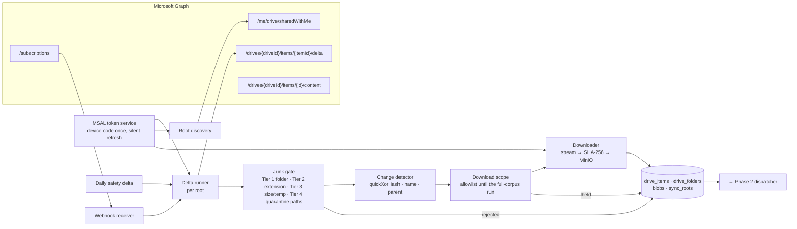
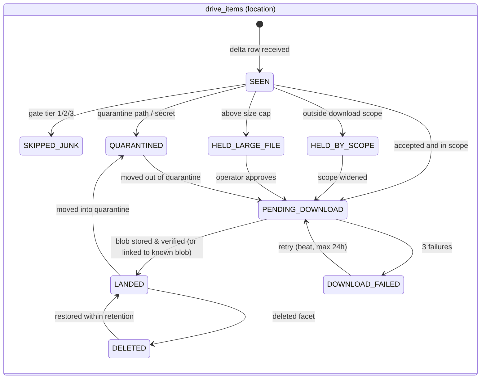
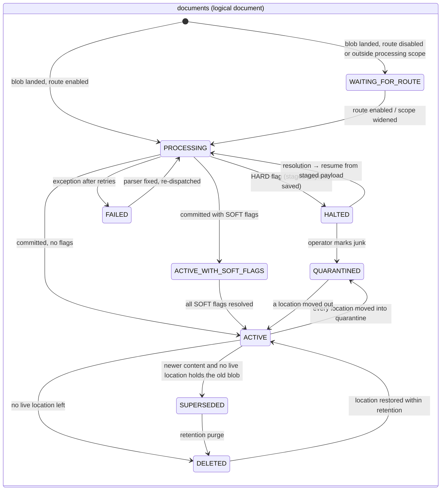
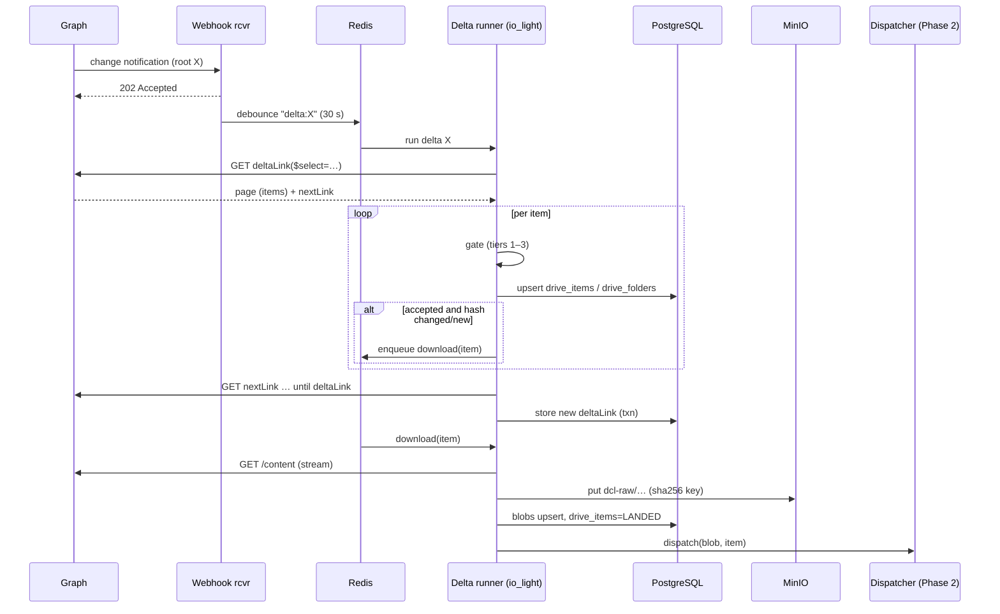

# 02 — Phase 1: Ingestion & Sync Engine

Phase 1 owns everything between OneDrive and a content-addressed blob in MinIO with a registry row that says "this item, this content hash, this route, this status". It never parses file contents (except magic bytes for routing and a secret scan). It must be boring, idempotent, and cheap on Graph quota.



## 1. Identity and authentication

**Decision (carried over, confirmed H4):** delegated permissions, app `dcl-reader-delegated` (`DCL_AUTH_MODE=delegated`, `DCL_DELEGATED_USERNAME`), signed in once with the device-code flow. The permission scope follows `DCL_PERMISSION_OPTION` from the env: **A** = `Files.SelectedOperations.Selected` granted on the shared folders only (preferred, no tenant-wide read), **B** = `Files.Read.All` (needs a written security sign-off). The code must work with either; with option A, every Graph call addresses the folders by the ids in `DCL_FOLDER_IDS` and the service must never try to resolve a sharing link itself (that needs write scope). Microsoft's scan guidance prefers application permissions for crawlers; the env already carries certificate variables for that future variant. The consequences of delegated auth are handled explicitly:

1. **Token cache.** MSAL's serializable token cache is persisted at `DCL_TOKEN_CACHE_PATH` (v2's own file under `DCL_TOKEN_DIR`, mode 600 in a 700 directory, written atomically, **Fernet-encrypted with `DCL_TOKEN_CACHE_KEY`**; the v1 pipeline's plain cache is never read or modified, so v2 performs its own one-time device-code sign-in), mounted read-write into the sync worker only. Every job calls `acquire_token_silent` first. The refresh token is rotated by MSAL; it expires after 90 days of inactivity or when a Conditional Access policy revokes it.
2. **Token health check** runs every 15 minutes (Celery beat): a `GET /me/drive` with the silent token. Failure raises an alert and sets `sync_roots.auth_status = 'REAUTH_REQUIRED'`. The DCL Console shows a banner with a "Start device-code sign-in" button; the code and verification URL are displayed to the operator, who completes sign-in as the service account. No human interaction is needed otherwise.
3. **Least privilege.** Read-only scope. The app never calls write endpoints. There is no path in the code that could modify OneDrive.
4. **Secrets.** Client id, tenant id, encryption key, Gemini credentials, MinIO keys live in the host secret store (Docker secrets or Vault), never in `pipeline_config`.

## 2. Discovering the four roots

Shared folders are not in the service account's own drive. The admin records their ids once in the env (`DCL_DRIVE_ID`, `DCL_FOLDER_IDS`, `DCL_FOLDER_PATHS`); the pipeline never resolves sharing links itself. On first start:

1. Seed `sync_roots` from the env: one row per folder id (`root_name` from the matching path, `remote_drive_id`, `remote_item_id`).
2. Validate each root with a metadata `GET /drives/{drive}/items/{id}`; as a negative check, confirm that `DCL_TEST_OUTSIDE_ITEM_ID` returns 403/404 (the identity must not see anything outside the shared folders).
3. All later calls address the owner's drive: `GET /drives/{remote_drive_id}/items/{remote_item_id}/delta`. `GET /me/drive/sharedWithMe` is used only as a diagnostic in the Console when a root becomes unreachable.

Edge cases:
- **Root unshared or renamed by the owner.** The delta call returns 403/404. The root is marked `UNREACHABLE`, an alert fires, and nothing is deleted locally (file 06 §6: no destructive action on an auth or sharing error).
- **A fifth folder gets shared.** Roots are configuration, not discovery: an operator adds it in the Console; the system does not auto-ingest anything new shared with the account.

## 3. The sync loop

### 3.1 Initial crawl

Call delta with no token, select only the fields needed, and page through `@odata.nextLink` until `@odata.deltaLink` arrives:

```
$select=id,name,size,file,folder,parentReference,eTag,lastModifiedDateTime,createdDateTime,webUrl,deleted,package,shortcut,remoteItem
```

Every page is processed by the gate and change detector **before** the next page is fetched. 110,864 items at 200 per page is ~550 requests; the only cost of junk is metadata.

**Ordering is not guaranteed.** A child can arrive before its parent folder, the same item can appear twice (use the last occurrence), and renames show only the final name. Therefore:
- Folders are stored in `drive_folders` (`item_id`, `drive_id`, `parent_item_id`, `name`, `deleted_at`). Paths are **never** taken from Graph; they are computed by walking `drive_folders` up to the root and cached in `drive_items.path_cached`. When a folder is renamed or moved, one update to `drive_folders` plus a cached-path refresh for its subtree is enough — no re-download, no re-processing.
- Items whose parent is unknown at insert time are stored with `parent_item_id` set and `path_cached = NULL`; a pass at the end of the crawl resolves them. For the same reason `parent_item_id` carries **no foreign key** to `drive_folders`; identity of items and folders is `(drive_id, item_id)` with a surrogate key for other tables to reference.

### 3.1a Metadata-only mode and the download scope

The crawl always covers **all four roots in full**, because metadata costs nothing and is the only way to prove the gate numbers and build the registry. Whether an accepted item is *downloaded* is a separate decision:

- `pipeline_config.sync.download_scope` is an allowlist of roots, folder ids or path globs. Accepted items outside it get `status = HELD_BY_SCOPE` with `gate_reason = SCOPE:not_in_download_scope`. They are counted, visible in the Console, and never fetched.
- `pipeline_config.processing.scope` is the equivalent allowlist for Phase 2: a landed blob outside it stays `LANDED` and is not dispatched.
- An empty scope means "everything". Widening a scope (or lifting it entirely in the full-corpus run, file 10 M6) enqueues the held items in batches that honor the download token bucket; nothing else changes.
- **Decision H11:** `sync.download_scope` is **empty** (everything the gate accepts is downloaded from the start: bandwidth is cheap and the registry, dedup statistics and dispatcher tests become real), while `processing.scope` holds the SME-chosen test folders until the full-corpus run (M6). The metadata crawl therefore shows the real ~5,200 / ~105k split from day one, and the only cost that is deferred is Gemini processing.

### 3.2 Incremental delta

Triggered by (a) a webhook notification, (b) the daily safety run, (c) an operator button. It calls the stored `delta_link`, processes pages identically to the crawl, and stores the new `delta_link` only after the whole page set has been committed (transactionally, so a crash mid-run replays from the previous link — idempotency covers the duplicates).

### 3.3 Webhooks

One Graph subscription per root on the drive resource, change type `updated`, lifetime ≈ 3 days (max for drives), renewed by a beat task at 70% of lifetime. The receiver:
1. Validates the `clientState` secret.
2. Replies **202 within one second** (otherwise Graph retries and you get duplicate notifications).
3. Pushes a debounced "run delta for root X" job into Redis (coalesce notifications within 30 s; a burst of 100 saves on one folder produces one delta run).

Webhooks are a trigger, not a source of truth. The daily full delta ensures nothing is missed if the subscription lapses.

### 3.4 Throttling

On 429 or 503: read `Retry-After`, **pause every Graph call process-wide** (a Redis key `graph:paused_until`), then resume. Downloads run through a token bucket (default 8 concurrent, 4 MB/s each) that the operator can lower from the Console. Never retry in a tight loop; Microsoft blocks abusive callers.

### 3.5 Delta token expiry (HTTP 410 Gone)

Graph returns 410 with `error.code` `resyncRequired`/`resyncChangesApplyDifferences` and a `Location` header pointing to a fresh enumeration. Procedure:
1. Mark the root `RESYNCING` (delta runs for that root pause).
2. Compute the root's new resync generation as `max(drive_items.resync_gen) + 1` over that root's items (no column on `sync_roots`) and run the full enumeration from the `Location` link; every item seen is upserted normally **and stamped** with the new generation in `drive_items.resync_gen` (no staging table):
   - known item, same `quickXorHash` → stamp only;
   - known item, different hash → treat as modified;
   - unknown item → treat as new.
3. Items of that root whose `resync_gen` is older than the current generation are the "missing" set. Each is treated as deleted **only if** a direct `GET /drives/{d}/items/{id}` also fails (guards against partial enumerations).
4. Store the new delta link, mark `ACTIVE`.

### 3.6 Scheduling summary

| Job | Trigger | Queue |
|-----|---------|-------|
| Delta run per root | Webhook (debounced), daily at 02:00 local, manual | `io_light` |
| Subscription renewal | Beat, every 12 h | `io_light` |
| Token health | Beat, every 15 min | `io_light` |
| Download | Enqueued by change detector | `io_light` (bounded concurrency) |
| Resync after 410 | Automatic | `io_light` |
| Scope widening (download / process more folders, or everything) | Operator action in the Console | `io_light`, batched through the download token bucket |
| Retention/purge of unreferenced blobs | Beat, weekly (`NOT EXISTS` against `document_sources` and live `drive_items`) | `io_light` |

## 4. What is rejected (the junk gate) and why

The gate runs on metadata only. Decisions are stored (`drive_items.status`, `gate_reason`) so the Console can show "why is my file not indexed?" without guessing. Rejected items are **not downloaded** and have no `blobs` row.

### Tier 1 — Path segments (stop traversal)

If any segment of the computed path matches: `.venv`, `venv`, `env`, `site-packages`, `__pycache__`, `.git`, `.idea`, `.vscode`, `build`, `dist`, `node_modules`, `.ipynb_checkpoints`, `.mypy_cache`, `.pytest_cache`, `.tox`, `.eggs`, `*.egg-info` → `SKIPPED_JUNK:PATH`. The folder itself is recorded in `drive_folders` with `junk=true` so that all descendants are decided in O(1) without walking.

`_to_delete` (and any folder matching the configurable `quarantine_path_patterns`, default also `old`, `archive_old`, `backup`) → `QUARANTINED:PATH`. Metadata is kept and visible in the Console; nothing is downloaded or indexed. If the folder is later renamed out of quarantine, the items are re-evaluated automatically (because paths are recomputed from the folder tree).

### Tier 2 — Extensions (never download)

- Compiled/environment: `.pyc .pyi .pyd .typed .dll .exe .lib .a .so .o .qml .qmltypes .qm .pak .metainfo .mesh .frag .bin .h .c .cpp .pxd .pyx .f90 .f .f95 .pyf .inc .f2py_f2cmap .afm .ttf .mplstyle .ico .icns .ani .cls .bas .xlam .xlsm(when under library) .applescript .asp .pys .vbs .sct .idl .rc .chm .pyw .tab .zi .tpl .tmpl .template .build .cmake .toml .ini .pc .pth .spec .whl .rst .1 .apache .bsd .python .external .ps1 .fish .pem .lua .xrc .al .g4 .lark .gitignore .iml`
- LaTeX intermediates: `.aux .log .toc .lof .lot .out .fls .fdb_latexmk .synctex .synctex(busy) .synctex.gz .bbl .blg .nav .snm .vrb`
- Redundant companions: `.bkp` (draw.io backups), `.tdms_index`
- OS/editor noise: `.DS_Store`, `Thumbs.db`, `desktop.ini`, names starting with `~$` (Office lock files), `.tmp`, `.crdownload`, `.part`

→ `SKIPPED_JUNK:EXT`.

**Important nuance:** the extension list is applied **after** Tier 1. Data-like extensions (`.mat .sav .arff .nc .wav .npz .fits .pkl .html .xml .csv .png`) are junk only when under a Tier-1 path (they are library sample data). The same extensions in a team folder are real and go to a route.

### Tier 3 — Size and type sanity

- Zero-byte files → `SKIPPED_EMPTY`.
- `package` facet (OneNote notebooks) → `SKIPPED_UNSUPPORTED_PACKAGE` (OneNote needs a different API; out of scope).
- `shortcut` facet / `.url` / `.lnk` → `SKIPPED_SHORTCUT`.
- Files > 4 GB → `HELD_LARGE_FILE` (SOFT flag, operator can approve download; prevents one video from exhausting disk).

### Tier 4 — Post-download content checks (still Phase 1)

After download, before dispatch:
- **Magic-byte mismatch** (`.pdf` that is actually HTML, `.xlsx` that is actually CSV): the real type wins for routing; the mismatch is recorded in `drive_items.detected_mime` and shown in the Console.
- **Secret scan** on text-like files (`.cfg .txt .py .json .ini .env .bat .md`): regex for API keys, bearer tokens, private key headers, connection strings. Hit → `QUARANTINED:SECRET` (HARD flag `SENSITIVE_CONTENT`), blob kept in MinIO under restricted prefix, never sent to Gemini or indexed until an operator redacts/approves.
- **Encrypted archive / password-protected PDF** → routed, and the route raises `PARSE_FAILURE` (file 06).

### What is deliberately **not** rejected

`.dat_fail` (failed test runs are the most valuable telemetry), `.csv` and `.xlsx` in team folders, extensionless files in team folders (they go to the mystery-format sniffer), `.png/.jpg` in team folders (hardware photos and exported plots), `.bat/.txt/.md` in team folders (tooling docs), `.xsd`, `.drawio`, `.wbpz`, `.scdoc`.

## 5. Change detection and the hashing/deduplication model

Four layers, each answering a different question.

| Layer | Hash | Computed where | Question it answers |
|-------|------|----------------|---------------------|
| L0 | `quickXorHash` (from Graph metadata) | Microsoft, free | "Did the bytes change since I last saw this item?" — decided **without downloading** |
| L1 | SHA-256 of the full byte stream | During download (streamed) | "Have I seen these exact bytes anywhere, under any name?" — content identity for the `blobs` table |
| L2 | Per-unit text hashes (page, sheet, slide, code symbol) | Phase 2, stored in CIR | "Which pages of this new version actually changed?" — partial re-processing |
| L3 | Perceptual hash (pHash, 64-bit) for images; MinHash signature (128 perms over 5-word shingles) for text documents | Phase 2 | "Is this the same photo re-saved / the same report with edits?" — near-duplicate linkage |

### 5.1 Event handling table

| Graph event (as seen in delta) | Detection | Action |
|-------------------------------|-----------|--------|
| New item, hash unseen | no `drive_items` row; no `blobs` row for L1 after download | Download → new blob → new `documents` logical doc → dispatch |
| New item, bytes already known (copy of an existing file into another folder) | L0 `quickXorHash` + size already in `blobs`, or L1 matches after download | **No re-processing, usually no download.** Insert the `drive_items` row pointing to the existing blob; the document gains a second location (locations are derived by joining `document_sources` to `drive_items` on the blob). Citations list all locations; the canonical display path is the earliest-seen or the one outside any `old/` folder |
| Content modified in place | same id, `quickXorHash` changed | Download → new blob → new document; `document_relations(SUPERSEDES)` from new to old. The old document's `status` becomes `SUPERSEDED` **only when no live location still holds the old blob** (a copy of the old file in another folder keeps it active). Superseded documents stay citable and are excluded from default retrieval. Phase 2 uses L2 page hashes to skip unchanged pages' vision calls |
| Metadata-only change (eTag changed, hash same) | hash equal | Update `name`, `last_modified`, `web_url`; nothing else |
| Rename or move (same id, new `name`/`parentReference.id`) | compare stored values | Update row + recompute `path_cached` for the item (or subtree for folders). Folder context metadata (test plan inferred from folder name) is recomputed and the documents' metadata row updated without re-parsing |
| Move **into** a quarantine folder | new path matches Tier 1/4 pattern | `drive_items.status = QUARANTINED`, `documents.status = QUARANTINED`, nodes excluded from retrieval immediately (status filter), blob retained |
| Move **out of** quarantine | path no longer matches | Status back to `ACTIVE`; if never processed, dispatch now |
| Deleted (`deleted` facet) | — | `drive_items.deleted_at = now`; if no other live location holds any blob of the document → `documents.status = DELETED`; nodes excluded; blob and CIR retained for the retention window (default 90 days) then purged |
| Folder added to the download or processing scope | operator widens the scope | `HELD_BY_SCOPE` items become `PENDING_DOWNLOAD` in batches; landed blobs newly in processing scope are dispatched |
| Restored from recycle bin | item id reappears | Clear `deleted_at`; if the blob is still present, document returns to `ACTIVE` with zero processing |
| Folder deleted | `deleted` facet on folder | Mark folder deleted; children arrive as their own deleted events; never cascade-delete from the folder event alone (Graph says delete a folder locally only when empty) |

### 5.2 Why SHA-256 and not only quickXorHash

`quickXorHash` is Microsoft-proprietary, cheap, and only available from Graph; it is perfect for L0. SHA-256 is what everything downstream keys on (MinIO object key, CIR key, `document_sources.blob_sha256`), is reproducible outside Graph (uploads via other channels in the future), and is collision-safe for identity. Because quickXorHash is not cryptographic, the L0 "seen before" lookup on `blobs` always pairs it with `size_bytes`. The downloader also computes `quickXorHash` locally (Microsoft publishes the algorithm) and compares it with the Graph value — a cheap integrity check that catches truncated downloads.

### 5.3 Near-duplicates (L3) — what we do and don't do

- **Photos:** pHash Hamming distance ≤ 6 → same `photo_cluster_id`. One Gemini analysis per cluster; the other members inherit it and are listed as "also seen as…". Prevents 1,266 photos from becoming 2,500 Gemini calls when engineers re-save HEIC as JPG.
- **Reports:** MinHash Jaccard ≥ 0.85 between two ACTIVE documents in the same root → create a `document_relations` row (`relation = NEAR_DUPLICATE`, with the score). Both remain indexed; the Answer Engine collapses near-duplicates in the result list and prefers the newer `doc_date`. **We do not auto-mark one as superseded** — that is a `CONFLICT` SOFT flag for a human only if both carry the same `test_plan_id` and different numbers in their enrichment summary (file 06 §3).
- **PDF compiled from `.tex`/`.json` siblings:** handled explicitly by the Route A1 sibling check (file 03 §4), not by MinHash.

## 6. Download and landing in MinIO

1. `GET /drives/{d}/items/{id}/content` follows the 302 to a pre-authenticated URL; stream in 8 MB chunks; compute SHA-256 and quickXorHash on the fly; write to a temp object `dcl-raw/_incoming/{uuid}`.
2. Verify size and quickXorHash; on mismatch delete temp and retry (max 3, exponential backoff).
3. If `blobs` already has this SHA-256: delete the temp object and link the item to the existing blob. (Most such cases never reach this step: before downloading, the change detector looks up `blobs` by `(quick_xor_hash, size_bytes)` and links the item directly when it finds a match.)
4. Else move to `dcl-raw/{sha256[0:2]}/{sha256[2:4]}/{sha256}` with object metadata `original_name`, `first_location_id`, `mime_detected`, `source=onedrive`.
5. Insert the `blobs` row with `ON CONFLICT DO NOTHING` (two parallel downloads of the same new content must not create two documents; the partial unique index on `document_sources` is the second guard); set `drive_items.status = LANDED`; if the blob is within `processing.scope`, enqueue Phase 2 dispatch with `(blob_sha256, location_id)`, otherwise it waits for the scope to widen.

Large files (> 250 MB, typically videos) use ranged requests with resume; a crashed download resumes from the last committed range.

## 7. The registry state machine

Two state machines, deliberately separate. `drive_items.status` tracks the **location** and covers Phase 1 only. `documents.status` tracks the **logical document**, which is shared by every location holding the same content; Phase 2 and the Review Console own it. A document transition therefore never has to touch N item rows.





### 7.1 Idempotency rules (every task obeys these)

- Every unit of work is a row in `jobs` with a code-built `job_key` = `{stage}:{blob_sha256 or doc_id}:v{parser_version}.{pipeline_version}` (text, NOT NULL, UNIQUE). The key **never contains a location id**: a second copy of known content is the same job, not a new one. Re-running a job whose key is `done` is a no-op.
- All writes for one document happen in one transaction that first deletes **all** of the document's nodes, mentions and facts (by `doc_id`, every version), then re-applies stored review resolutions as overlays, then inserts. A crash never leaves half a document indexed, and old versions never linger in the vector or lexical index.
- `pipeline_version` is bumped when chunking/enrichment logic changes in a way that should re-index. A beat job walks `documents` where `pipeline_version < current` and re-enqueues **from the CIR**, not from OneDrive, reusing vectors whose `embed_text_hash` is unchanged. Only parser changes force a re-parse from the blob (controlled by a per-route `parser_version`).

## 8. Diagrams

### 8.1 Sync sequence



## 9. Edge cases checklist (Phase 1)

| # | Case | Handling |
|---|------|----------|
| 1 | Same file in two folders | One blob, one document, two locations; no double indexing |
| 2 | File replaced by byte-identical upload (eTag changes, hash same) | Metadata update only |
| 3 | Report `v1.docx` and `v2.docx` side by side | Two documents; MinHash links them; both retrievable; newer preferred |
| 4 | Folder renamed `Test Plan 30` → `TP30 (old)` | Paths recomputed; folder-derived metadata recomputed; if new name matches quarantine patterns, subtree quarantined |
| 5 | Owner unshares a root | Root `UNREACHABLE`; nothing deleted; alert |
| 6 | Service account refresh token revoked | Health check fails → banner + device-code re-auth; queue pauses on 401 |
| 7 | 429 storm during initial crawl | Global pause honoring `Retry-After`; crawl resumes from last committed page |
| 8 | Delta token older than Graph retains | 410 → staged resync with diff; no mass deletes without per-item confirmation |
| 9 | Child appears before parent | Parent id stored; path resolved at end of page set |
| 10 | Item duplicated in one delta feed | Last occurrence wins |
| 11 | File > 4 GB | Held; operator approves |
| 12 | Office lock file `~$report.docx` | Skipped |
| 13 | `.cfg` containing a token | Quarantined `SENSITIVE_CONTENT`; sibling `.dat` files still process but channel map comes from a redacted copy approved in the Console |
| 14 | File content is HTML but extension `.pdf` (saved error page) | Magic bytes win; routed to A1 as HTML → parses to nearly empty document → `PARSE_FAILURE` SOFT flag (nothing useful) |
| 15 | Path longer than filesystem limits | Irrelevant: MinIO keys are hashes; paths live only in the DB |
| 16 | Unicode/emoji in names | Stored as-is; `path_cached` is text; display only |
| 17 | Recycle-bin restore after purge window | Treated as new (blob gone) |
| 18 | Two roots that contain the same shared subfolder | Items deduplicate by `(drive_id, item_id)`; the item is listed once with the first root as owner |
| 19 | Very large initial crawl interrupted | Resume from stored `nextLink` (persisted per page); gate decisions are idempotent |
| 20 | Clock skew between host and Graph timestamps | We never compare times for change detection; hashes only |
| 21 | Two copies of a new file downloaded in parallel by two workers | Blob insert is conflict-safe; the second worker links to the first worker's blob; one document |
| 22 | A folder is added to the download scope months later | Held items were already registered; they move to `PENDING_DOWNLOAD` in batches with no re-crawl |
| 23 | Old file copied into another folder after the item was modified in place | The old document stays `ACTIVE` (a live location still holds its blob); both documents are linked by `SUPERSEDES`; retrieval prefers the newer and says so |

## 10. Metrics and alerts

- `graph_requests_total{status}`, `graph_pause_seconds_total`, `delta_pages_total`, `items_gated_total{decision}`, `downloads_total{result}`, `download_bytes_total`, `blob_dedup_hits_total`.
- Alerts: auth failure, root unreachable, 410 resync started, download failures > 5% in an hour, webhook silence > 36 h for a root with recent activity, queue depth `io_light` > 2,000 for 30 min.
