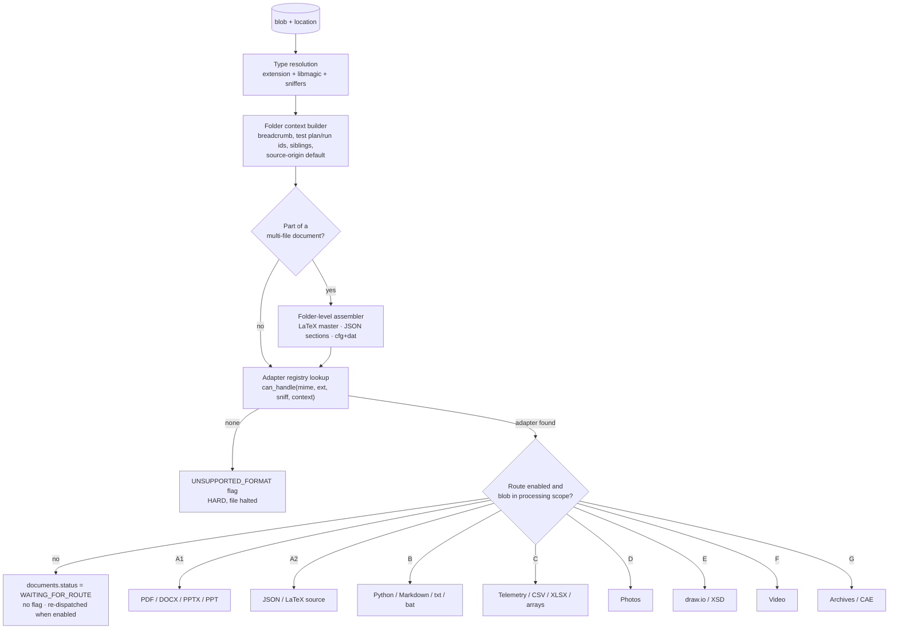
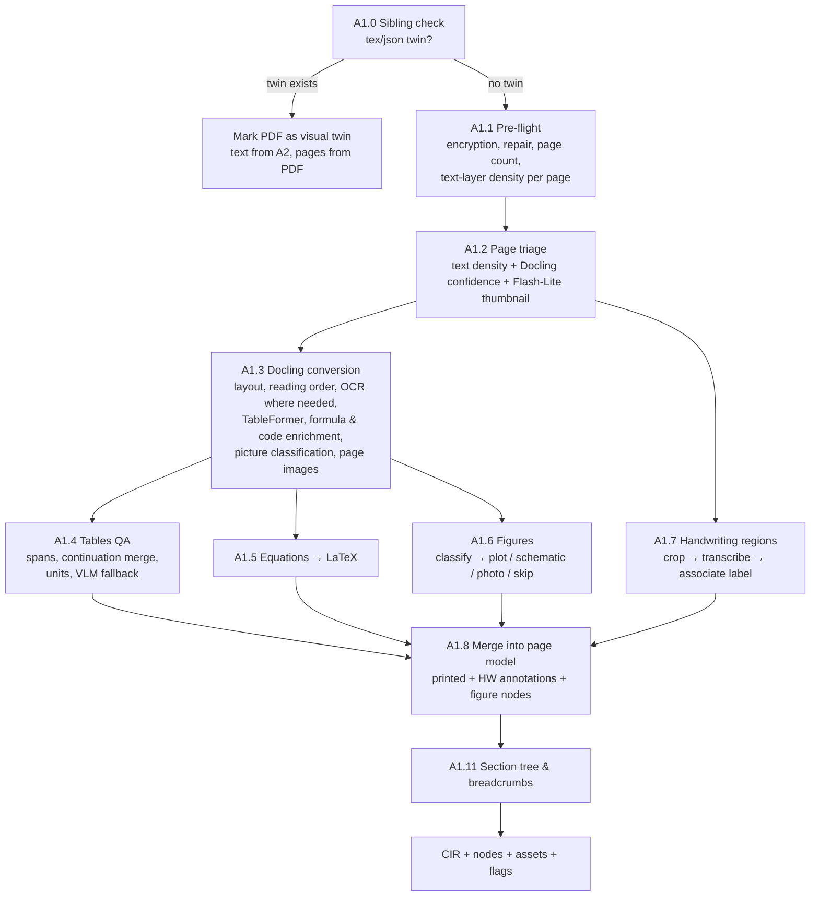
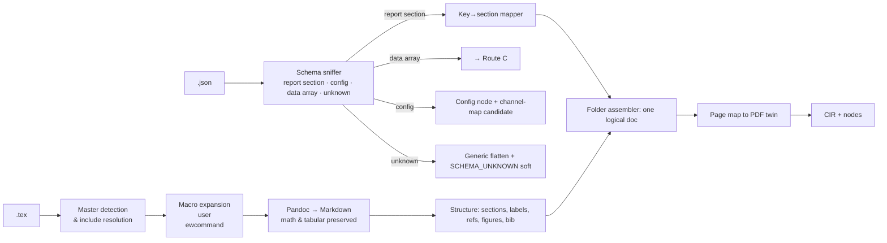
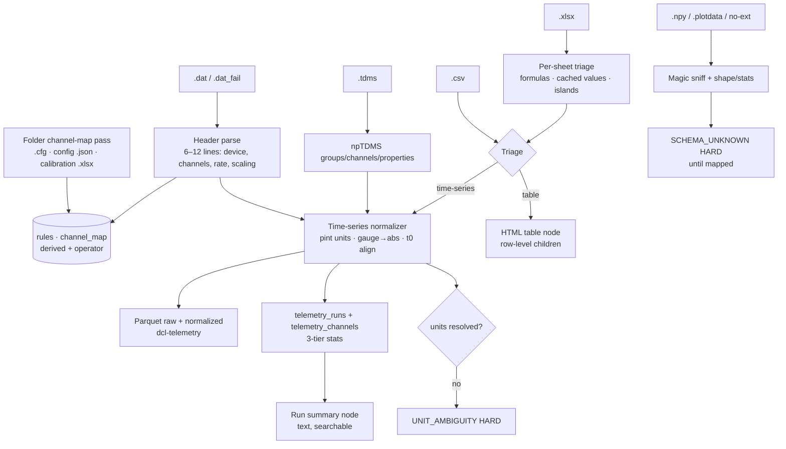
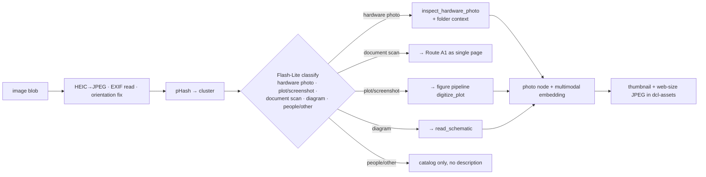

# 03 — Phase 2: Processing Routes

Phase 2 turns a landed blob into (a) a Canonical Intermediate Representation (CIR) in MinIO, (b) retrievable nodes, assets, catalog rows and entity mentions in PostgreSQL, and (c) flags for anything a human must decide. One route per format family; every route produces the same output contract so the common tail (validation gate → enrichment → chunking → embedding, file 04) is shared.

## 1. The dispatcher



### 1.1 Type resolution

Order of precedence: **magic bytes** (libmagic + custom sniffers) → **extension** → **folder convention**. The resolved type is stored as `drive_items.detected_mime`. Custom sniffers (first 16–64 bytes):

| Signature | Meaning | Route |
|-----------|---------|-------|
| `%PDF-` | PDF | A1 |
| `PK\x03\x04` + `[Content_Types].xml` containing `word/`, `ppt/`, `xl/` | DOCX / PPTX / XLSX | A1 / A1 / C |
| `PK\x03\x04` + `dp0/` or `.wbpj` inside | ANSYS `.wbpz` | G |
| `PK\x03\x04` otherwise | ZIP | G |
| `\xD0\xCF\x11\xE0` (OLE2) | `.doc/.ppt/.xls` legacy | A1 / A1 / C (via LibreOffice) |
| `\x93NUMPY` | NumPy array | C |
| `\x80\x04`, `\x80\x05`, `\x80\x03` | Python pickle | C (mystery, **never unpickled**, see §7.5) |
| `TDSm` | LabVIEW TDMS | C |
| `<mxfile` or `<mxGraphModel` | draw.io | E |
| `<?xml` + `<xs:schema` | XSD | E |
| `\x1F\x8B` | gzip | G |
| `ftyp` at offset 4 with `heic/heix/mif1` | HEIC | D |
| `\xFF\xD8\xFF`, `\x89PNG` | JPEG / PNG | D (then photo vs plot classifier) |
| `ftyp` with `isom/mp42/qt  ` | MP4 / MOV | F |
| Printable ASCII, first line matches LabJack header regex | LJStreamM `.dat` | C |
| Printable ASCII with consistent delimiters | CSV/TSV | C |

Extension-vs-content mismatches are recorded; the content wins.

### 1.2 Folder context builder

Every file gets a `FolderContext` before routing (persisted in `documents.folder_context` JSONB):

- `root_name`, `breadcrumb` (list of folder names from root), `path_cached`
- `test_plan_id`, `test_run_id`, `hardware_item` inferred deterministically by regex over the breadcrumb and filename (`TP\s?(\d+)`, `Test[_ ]Plan[_ ](\d+)`, `T(\d{2})`, `Test_(\d+)_`, `INJ(?:ector)?[_ ]?(\d+)`, `Run[_ ]?(\d+)`), with the **source of each inference recorded** (`from: folder[2]` vs `from: filename`). If regexes disagree (folder says TP30, filename says T02 — fine: plan vs run) they are both kept; if two different plan ids are found, `CONFLICT` SOFT flag.
- `siblings`: names and types of files in the same folder (used by A1 sibling check, C channel maps, A2 assembler, D folder-context prompts).
- `folder_kind` heuristics: `pressure_data_files`, `post_firing_photos`, `reports`, `library` — assigned by matching folder names against a configurable dictionary; informational only.
- `source_origin` default and `trust_tier`: from `sync_roots.default_source_origin` and any `drive_folders.source_origin_override` (for example the `APS - Library` root defaults to `external_kept`). The route's detectors (DOI, publisher, vendor name, file 04 §2) may later override `internal` → `external_kept`, never the reverse.

### 1.3 Folder-level assembler

Runs before route selection when a folder contains files that only make sense together. It creates a **logical document** spanning several blobs: one `documents` row with several `document_sources` rows (the master as `primary`, the others as `part`, `visual_twin`, `channel_map`, …):

| Pattern | Rule |
|---------|------|
| LaTeX project | Find the master `.tex` (contains `\documentclass`); resolve `\input{}`/`\include{}` recursively; the logical doc is the master; included files become `document_sources(role = part)` of the master and are not indexed separately |
| JSON report sections | Files named `objectives.json`, `checklist.json`, `observations.json`, `conclusions.json` (configurable list) in one folder → one logical document named after the folder; order by the configured section order |
| Compiled PDF with sources | `report.pdf` next to `report.tex` or the JSON set → PDF becomes the **visual twin** of the source doc (see A1.0) |
| Telemetry run folder | `.cfg` + N `.dat` (+ `.tdms`, `.csv`) → channel map built once per folder and shared |
| Photo bursts | Same folder, timestamps within 60 s, pHash distance ≤ 6 → `photo_cluster` |

If the assembler is unsure (two `.tex` files both with `\documentclass`), it indexes both and raises `CONFLICT` SOFT ("two masters in folder X").

### 1.4 Output contract (every route)

```
ProcessedDocument
  document        : row for `documents` (title, doc_kind, route, dates, canonical flags)
  cir_uri         : s3://dcl-cir/{sha256}/{route}/v{parser_version}/…
  nodes[]         : hierarchical nodes (parent/child), each with content, node_type,
                    page/line/slide/time anchors, bbox, breadcrumb, unit-normalized numbers
  assets[]        : page renders, crops, photos, frames (→ dcl-assets, rows in `assets`)
  catalog[]       : telemetry_runs / telemetry_channels rows, or a JSON payload for
                    documents.catalog (diagram graph, CAE summary, CAD reference)
  mentions[]      : deterministic entity mentions (regex-found ids, part numbers, standards)
  flags[]         : {type, severity, fingerprint, anchor(page/sheet/bbox/content hash/line),
                    evidence, suggested_fix}   -- fingerprint = type + CIR anchor, stable across re-runs
  unit_hashes[]   : L2 hashes per page/sheet/slide/symbol
```

### 1.5 Common post-route stages (shared, defined in file 04)

validation gate → (HARD flag? halt with staged payload) → deterministic metadata → LLM enrichment → chunking → embedding → index commit → SOFT flags recorded.

### 1.6 Route gating and the processing scope

Two configuration switches sit between the adapter lookup and the route, so the pipeline can be built and rolled out route by route (file 10 §3, §5):

- `routes.<X>.enabled` — a disabled route does not halt or flag its files. The dispatcher creates the `documents` row with `status = WAITING_FOR_ROUTE` and stops. Enabling the route later re-dispatches every parked document automatically; the Console shows the parked count per route.
- `processing.scope` — a landed blob outside the allowlist is not dispatched at all (it stays `LANDED` on the location, no document row). Widening the scope dispatches it.

Neither switch is a flag: nothing in the Review queue, no human action needed. `UNSUPPORTED_FORMAT` remains reserved for types with no adapter at all.

---

## 2. The Canonical Intermediate Representation (CIR)

Everything a parser learns is written to `dcl-cir/{blob_sha256}/{route}/v{parser_version}/` **before** any chunking:

| Route | CIR content |
|-------|-------------|
| A1 | `docling.json` (lossless DoclingDocument with provenance bboxes), `pages/{n}.txt`, `pages/{n}.meta.json` (page_type, confidence scores, OCR engine), `tables/{id}.html`, `figures/{id}.json` (classification + VLM output), `handwriting/{id}.json`, `page_hashes.json` |
| A2 | `assembled.md` (post-macro Markdown), `structure.json` (section tree with labels/refs), `source_map.json` (markdown line → source file:line), `page_map.json` (section → PDF page, when a twin exists) |
| B | `ast.json` (symbols, ranges, parents, imports, docstrings), `module_header.md` |
| C | `schema.json` (columns, raw units, mapped names, conversions, time base, t0), `stats.json`, Parquet lives in `dcl-telemetry` and is referenced |
| D | `exif.json`, `classification.json`, `vlm.json`, `phash` |
| E | `graph.json` (nodes, edges, labels, styles), `render.png` (asset) |
| F | `probe.json`, `transcript.json` (word timestamps), `scenes.json`, `events.json` |
| G | `manifest.json` (inner files, hashes, routes assigned) |

Why: re-chunking, re-embedding, changing enrichment prompts, or fixing a bug in table HTML serialization must never require re-running OCR or Gemini vision. The CIR is the expensive part; everything after it is cheap and repeatable.

---

## 3. Shared vision sub-pipeline (used by A1, C-XLSX, D, E, F)

All routes that need a vision model call the same component, `VisionService`, so prompts, caching, cost logging and retries live in one place.

| Capability | Model | Input | Output schema (structured output) |
|-----------|-------|-------|------------------------------------|
| `triage_page` | Flash-Lite | page thumbnail (≤ 768 px long side) + 1-line context | `{page_type, has_handwriting, has_tables, has_figures, is_rotated, language (BCP-47), script (latin · cyrillic · devanagari · arabic · cjk · mixed), handwriting_regions:[{box_2d, kind}]}` |
| `transcribe_page` | 3.8 Flash, media_resolution high | full page image, any script; used when OCR stays below threshold after the second engine | `{markdown, language, confidence, illegible_regions:[box_2d]}` |
| `transcribe_handwriting` | 3.8 Flash, media_resolution high | crop (+20 px padding) + nearest printed label + unit hint | `{field_label, value_raw, value_number, unit, confidence 0–1, alternatives[], illegible:boolean, notes}` |
| `read_table_image` | 3.8 Flash | table crop | `{html_table, n_rows, n_cols, header_rows, units_by_column[], confidence}` |
| `digitize_plot` | 3.8 Flash | figure crop + caption | `{plot_type, x_axis:{label,unit,range}, y_axes:[…], series:[{name, key_points:[{x,y}], trend}], annotations[], confidence}` |
| `read_schematic` | 3.8 Flash | figure crop | `{components:[{tag, type, label}], connections:[{from,to,medium,label}], notes}` |
| `inspect_hardware_photo` | 3.8 Flash | photo + folder context | `{components_visible[], failure_modes:[{mode, location, severity, confidence}], visible_text[], test_stage_hint, description}` |
| `describe_slide` | 3.8 Flash | slide image + extracted text | `{summary, diagram_description, key_numbers[]}` |
| `video_timeline` | 3.8 Flash (video input) | clip ≤ 2 min or keyframes | `{events:[{t_s, type, description}], anomalies[]}` |

Rules:
1. Every call is logged to `llm_calls` with `doc_id`, `purpose`, token counts.
2. Results are cached in MinIO under `dcl-cir/_vision_cache/{model}/{prompt_version}/{input_sha256}.json` (lifecycle-expired, no database writes on a hit); identical crops (e.g., the same logo on 300 pages) cost once.
3. Any numeric value returned by a vision call is **data with a confidence**, never silently merged into printed text; the node keeps `source = vlm` and the confidence.
4. Prompts forbid guessing: the model must return `illegible: true` or `confidence < 0.5` rather than invent a digit. Prompts include the allowed units from the context.

---

## 4. Route A1 — PDF, DOCX, PPTX, PPT

Inventory: 1,069 `.pdf` (ECSS standards, test reports, post-explosion reports), 93 `.docx` (calibration, heater plans), 12 `.pptx/.ppt` (workshop slides).



### A1.0 Sibling check (anti-duplication with ground-truth sources)

If the folder contains `name.tex` (or the JSON section set) whose stem matches the PDF stem (case-insensitive, ignoring `_final`, `_v2`, dates), the PDF is a **visual twin**:
- Text nodes come from Route A2 (exact source).
- The PDF is still processed for **page renders** (citations with page highlights), **figure crops** (the compiled figures), and **page mapping**: each A2 section heading is located in the PDF page texts (fuzzy match on normalized heading text + order constraint) and `page_map.json` is written. Nodes from A2 receive `page_no` through this map so a citation says "Test_Report_37.pdf, page 12" even though the text came from `.tex`.
- If the PDF has pages with content absent from the source (appendices scanned in, signatures, stamped approvals), those pages are processed as if there were no twin and are appended as nodes with `section = Appendix (PDF-only)`.

### A1.1 Pre-flight

- **Encrypted / password-protected:** `PARSE_FAILURE` HARD with reason; operator can upload a decrypted copy in the Console or mark skip.
- **Damaged xref / malformed:** attempt repair with `qpdf --qdf`/`pikepdf`; if repaired, record `repaired=true`; else `PARSE_FAILURE`.
- **Text-layer density per page:** characters per page from the PDF text layer (pypdfium2). Also a **garbage-text detector**: ratio of dictionary words and of printable ASCII; fonts without a ToUnicode map produce "text" that is noise. Density < 50 chars or garbage ratio > 40% → page is treated as image-only for triage.
- **Rotation:** OCR orientation detection on image-only pages; pages rotated for processing; original kept for rendering with the rotation recorded.
- **Page count > 400:** processed in page windows of 100 with the same CIR; Docling runs per window; section tree merged after.
- **PDF portfolios / attachments:** embedded files are extracted as their own blobs, recorded in `blob_derivations(kind = pdf_attachment)`, and dispatched as separate documents that inherit the folder context.

### A1.2 Page triage (decides what each page costs)

Signals per page: text-layer density, Docling `confidence.pages[n]` (`layout_score`, `ocr_score`, `low_grade`), and a Flash-Lite `triage_page` call on a thumbnail (cheap, ~300 tokens) which also returns the page's **language and script**. Language is stored per page (`languages_detected` on the document, `language` on every node) and the script decides the OCR engine in A1.3. Combined into `page_type`:

| `page_type` | Typical source | Extraction strategy |
|-------------|----------------|---------------------|
| `digital_text` | native PDF/DOCX | Docling without OCR |
| `digital_with_figures` | reports with plots | Docling + figure sub-pipeline |
| `table_dense` | data appendices | Docling TableFormer "accurate" mode + table QA |
| `scanned_printed` | old ECSS scans, faxed reports, scanned foreign-language brochures | Docling with the OCR engine chosen by script (A1.3); second engine if `ocr_score < 0.6`; `transcribe_page` by Gemini if still low |
| `scanned_form_with_handwriting` | test-cell run sheets, checklists | Docling OCR for printed + handwriting regions from triage boxes |
| `handwritten_notes` | lab notebook pages | Whole page to `transcribe_handwriting` in region tiles (3×3 grid with overlap) — printed OCR skipped |
| `drawing_schematic` | P&IDs, CAD views in PDF | `read_schematic` on the page image; text layer kept if present |
| `photo_page` | photo appendices | Each embedded image → Route D logic (`inspect_hardware_photo`) |
| `blank_or_separator` | — | Skipped; recorded |

The page type and the three signals are written to `pages/{n}.meta.json` and shown in the Review UI when a flag is raised on that page.

### A1.3 Docling conversion settings

- `do_ocr` only for pages marked scanned (Docling supports forcing OCR; we pass a per-page decision by splitting the PDF into windows by page type where needed — digital windows without OCR, scanned windows with OCR).
- **OCR engine per script.** Docling takes one engine and one language list per conversion run, so scanned pages are grouped by the script the triage call reported and each group is converted separately: Tesseract (`osd` orientation/script detection plus the installed traineddata) for Latin, Cyrillic, Devanagari and Arabic scripts; RapidOCR PP-OCRv5/v6 for Chinese, Japanese and Korean. The language list passed to the engine comes from the triage result (`iso:` tags). Pages whose `ocr_score` stays below 0.6 are retried with EasyOCR (Latin scripts); pages that still fail go whole to `transcribe_page` (Gemini 3.8 Flash, any script). Engine, language and pass are recorded in `pages/{n}.meta.json`. Unsupported script with no engine configured → `LOW_CONFIDENCE_EXTRACTION` SOFT on the page with the Gemini transcription used as content.
- `do_table_structure=True`, TableFormer mode `ACCURATE`.
- Enrichments on: `do_formula_enrichment` (LaTeX), `do_code_enrichment`, `do_picture_classification`. Picture description via Docling's remote API option is **not** used; our `VisionService` calls Gemini directly so that prompts and schemas are ours and logged.
- `generate_page_images=True` at 150 dpi for UI renders (stored as assets), and figure/handwriting crops are re-rendered from the PDF at 300 dpi for Gemini.
- Headers/footers: Docling labels them; they are excluded from node text but the footer text is scanned for `document_id`, `revision`, `date`, `classification` tokens (e.g., `ECSS-E-ST-35C Rev.1`, `Issue 2 Rev 0`, `CONFIDENTIAL`) and written to deterministic metadata.

### A1.4 Tables

1. **Serialization:** every table becomes one `table` node whose `content` is clean HTML (`<table>` with `colspan/rowspan`, `<thead>` where header rows are detected) and whose `metadata` holds `n_rows`, `n_cols`, `caption`, `units_by_column`, `numeric_density`.
2. **Units in headers:** `Pressure (bar)`, `Thrust [N]`, `Temp °C` parsed with `pint`; stored per column; values are *not* converted inside the HTML (the table must look like the source) but a parallel `cells_normalized.json` in the CIR holds SI values for the Answer Engine's table tool.
3. **Multi-page continuation:** if page n+1 starts with a table whose header row text equals the previous table's header (or the caption says "continued"), rows are appended to the same node; the node records `pages = [n, n+1]`.
4. **QA checks:** ragged rows (row lengths differ beyond span accounting), header missing when numeric density > 0.8, empty-cell ratio > 0.5, OCR'd table on a scanned page with `ocr_score < 0.75`, or TableFormer confidence low → run `read_table_image` on the crop; if the VLM table agrees in shape (±1 row/col) and in ≥ 90% of sampled numeric cells, use whichever has higher confidence and mark `source`; if they disagree → `LOW_CONFIDENCE_EXTRACTION` (SOFT, anchored to the table) with both versions in the evidence.
5. **Tables that are images** (pasted screenshots): picture classifier says `table` → `read_table_image` directly.
6. **Chunk integrity:** a table node is never split mid-row. Tables longer than ~1,200 tokens are split into row blocks with the header repeated in each block and `part k/n` in metadata; the LLM summary (file 04) is attached to every part.

### A1.5 Equations

Formula enrichment produces LaTeX for display and inline formulas. Equations remain inline in the parent node text as `$…$`/`$$…$$`. The chunker (file 04 §4) treats a display equation and its immediately preceding sentence (the one that defines variables) as an unbreakable unit. Equations are also recorded as `mentions` with `entity_type = equation` and a normalized symbol list, which lets the Answer Engine find "the Ergun equation section" lexically.

### A1.6 Figures

Docling's picture classifier labels each figure. Routing:

| Class | Action | Node |
|-------|--------|------|
| line/bar/scatter chart, plot | `digitize_plot` | `figure` node: structured series + caption + referencing sentences from body text ("Figure 4 shows…") |
| flow diagram, schematic, P&ID, CAD view | `read_schematic` | `figure` node: component & connection list + narrative |
| photo | `inspect_hardware_photo` with page context | `figure` node with Route D schema; also a row in `assets` with `kind=photo_in_doc` |
| table image | A1.4 step 5 | `table` node |
| logo, signature, icon, decorative | skipped | none (recorded in CIR only) |
| map / other | short description only | `figure` node |

Every figure crop is an asset (`dcl-assets/figures/{sha256}/{figure_id}.png`) so the UI shows the original next to the structured reading.

### A1.7 Handwriting

1. **Region detection** (three sources, unioned): Flash-Lite triage boxes (`handwriting_regions`, 0–1000 normalized → pixel bboxes); Docling OCR words with confidence < 0.80 clustered by proximity; Docling form/checkbox items.
2. **Context label:** for each region find the nearest printed text to the left (same line band) or above (within 2 line heights); pass it as `field_label`. Also pass the page's known units (from the printed labels, e.g., `(bar)`), and the document's test plan id.
3. **Transcription:** `transcribe_handwriting` on a 300 dpi crop with 20 px padding. Output is a value with confidence and alternatives.
4. **Merge:** the value is inserted into the page text at the region's reading-order position as an annotated span: `Injector orifice dia (mm): [HW 0.85 | conf 0.92]`. The node metadata keeps the raw structure (`handwriting:[{bbox, label, value, unit, confidence, alternatives}]`).
5. **Flags:** confidence < 0.75 or `illegible` → `LOW_CONFIDENCE_EXTRACTION`. **Severity:** SOFT by default (the page is indexed with the uncertain span marked); **HARD** when the value is the source of a catalog field (tare weight that feeds thrust calculation, a channel scaling factor on a calibration sheet) — the route knows this because the field label matches a `critical_field_patterns` list in config.
6. **Corrections:** a strike-through printed value with a handwritten replacement (detected by the triage model returning `kind = correction`) yields `override: {printed, handwritten}`; the node text shows both: `preheat 28 W (struck through), handwritten: 18 W`.

### A1.8 Mixed pages (printed form + pen)

Handled by A1.3 (printed) + A1.7 (regions). The association rule above binds each handwritten value to a printed label. Checkboxes: Docling form items give state; if unsure, the triage model is asked for `checked/unchecked` per box in one call per page.

### A1.9 DOCX specifics

- Docling parses DOCX natively (headings from styles, lists, tables, images, OMML equations → LaTeX).
- **Tracked changes:** the "accepted" view is used; the presence of unaccepted revisions is recorded (`has_tracked_changes`) and shown as a caution in citations.
- **Comments** are extracted as `annotation` mentions (author, text, anchor paragraph) — not indexed as body text.
- **Embedded objects** (Excel sheets, Visio): extracted as their own blobs (`blob_derivations(kind = embedded_object)`); Excel objects go through Route C's sheet triage as separate documents linked to the report by `document_relations(REFERENCES)`.
- **Headers/footers/footnotes:** footers scanned for revision metadata; footnotes appended to the paragraph they belong to.
- Legacy `.doc`: LibreOffice → `.docx` first.

### A1.10 PPTX / PPT

- `.ppt` → LibreOffice → `.pptx`.
- One **slide node per slide**: title + bullet text + speaker notes + (if the slide has a diagram/chart/image covering > 25% of the area) a `describe_slide` result. `page_no` = slide number. Parent node = the slide section (grouped by section markers or every 8 slides).
- Charts with embedded data (`chart.xml`) are read as structured series directly — no vision call needed.

### A1.11 Section tree and breadcrumbs

Docling heading levels + numbering patterns (`3.2.1`, `Annex B`) → a section tree. Breadcrumb string per node: `Test Report 37 › 3 Hot Fire Results › 3.2 Chamber Pressure`. Standards get special handling: ECSS clause numbers (`4.2.3a`) become `clause_id` mentions so "requirement 4.2.3a" is lexically findable, and the ECSS identifier in the footer sets `standard_id` and `revision` on the document (used for supersession, file 04 §2.4).

### A1.12 External literature and brochures (library documents)

The library folders hold vendor brochures, datasheets, papers, articles and book excerpts, in several languages. They go through the same A1 pipeline with these additions:

1. **Origin and identity.** `source_origin = external_kept` from the folder default or from detectors on page 1 and in headers/footers: DOI, arXiv id, ISBN, journal or conference name, running heads, a copyright line naming an outside publisher, a vendor name from `config/vendors.yaml`, "Datasheet"/"Technical specification"/"Produktinformation" style titles. `publisher`, `external_ids`, `doc_date` (publication date) and `trust_tier` (4 for vendor material, 5 for literature) are set in L1.
2. **Scientific layout.** Two-column papers rely on Docling's reading order, verified by a sentence-continuity check across column breaks. The abstract becomes its own parent node (`section_kind = abstract`). Author affiliations, footers and page headers are excluded from body text. The **references section is not indexed as body nodes** (it would flood retrieval with other papers' titles); each entry becomes a `reference` mention attached to the document.
3. **Datasheets and brochures.** Specification tables become table nodes with row-level children; their numbers enter `numeric_facts` with `source = vendor_claim`. Product and model designations become `product` entities with the `vendor` entity attached. Operating ranges ("0–300 bar", "−40 °C to +85 °C") are parsed as two facts. A brochure covering several products yields one section per product so a question about one model retrieves only its rows. Marketing prose is summarized, not expanded.
4. **Language.** Per-page language and script from triage; OCR engine by script (A1.3); the enrichment summary, entities and question proxies are produced in English with the original surfaces kept (file 04 §3.2); locale-aware number parsing (`12,4 bar`); unit aliases from the extended registry (`kp/cm²`, `kgf/cm²`, `at`). No separate flags for language.
5. **Same datasheet in two languages.** Linked as `document_relations(NEAR_DUPLICATE)` only when the product designation and the specification tables match; otherwise they are independent documents. Retrieval collapses the pair and prefers the user's language.
6. **Trust in answers.** Numbers from these documents are labeled `vendor claim` or `literature` and are never combined with measured values without the label (file 07 §7). Design-synthesis playbooks consult them **before** any live web search.
7. **Licensing.** Library material is processed for internal use; its text may be sent to Gemini for processing like everything else, but never appears in an outbound web query.

### A1 flags

| Flag | Severity | Trigger |
|------|----------|---------|
| `PARSE_FAILURE` | HARD | encrypted, unrepairable, zero extractable content |
| `LOW_CONFIDENCE_EXTRACTION` | SOFT (HARD for critical fields) | OCR `low_grade = POOR` on a page, handwriting conf < 0.75 or illegible, table disagreement |
| `UNIT_AMBIGUITY` | HARD only if the value feeds a catalog/calculation; SOFT in prose | a numeric table column without any unit in header/caption/first rows |
| `CONFLICT` | SOFT | footer says `SUPERSEDED`/`DRAFT`/`OBSOLETE` watermark; two revisions of the same standard id both active |
| `SENSITIVE_CONTENT` | HARD | classification marking `ITAR`/`EXPORT CONTROLLED`/`RESTRICTED` detected (configurable list) |

### A1 edge cases

Two-column layouts (Docling reading order handles; verified by sentence continuity check), repeated headers/footers (excluded), watermarks "DRAFT" (metadata, SOFT flag), skewed scans (deskew before OCR), bleed-through (OCR engine handles; low confidence falls to VLM), stamps and signatures (classified, skipped), checkboxes, tables split across columns, footnote markers inside numbers (`12.4¹` → strip superscript footnote marks when parsing numbers), decimal commas in European-origin standards (locale detection per document from number patterns), hyphenated part numbers split across lines (`PT-` / `104` rejoined by the line-merge rule), very large single-page drawings (A0 scans → tiled vision calls), PDFs with form fields (AcroForm values read directly from the field dictionary — no OCR needed), scanned PDFs where the text layer is an earlier bad OCR (density is fine but garbage ratio is high → treated as scanned).

---

## 5. Route A2 — Structured report sources (JSON, LaTeX)

Inventory: 177 team `.json` (objectives, checklists, procedures, observations per test), 1,323 `.tex` (report sections). These are the ground truth for the compiled PDFs.



### A2.1 JSON

1. **Schema sniffing:** top-level keys compared to a configurable `report_json_schemas.yaml` (e.g., `{objectives, pre_firing_checklist, emergency_procedures, observations, conclusions, test_id}`). Matched → each key becomes a section node with breadcrumb `Test T01 › Observations`; `test_id` sets `test_run_id`. Lists of steps become numbered lines (one child node per ~8 steps). Numbers with units in strings (`"preheat": "28 W"`) are parsed with `pint` into normalized mentions.
2. **Data-array JSON** (arrays of numbers / records with a time key) → Route C.
3. **Config JSON** (keys like `channels`, `sampling_rate`, `scaling`) → a `config` node and a candidate channel map for Route C in the same folder.
4. **Unknown shape** → generic flatten (`path.to.key: value` lines, depth ≤ 4, arrays summarized beyond 20 items) + `SCHEMA_UNKNOWN` **SOFT** (indexed, but the Console suggests mapping the keys to a known schema; once mapped, the schema file is updated and the file re-processed from CIR).

### A2.2 LaTeX

1. **Master detection** (`\documentclass`); non-master `.tex` files are indexed only as parts of their master. Orphan section files (no master found in the folder tree) are assembled into a synthetic document per folder in filename order (`CONFLICT` SOFT: "no master found, assembled by filename").
2. **Include resolution**: `\input`, `\include`, `\subfile`, `\import{dir}{file}` resolved relative to the master; a cycle guard; missing includes recorded.
3. **Macro expansion**: user `\newcommand`/`\def` from the preamble and `.sty` files in the folder are expanded (de-macro pass) so that `\Pc` becomes `P_c` in the text. Formatting macros (`\vspace`, `\noindent`, `\centering`) are stripped.
4. **Pandoc** to Markdown with `--mathjax`-style math preserved (`$…$`), `tabular`/`longtable` → HTML tables (same QA as A1.4, minus OCR), `\caption` and `\label` retained, `\ref`/`\eqref`/`\cite` resolved to the referenced caption number or bib entry text in brackets so the chunk is self-contained.
5. **Figures**: `\includegraphics{path}` → the image file in the folder is linked (asset); if it is a plot PNG it goes through `digitize_plot`; the figure node carries the LaTeX caption.
6. **Bibliography**: `.bib` entries become `reference` mentions; not body text.
7. **Source map**: every Markdown line keeps `file:line` so a citation can open the `.tex` file at the line (and the PDF page via the page map when a twin exists).

### A2 flags

`SCHEMA_UNKNOWN` (SOFT), `CONFLICT` (SOFT, two masters / no master), `PARSE_FAILURE` (HARD, Pandoc fails on both the full document and a per-section fallback), `UNIT_AMBIGUITY` (SOFT in prose; HARD if a `tabular` with numeric columns and no units feeds a catalog field — rare).

### A2 edge cases

Comments (`%`) stripped except magic comments; `\verb` and listings kept as code; Unicode/`inputenc`; `siunitx` macros (`\SI{300}{\bar}` → `300 bar` and a parsed quantity — this is a gift: exact units); custom table packages (`booktabs`, `tabularx`, `multirow`); `\newcolumntype`; TikZ pictures (treated as figures: compiled image from the PDF twin is used; otherwise a description of the TikZ source by Gemini, low priority); BibTeX with non-ASCII; `\input` of generated data tables (`.tex` tables generated by scripts — fine, still text).

---

## 6. Route B — Team scripts and tooling docs

Inventory: 74 team `.py` (test-plan creator GUI, pressure analysis, plotting, column validators), 3 `.md`, 15 `.txt`, 1 `.bat`.

Steps:
1. **Secret scan** already done at the gate; a second pass for hard-coded credentials inside code → `SENSITIVE_CONTENT` HARD.
2. **Tree-sitter AST** (`CodeSplitter` from `llama-index-packs-code-hierarchy` or a direct Tree-sitter walker): one node per function, method, class, and a **module header node** (module docstring, imports, module-level constants and dataclasses). Each node's `content` is prefixed by a context header: `# File: nozzle_calc.py | Module: apu.tools.nozzle | Class: NozzleSizer | Imports: numpy, scipy.optimize` — this is what makes "how do we compute expansion ratio" retrievable.
3. **Nesting:** methods keep their class header and class-level attributes (the `__init__` assignments) in a short preamble so a method node is self-explanatory.
4. **Long functions** (> 1,500 tokens) are split at top-level statement boundaries with the signature repeated.
5. **Docstrings and comments** are kept; `# TODO`/`# FIXME` become `annotation` mentions.
6. **Constants with units** (`P_ATM_BAR = 1.01325`, `MAX_CHAMBER_PSI = 300`) are parsed into normalized mentions (helps answer "what limit does the validator use?").
7. `.md` → Docling Markdown backend (headings → sections). `.txt`/`.bat` → single document with line-window children; `requirements.txt` → a `dependencies` mention list.
8. Call graph (optional, phase 2 of the build): `calls[]` per function from AST; stored in metadata to let the Answer Engine expand "and what does `validate_pressure_columns` call?".

Flags: `SENSITIVE_CONTENT` (HARD), `PARSE_FAILURE` (SOFT — syntax error files are indexed as plain text with the error noted).

Edge cases: Python 2 syntax (fall back to text with line windows), generated UI files (`ui_*.py` from Qt Designer — indexed but tagged `generated=true` and down-weighted), notebooks (`.ipynb` adapter ready: cells → nodes, outputs ignored), very large single-file scripts, shebang/encoding lines, Windows line endings, non-UTF-8 (chardet).

---

## 7. Route C — Telemetry, LabVIEW logs, spreadsheets, arrays

Inventory: 116 team `.dat`, 2 `.dat_fail`, 20 team `.csv`, 2 `.tdms`, 10 team `.cfg`, 219 `.xlsx`, 3 `.plotdata`, 6 `.npy`, 4 extensionless chunks.

This route is deterministic end-to-end; Gemini is used only to **propose** column/channel mappings for humans to approve when nothing else resolves them, and to produce the run-summary text.



### C.0 Folder channel-map pass (two-pass ingestion order)

Before any `.dat/.csv/.tdms` in a folder is processed, the dispatcher processes (or looks up) that folder's `.cfg`, config `.json`, and calibration `.xlsx` files and writes **derived rules** into the `rules` table (`rule_type = channel_map`, `origin = cfg | header | config_json | tdms_props`, `scope_folder_id` = the folder, `source_blob_sha256` = the file they came from): `raw_channel → {canonical_name, physical_quantity, unit, scaling: {slope, offset} | expression, sensor_tag, range}`. When the source file changes, its derived rules are replaced. A Celery chord enforces the order; if a `.dat` arrives in a folder with no map, it waits up to 10 minutes for a map and then proceeds with header-only information (and flags if that is insufficient).

Operator decisions from the Review Console (file 06 §6) are rows in the same table with `origin = operator`: "for folder `APU Injector/Pressure_Data_Files`, `AIN0` = `pt_101_chamber_bar_abs` (psig → bar abs, sea level)". One precedence resolver reads one table: most specific scope wins, then `origin = operator` over derived, then `precedence`, then newest. The rule that produced a run's mapping is recorded in `telemetry_runs.channel_map_rule_id`.

### C.1 LabJack LJStreamM `.dat` and `.dat_fail`

1. **Header:** tab-delimited ASCII; a 6–12 line header (device, serial, scan rate, channel names, voltage ranges, scaling equations such as `y = 50*v - 25`). All header lines are kept verbatim in the CIR.
2. **Channel resolution** in precedence: review rule → `.cfg` map → header scaling equation + name → config JSON → **unresolved**.
3. **Units:** every channel needs a `physical_quantity` and `unit`. Pressure channels need **gauge/absolute** explicitly; `telemetry_runs.ambient_condition` (`VACUUM_CHAMBER`, `SEA_LEVEL`, `AMBIENT_RECORDED` with the recorded value) comes from the folder map, the test-plan JSON, or a review rule. Gauge → absolute conversion is stored as a separate normalized column (`*_bar_abs`) next to the gauge column (`*_bar_g`); never overwrite.
4. **Sanity bounds** per quantity (configurable): chamber pressure 0–150 bar, thrust 0–200 N, temperature 200–2,000 K, mass flow 0–50 g/s. A channel whose 99th percentile falls outside bounds after conversion → `UNIT_AMBIGUITY` HARD with evidence (min/max/mean, a sparkline asset, the header lines).
5. **Time base:** scan rate from header; monotonic check; gaps and duplicate timestamps counted; `t_rel_ms` created from the first sample; `t0_ignition_ms` detected (see C.6).
6. **Parquet:** two files per run — `raw.parquet` (exact columns as logged, original names, original units) and `normalized.parquet` (canonical names, SI, `t_rel_ms`, `t_from_ignition_ms`, `valve_state` if present). Both referenced from `telemetry_runs`.
7. **Catalog stats** per channel: `min, max, mean, p50, p99, std`, plus for pressure/thrust the **three-tier metrics** (instantaneous max, 50 ms rolling-window peak, steady-state plateau mean over the window where `valve_state = open` and `t > t0 + 1 s`, or, without a valve column, the longest window where the derivative is below a threshold). The windows used are stored so the Answer Engine can state them.
8. `.dat_fail` → identical processing + `run_status = FAILED_RUN`; failures are first-class citizens.
9. **Run identity:** the run gets a stable `run_uuid` (primary key and MinIO prefix) and a human `run_label` `{TPxx}_{Txx}` or `{INJxx}_{run}` from folder context (unique; collision → suffix and `CONFLICT` SOFT). A folder rename or a rule can change the label without moving Parquet files or breaking benchmark references.

### C.2 LabVIEW `.tdms`

npTDMS reads groups and channels with their properties (`unit_string`, `wf_increment`, `wf_start_time`, `NI_ChannelName`). Properties supply units and the time base; everything else as C.1. `.tdms_index` is ignored (npTDMS rebuilds it).

### C.3 `.csv`

- Sniff delimiter, encoding, decimal separator (`,` vs `.`), quoting; detect header row (first row with mostly non-numeric cells); detect footer/summary rows (last rows that break the numeric pattern) and drop them into metadata.
- **Triage:** a column named/looking like time (`time`, `t`, `timestamp`, monotonic numeric) **and** ≥ 100 rows → time-series (C.1 steps 3–7). Otherwise → **table** (HTML table node + **row-level child nodes** for tables that are requirement/FMEA lists so a single requirement is retrievable on its own).
- Units parsed from header cells; otherwise from a units row (second row with unit-like tokens).

### C.4 `.xlsx` (219 workbooks — the heaviest sub-route)

Per workbook:
1. Open with openpyxl twice: `data_only=True` (cached values) and `data_only=False` (formulas). If any formula cell has `None` cached value (file saved by a script that never recalculated) or any cell holds `#REF!`, `#DIV/0!`, `#VALUE!`, `#N/A` → run LibreOffice headless recalculation into a temp copy and read values from it. If errors persist → `CONFLICT` SOFT anchored to the sheet (the table is indexed with the error cells marked).
2. Hidden sheets and very-hidden sheets are processed but tagged `hidden=true` (often contain lookup tables engineers forgot about).
3. **Island detection** per sheet: contiguous non-empty regions separated by ≥ 2 blank rows/cols become separate tables; each gets the nearest bold/merged title cell above it as caption.
4. **Per-island triage:** time-series (monotonic time column, ≥ 100 rows, numeric density > 0.9) → C.1 path with Parquet + catalog; **matrix/table** (requirements, FMEA, material properties, risk registers) → HTML table node + row-level children with the header repeated in each child (`Requirement R-12 | Cooling duct shall… | Verification: test | Status: open`).
5. **Merged cells** are expanded (value copied to all covered cells in the normalized representation; HTML keeps spans). Excel date serials converted. Percent formats preserved as numbers with `unit = %`.
6. **Charts** in the workbook: series references are read from `chart.xml` to produce `figure` nodes from data, no image needed.
7. Named ranges and defined names are recorded as mentions (`defined_name: Pc_max → Sheet1!B12`).
8. **Units**: header parsing; a dedicated `units` row; cell number formats (`0.0 "bar"`); if a numeric column in a time-series island has none → `UNIT_AMBIGUITY` HARD; in a matrix table → SOFT.

### C.5 Mystery formats (`.npy`, `.plotdata`, extensionless `t02_00…`)

- `.npy`: load with `mmap_mode='r'`, `allow_pickle=False`. Record shape, dtype, per-column min/max/mean, first 10 rows, folder context. Columns are unnamed → `SCHEMA_UNKNOWN` **HARD** (the Console shows a column-mapper grid; once mapped, the rule is saved for the folder and all siblings resume automatically).
- `.plotdata` and extensionless chunks: magic sniff. ASCII → CSV path. HDF5 (`\x89HDF`) → h5py inspection → same as `.npy`. **Pickle: never `pickle.load`.** Pickle executes code on load; these files came from a user machine. Use `pickletools.dis` on the stream to list the referenced classes and array shapes without executing; present that to the operator (`SCHEMA_UNKNOWN` HARD) with an "export to CSV with the original tool" recommendation. If a trusted re-export appears in the folder, the pickle is marked `SUPERSEDED_BY_EXPORT`.
- Files inside `_to_delete` never reach this route (quarantined at the gate).

### C.6 Clock alignment across devices (video, LabJack, LabVIEW)

Each device starts `t = 0` when the operator presses record. For every run: detect the **ignition/valve-open event** in each source — pressure: first time `dP/dt` exceeds a threshold sustained for 20 ms (or `valve_state` edge); temperature: first time `dT/dt` exceeds its threshold; video: luminance jump (Route F). Store `t0_ignition_ms` per source and write `t_from_ignition_ms` in every normalized Parquet so DuckDB joins pressure and temperature on the same axis. The alignment confidence (how sharp the edge was) is stored; weak edges → `CONFLICT` SOFT ("t0 alignment uncertain for TP07 temperature; ±300 ms") rather than silently joining.

### C.7 Outputs

- `telemetry_runs` (one per run), `telemetry_channels` (one per canonical channel per run), Parquet files, a **run summary node** (text: "Run TP07_T01, 2024-03-12, 1 kHz, 42 s, channels: pt_101 chamber pressure (bar abs, peak 12.4, steady 10.8), tc_bed_k (max 845 K)…, status NOMINAL, t0 at 3.2 s") that is embedded so semantic questions reach the right run, and table nodes for spreadsheet tables.

### C flags

| Flag | Severity | Trigger |
|------|----------|---------|
| `UNIT_AMBIGUITY` | HARD | time-series channel with unknown unit or quantity, gauge/absolute unknown for pressure, bounds violated after conversion |
| `SCHEMA_UNKNOWN` | HARD | unnamed columns (`.npy`), CSV without header and > 3 numeric columns, pickle/HDF5 without labels |
| `SCHEMA_UNKNOWN` | SOFT | matrix table with unclear header (indexed as-is) |
| `CONFLICT` | SOFT | `.cfg` unit ≠ header unit (the map is applied, the disagreement recorded); spreadsheet formula errors; run id collision; weak t0 alignment |
| `PARSE_FAILURE` | HARD | corrupt workbook, truncated binary, unreadable TDMS |

### C edge cases

Sampling rate drift (compute actual rate from timestamps, store both), NaN dropouts (kept as NULL, counted), sensor saturation (flat top at range limit → `saturated=true` on the channel, stats note it), negative gauge pressures (valid; conversion keeps sign), multiple firings in one file (segment by valve state / pressure plateaus into `sub_runs` with their own stats), column count change mid-file (split into segments, `CONFLICT` SOFT), > 1M rows (streamed with PyArrow in batches — never a full pandas DataFrame in the worker; memory-limited queue `telemetry_stream`), CSV with thousands separators, Excel sheets that are reports (text-heavy) → treated as documents (Docling XLSX backend) not tables, password-protected workbooks (`PARSE_FAILURE`), workbooks with external links (values only), `.cfg` that is INI vs JSON vs key=value (all three parsers tried).

---

## 8. Route D — Hardware inspection photos

Inventory: 1,006 `.jpg`, 123 `.jpeg`, 137 `.heic` (iPhone), 743 team `.png`.



Steps:
1. **Normalize:** HEIC → JPEG (pillow-heif), apply EXIF orientation, read EXIF date/camera/lens; **GPS is stripped** from stored derivatives and never indexed (test site location is not needed and is sensitive).
2. **pHash cluster** (distance ≤ 6 within the same folder) → `photo_cluster_id`; one representative analyzed; members inherit.
3. **Classify first** (Flash-Lite): 743 team PNGs are mostly exported plots and screenshots, not hardware — sending them to the hardware prompt produces nonsense. Plots go to `digitize_plot`; scanned documents photographed with a phone go to Route A1 as a single image page; diagrams to `read_schematic`.
4. **Hardware photos:** `inspect_hardware_photo` with the folder breadcrumb and filename as context (`APU / Test Plan 19 / Post-Explosion / burned_injector_mesh.jpg`). Output: components visible, failure modes with location and severity, visible text (part numbers, labels, scale bars), test-stage hint (pre-test / post-test / disassembly), narrative description. **Prompts never describe people**; if a person is the subject, the classifier routes to `people/other`.
5. **Node:** `content` = narrative + structured list rendered as text; `metadata` = structured JSON; `embedding` = text embedding of the content **and** `image_embedding` = the image itself through EmbeddingGemma 2's vision encoder (same 768-d space, stored on the same node row) so "find photos that look like this" works.
6. **Assets:** 1,600 px web JPEG and 256 px thumbnail; presigned URLs rendered inline by the Answer Engine.

Flags: `LOW_CONFIDENCE_EXTRACTION` SOFT when the model's top failure-mode confidence < 0.5 or it reports "cannot determine component"; `SENSITIVE_CONTENT` HARD if visible text contains export-control markings.

Edge cases: burst duplicates, portrait/landscape, very dark photos (auto-exposure normalization before the call), macro photos without scale (model asked to say "scale unknown"), photos with annotations drawn on them (model asked to read the annotation), photos embedded in `.docx` (handled in A1.6 and linked to the same cluster if pHash matches a standalone photo — the report's caption then enriches the standalone photo node).

---

## 9. Route E — draw.io diagrams and XML schemas

Inventory: 6 `.drawio` (thruster configuration Rev C, Test Plans 22–24), 1 `.xsd` (ECSS-M-50B schema).

### E.1 draw.io

1. Parse `<mxfile>`; each `<diagram>` is a page (multi-page files produce one logical document with one section per page). Compressed diagrams (base64 + deflate + URL-encoding) are decoded.
2. Cells with `vertex="1"` → components: label (HTML stripped), style string (shape type: `shape=mxgraph.pid.valves…` tells us it is a valve), geometry; cells with `edge="1"` → connections: `source`, `target`, label, direction (arrow style), style (dashed = electrical, solid = fluid, configurable).
3. Containers/groups (`parent` not root) become subsystem groupings (`Propellant feed`, `Heater`).
4. Store the graph as `documents.catalog = {nodes[], edges[], groups[]}` on the diagram's document (six diagrams do not justify tables; traversal runs in Python with networkx over this JSON) and write `graph.json` to the CIR. Tag lookup works through the `diagram_component` nodes and `entity_mentions`.
5. **Text nodes** for retrieval: (a) a whole-diagram summary node (`Thruster Config Rev C: Tank → Filter F-101 → SV-1 → Injector; heater coil HPC-1 on bed…`), (b) one node per component with its immediate neighborhood (`SV-1 (solenoid valve): inlet from F-101, outlet to Injector INJ-14; electrical from PSU-2`), so questions about one tag retrieve a focused chunk.
6. **Render** PNG via draw.io CLI (headless) for the UI; if the CLI is unavailable, the page is rendered by the Answer Engine's embed from the XML using the viewer script. Optional: `read_schematic` on the render to catch labels drawn as free text and cross-check tags (disagreements → `CONFLICT` SOFT).
7. Revisions: filename `Rev C` → `revision`; multiple revisions of the same diagram title → newest ACTIVE, older `SUPERSEDED` (only when the title matches exactly; otherwise both active).

### E.2 XSD

Elements, complex types, enumerations, and documentation annotations become a section tree (`ECSS-M-50B › element TestProcedure › attributes`). Enumerations (allowed values) become mentions so "what statuses does the schema allow?" is answerable.

Flags: `PARSE_FAILURE` HARD (invalid XML), `CONFLICT` SOFT (unlabeled edges > 30%, orphan components > 20% — the diagram is indexed but the graph is marked incomplete).

Edge cases: labels with units inside (`PT-101 (0–250 bar)` → tag + range mention), edges without arrows (undirected), edges connected to groups instead of components (mapped to the group's boundary), text-only cells used as notes, embedded images in diagrams, duplicate tags on one page.

---

## 10. Route F — Videos

Inventory: 25 `.mp4`, 1 `.mov` (test-cell camera and workshop recordings).

Sub-route decision by `ffprobe`: duration, audio stream present, speech probability (quick VAD on the first 60 s), folder context.

### F.1 Workshop / meeting recordings (speech, typically > 5 min)

1. FFmpeg extracts 16 kHz mono audio.
2. faster-whisper (`large-v3`) with word timestamps; optional diarization (pyannote) if speakers matter — default off.
3. Scene-change detection (frame histogram delta) finds slide transitions; each slide frame is OCR'd (Docling image backend) and, if diagram-heavy, described by `describe_slide`.
4. Chunking by topic: transcript segmented at pauses > 2 s and slide changes into 60–120 s windows; each child node = window text + slide text; parent = 10-minute section; `metadata.t_start_s/t_end_s` and a deep link `…/video?asset=…#t=14m20s` (the Console serves a player that seeks).

### F.2 Test-cell camera videos (short, usually no speech)

1. Frame sampling at 2 fps; luminance and color-histogram deltas detect ignition (sudden brightness) and shutdown.
2. Keyframes at `t_ign − 0.5 s, t_ign, t_ign + 0.5 s, steady (midpoint), shutdown` plus any anomaly spikes.
3. Either the clip (≤ 2 min) is sent to Gemini as video, or the keyframe strip is sent — `video_timeline` returns timestamped events (`ignition delay ~0.4 s`, `bright orange spark shower at 2.1 s`, `steady blue plume`, `debris ejection at 7.3 s`).
4. Nodes: one timeline node per video; one child per event with the keyframe asset; `t0_ignition_video_ms` stored for cross-device alignment (C.6).
5. Audio-only acoustic events (pops, bangs) are detected by RMS spikes and listed as events without interpretation.

Flags: `PARSE_FAILURE` HARD (undecodable), `LOW_CONFIDENCE_EXTRACTION` SOFT (ignition not detected confidently), `CONFLICT` SOFT (video t0 vs telemetry t0 disagree by > 1 s after alignment).

Edge cases: no audio track, variable frame rate, portrait phone video, very long recordings (segmented into 30-minute parts with overlap), screen recordings of Teams meetings (slide OCR dominates), multiple cameras of the same test (same folder → linked by `test_run_id`).

---

## 11. Route G — Archives and CAE packages

Inventory: 3 `.zip`, 41 `.gz`, 1 `.wbpz` (ANSYS Workbench), 1 `.scdoc` (SpaceClaim).

1. **Bomb guard** before extraction: compressed/uncompressed ratio ≤ 100, total uncompressed ≤ 5 GB, entries ≤ 50,000, nesting depth ≤ 3, path traversal (`../`, absolute paths) rejected. Violations → `PARSE_FAILURE` HARD with the manifest.
2. **Extraction** to a scratch directory; every inner file becomes a blob in `dcl-raw` (content-addressed, so a member identical to a loose file is the same blob and is **not** processed twice) and a row in `blob_derivations` (`parent_blob_sha256`, `member_path`, `child_blob_sha256`, `kind = archive_member`).
3. Members are dispatched to routes A–F with the archive's folder context plus `archive_path` breadcrumb. `.synctex.gz` and other gate-listed junk inside archives are skipped by the same gate.
4. `.dat.gz` (`11bar_10sec.dat.gz`) → gunzip → Route C with the folder's channel map.
5. **`.wbpz`** (zip): extract solver `.out` logs (text → document nodes with the solver-summary table parsed), engineering data XML (material properties → table nodes + `material` mentions with units), report images (→ figure pipeline), project tree (`.wbpj`) → a summary in `documents.catalog` of the archive's document (analysis systems, materials, mesh stats if present).
6. **`.scdoc`**: no open parser. Recorded as a `cad_reference` document whose `catalog` holds filename, size, folder context and the OneDrive link; `STL/STEP` exports found in the same folder (none in the current inventory) would be linked by `document_relations(REFERENCES)` and measured with trimesh when an adapter is added.
7. Encrypted archives → `PARSE_FAILURE` HARD.

Edge cases: duplicate member names in different case, zip within zip, archives of entire Python environments (members hit the Tier-1/2 gate and are skipped — the archive itself is marked `mostly_junk` if > 90% skipped), symlinks in tar (ignored), very large members (> 1 GB → held).

---

## 12. Cross-route rules

- **Disabled route or out-of-scope blob:** parked without a flag (`WAITING_FOR_ROUTE`, or not dispatched); automatically picked up when the route is enabled or the scope widened (§1.6).
- **Unsupported format:** no adapter → `UNSUPPORTED_FORMAT` HARD, blob kept, visible in the Console with a "what is this?" preview (magic bytes, size, first 1 KB hex/ASCII). When an adapter is added, a Console action re-dispatches all files of that type.
- **Language:** every route records `language` per node where text exists (per page for A1, per file for A2/B, per transcript window for F); nothing is translated at this stage unless `translation.mode = full` (file 04 §10).
- **Re-processing policy:** `parser_version` per route; bumping it re-parses from the blob; bumping `pipeline_version` re-runs only from the CIR. Both are per-document columns, so partial rollouts are visible.
- **Memory isolation:** Route C streams through PyArrow in batches on the `telemetry_stream` queue with a hard memory limit; Docling and vision batching run on `cpu_parse`; Graph I/O on `io_light`. One OOM never takes down the sync.
- **Time budget:** a single document processing task has a soft limit (A1: 30 min; C: 20 min; F: 60 min) after which it is checkpointed (CIR written so far) and re-queued, so a 900-page standard cannot block a worker indefinitely.
