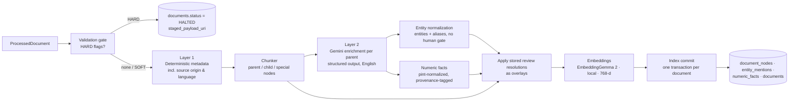

# 04 — Metadata Layer, LLM Enrichment, Chunking & Embedding

This is the common tail of Phase 2. Every route hands over a `ProcessedDocument` (file 03 §1.4); this stage produces the rows that retrieval actually uses. It is deliberately **separate from parsing** so that prompts, chunk sizes and embedding models can change without re-running OCR or vision.



## 1. The three metadata layers

| Layer | Produced by | Trust | Used for |
|-------|-------------|-------|----------|
| **L1 Deterministic provenance** | code (regex, file headers, Graph metadata, EXIF, footers, folder configuration) | authoritative | citations, hard filters, dedup, supersession, source origin, trust tier |
| **L2 Semantic enrichment** | Gemini 3.8 Flash structured output over each **parent** node, aggregated to the document; always written in English | probabilistic, validated against the text | semantic filters, summaries, entity search, routing hints, cross-lingual lexical hooks |
| **L3 Quantitative facts** | code (`pint`) over numbers that L2 located or that tables/telemetry yielded | authoritative value, probabilistic context | numeric questions, range filters, cross-checks |

## 2. Layer 1 — Deterministic metadata (per document)

| Field | Derivation (first hit wins; source recorded in `metadata_sources`) |
|-------|------------------------------------------------------------------|
| `title` | PDF metadata title if not generic → first H1/largest heading on page 1 → filename stem humanized |
| `doc_kind` (deterministic candidate) | rules over filename/folder/footer: `ECSS-` prefix → `standard`; `Test[_ ]Plan` → `test_plan`; `Report`/`Results` → `test_report`; `FMEA`/`Risk` → `risk_assessment`; `Calibration` → `calibration`; `.py` → `code`; photo → `hardware_photo`; telemetry → `telemetry_run`; DOI/journal header → `academic_paper`; vendor name + "datasheet"/"brochure" → `datasheet`/`vendor_brochure`; otherwise `unknown` → L2 decides |
| `source_origin` | **folder configuration first** (`pipeline_config.sources.origin_defaults`: e.g., `APS - Library/**` → `external_kept`, everything else → `internal`), then deterministic detectors that can override to `external_kept`: DOI (`10\.\d{4,9}/\S+`), arXiv id, ISBN, a copyright line naming an outside publisher, a journal/conference header, a vendor name from `config/vendors.yaml`, a URL footer. Values: `internal`, `external_kept`, `web_live` (answer-time only) |
| `trust_tier` | derived from origin and kind: 1 measured telemetry (`telemetry_run`), 2 internal reports/plans/code/photos, 3 standards, 4 vendor datasheets and brochures, 5 papers/articles/books, 6 live web. Overridable per folder in config |
| `publisher`, `external_ids` | publisher/vendor string; `{doi, arxiv, isbn, report_number}` when found |
| `test_plan_id`, `test_run_id`, `hardware_item` | folder context regexes (file 03 §1.2), then filename, then first-page text, then JSON `test_id` |
| `doc_date` | filename date, footer/cover date, DOCX core properties, EXIF, publication date from the DOI/journal header, else Graph `createdDateTime` (lowest trust, `date_source = onedrive_created`) |
| `standard_id`, `standard_revision` | regex `ECSS-([EMQU])-(ST|HB)-(\d+)([A-Z])?(?:\s*Rev\.?\s*(\d+))?`; also `ISO`, `MIL-STD`, `AIAA S-`, `DIN`, `GOST`, `JIS`, `GB/T` patterns |
| `revision_marker` | footer/watermark tokens: `DRAFT`, `ISSUE n`, `REV x`, `SUPERSEDED`, `OBSOLETE`, `FINAL` |
| `classification_marking` | `CONFIDENTIAL`, `INTERNAL`, `EXPORT CONTROLLED`, `ITAR` (feeds `SENSITIVE_CONTENT`) |
| `language`, `languages_detected` | document language from a text sample (fastText/langdetect); per-page language from the A1 triage call; `languages_detected` lists every language seen in the document so mixed documents (English body, German appendix) are handled per page |
| `number_locale` | decimal separator detected per document from number patterns (`12,4 bar` vs `12.4 bar`); used by the numeric parser |
| `page_count`, `slide_count`, `sheet_names`, `duration_s`, `image_dims` | from the route |
| `locations[]` | derived at read time: all `drive_items` whose blob is a source of this document, with `web_url` each (never stored on the document) |
| `folder_context` | breadcrumb, root, siblings summary |
| `parser_version`, `pipeline_version`, `ocr_engine`, `page_types_histogram` | from the route |
| `unit_hashes` | per page/sheet/slide/symbol (L2 dedup layer, file 02 §5) |

### 2.1 Why the deterministic layer comes first

Hard filters in retrieval (`test_plan_id = 'TP37'`, `doc_kind = 'standard'`, `source_origin = 'internal'`, `status = 'ACTIVE'`) must never depend on an LLM guess. If L1 and L2 disagree (folder says TP30, the model reads "Test Plan 31" in the body), **both are stored**: `test_plan_id` (L1) and `enrichment.test_plan_ids_mentioned` (L2); the Answer Engine filters on L1 and can widen to L2 when a strict search returns nothing.

### 2.2 Supersession (standards only, automatic)

Group documents by `standard_id` base (`ECSS-E-ST-35`); order by letter revision then numeric `Rev`; the highest is `ACTIVE`, lower ones get a `document_relations(SUPERSEDES)` row and `status = SUPERSEDED`. Superseded standards remain retrievable when the user asks for them explicitly or with `include_superseded=true`; the default retrieval filter excludes them and the Answer Engine says so when it matters.

Reports are **never** auto-superseded (file 02 §5.3): the newest of a near-duplicate pair is preferred in ranking, both stay active. Supersession of a modified file is recorded only as a relation, and the old document's status changes only when no live OneDrive location still holds the old blob (file 02 §5.1).

### 2.3 Source origin and trust tier: what they change downstream

- **Retrieval** can filter or boost by `source_origin` and `trust_tier` (file 07 §4 T1). Default scope is `internal + external_kept`; the user or the playbook can restrict to internal.
- **Numeric facts** from `external_kept` documents are stored with `source = vendor_claim` or `literature`; the physics and telemetry tools never treat them as measured data, and every answer labels them.
- **Design synthesis** consults the internal library before any live web search (file 07 §5).
- **Dedup and near-duplicate linking** work unchanged; a paper stored twice is one document.
- **Cloud processing** policy is per root and therefore also covers library folders.

## 3. Layer 2 — Open-vocabulary enrichment (replaces the taxonomy gate)

### 3.1 The decision

The earlier design forced every subsystem/material/propellant into a closed enum and raised `TAXONOMY_NEW_TERM` when a new code appeared. That is removed. Reasons: the engineers' vocabulary evolves (`C-102` today, `C-103` tomorrow, `PHP coil` in one plan, `heater_php_coil` in a script); the retrieval cases that need these terms are **specific questions** whose own wording carries the context; and a human choosing enum values for 5,200 files is cost without benefit. Instead the model extracts what the text says, a deterministic normalizer merges spelling variants, and an alias table grows by itself. Nobody is asked.

### 3.2 What is extracted (per parent node, one Gemini call, JSON schema enforced)

The prompt receives the parent text in its original language and the document's L1 context. **All free-text outputs are in English** regardless of the source language; `surface` strings are copied verbatim from the source.

| Field | Content | Validation before storage |
|-------|---------|---------------------------|
| `summary` | ≤ 2 sentences in English, what this section says, mentioning the test/hardware if named | length check |
| `section_kind` | free label from a **suggested** list (`procedure`, `results`, `observations`, `requirements`, `calibration_data`, `failure_analysis`, `design_description`, `theory`, `code_logic`, `meeting_notes`, `product_specification`, `abstract`, `related_work`, `other`); the model may return a label outside the list | stored as-is; counts visible in the Console |
| `publication_type` (document level, external docs) | `datasheet`, `brochure`, `journal_article`, `conference_paper`, `thesis`, `book_chapter`, `white_paper`, `standard_excerpt`, `other` | used only when L1 `doc_kind` is `unknown` |
| `entities[]` | `{type, surface, normalized_hint_en}` where `type ∈ {subsystem, component, material, propellant, catalyst, sensor_tag, part_number, test_id, standard_clause, person_role, organization, vendor, product, tool_software, equation, failure_mode}` (type list is closed; **values are open**); `normalized_hint_en` is the English canonical the model proposes | `surface` must occur in the node text (case-insensitive) — otherwise dropped |
| `numeric_facts[]` | `{quantity, value, unit, context, span}` for every physical quantity stated | `value` and `unit` must appear in the text (locale-aware: `12,4` in a decimal-comma document); `pint` must parse the unit; dimension must match the quantity; else dropped. Unparseable unit with a number → recorded with `unit = NULL`, `needs_unit = true` |
| `test_ids_mentioned[]`, `standards_mentioned[]` | normalized forms | regex re-check |
| `status_markers[]` | `failed`, `aborted`, `nominal`, `superseded`, `draft`, `preliminary`, `approved` as stated in the text | — |
| `claims[]` (reports and papers) | ≤ 5 key findings as short English sentences, each with the sentence span it comes from | span must exist |
| `questions_answered[]` | 3–5 English questions this section answers (used for a second embedding, §5.4) | — |

Prompt rules: extraction only, no inference beyond the text; keep units exactly as written; never normalize numbers; when uncertain omit; write in English but quote surfaces verbatim. Thinking level `low`. Temperature 0. Batch API for backfills.

### 3.3 Entity normalization (deterministic, no human gate)

Two tables: `entities` (one row per canonical, unique on `(type, canonical_key)`) and `entity_aliases` (one row per surface form, unique on `(type, alias_key)`, pointing to an entity). For each extracted `(type, surface)`:

1. **Canonicalize** the surface: Unicode NFKC, lowercase, collapse whitespace, unify dashes (`‐ – —` → `-`), strip trailing punctuation, normalize identifier patterns (`C 103`, `C103`, `c-103` → `C-103`; `PT 101` → `PT-101`).
2. **Exact lookup** in `entity_aliases` by `(type, alias_key)` → `entity_id`.
3. **Fuzzy lookup** within the same type: RapidFuzz token-set ratio ≥ 92 against existing canonical names and aliases → insert a new alias row for that entity (recorded with the score; reversible in the Console).
4. **Seeded synonyms** shipped with the system (`config/aerospace_synonyms.yaml`: `HTP ↔ H2O2 ↔ hydrogen peroxide ↔ Wasserstoffperoxid`, `ADN ↔ LMP-103S family`, `HAN ↔ AF-M315E family`, `Isp ↔ specific impulse`, `Pc ↔ chamber pressure`) are loaded as aliases at install time; the model's `normalized_hint_en` is used as a tie-breaker and as the English canonical name for a brand-new entity found in a non-English text.
5. **New** → insert `entities` row with `created_by = system`, `first_seen_doc_id`, plus its first alias.
6. Write `entity_mentions (node_id, doc_id, entity_id, surface, span, confidence, source)`.

The Console **Entities** page (not a queue) lets an engineer merge two entities or split a wrong alias. A merge re-points `entity_mentions.entity_id`, rewrites `documents.entity_ids` and `search_text` for affected documents in the same transaction, and writes an `audit_events` row. Embedding headers that contain the old name stay stale until the next re-index; that is accepted and documented.

### 3.4 Document-level aggregation

After all parents are enriched: `documents.enrichment` = `{doc_kind_llm, publication_type, doc_summary (English), entities_top (by frequency), subsystems[], materials[], propellants[], test_ids[], standards[], status_markers[], failure_modes[], languages_seen[]}` plus the denormalized `entity_ids uuid[]` (GIN-indexed; ids, not names, so merges do not stale it) and `search_text` (English: title + summary + canonical entity names) which is BM25-indexed so alias forms and non-English surfaces are reachable lexically through their English canonicals.

`doc_kind` final = L1 rule if confident, else L2 label; when they disagree, L1 wins and the disagreement is logged (no flag).

## 4. Chunking strategy

Goal: embed small, read big, never cut a unit of meaning.

### 4.1 Node hierarchy

| Level | Size | Boundary rule | Embedded? | Given to the LLM? |
|-------|------|---------------|-----------|-------------------|
| **Document** | — | — | no (uses `search_text`) | title/summary only |
| **Parent** (section) | 1,200–1,800 tokens | split at heading boundaries; a section > 1,800 tokens is split at paragraph boundaries, each part keeping the heading; parts < 300 tokens are merged with the previous sibling | optional (used by the section-level retriever for broad queries) | **yes** — this is what the model reads |
| **Child** (passage) | 250–400 tokens | sentence-aware; no mid-sentence cuts; 1-sentence overlap with the previous child | **yes** (primary retrieval unit) | only through its parent |
| **Table** | whole table ≤ 1,200 tokens, else row blocks with header repeated | never mid-row | yes (embedding of `summary + header + first rows`) | whole table HTML |
| **Table row child** | 1 row (requirement/FMEA/material/datasheet lists) | — | yes | row + header |
| **Figure** | structured reading + caption + referencing sentences | — | yes (text) + image embedding | yes |
| **Equation unit** | display equation + defining sentence | atomic inside its child | — | — |
| **Code symbol** | function/method/class with context header | AST | yes | yes (+ parent class header) |
| **Slide** | one slide | — | yes | yes |
| **Transcript window** | 60–120 s | pauses/slide changes | yes | parent = 10 min |
| **Run summary** | one per telemetry run | — | yes | yes |
| **Photo** | one per cluster representative | — | yes (text + image) | yes |

Every node carries `language` (per page/segment); a document in two languages yields nodes in two languages, each embedded as-is.

### 4.2 Contextual header

Every embedded text is prefixed with a short header that is **not** part of the stored `content` (stored separately as `embed_text`):

```
Doc: Test Report 37 — Hot Fire Campaign (test_report, internal, TP37, 2024-05-02)
Section: 3 Hot Fire Results › 3.2 Chamber Pressure
Entities: injector INJ-14, PT-101, C-103, HTP 90%
---
<child text in its original language>
```

The header is always English (titles are kept as written, entity names are the English canonicals). This is the "contextual retrieval" pattern: the child alone ("the pressure rose to 12.4 bar") is ambiguous; with the header it is retrievable by "TP37 chamber pressure". Headers are capped at ~80 tokens. For external documents the header includes the origin and publisher (`datasheet, external, Moog`).

### 4.3 Token counting

Use a local tokenizer (the embedding model's own tokenizer is available locally, so counts are exact) for chunk sizing. Hard cap: no `embed_text` may exceed 8,000 tokens (EmbeddingGemma 2 context is 8,192).

### 4.4 Stable anchors

Node ids are regenerated on every re-index, so nothing durable may reference a `node_id`. Citations in traces, benchmark gold, flag anchors and chat deep links store a **stable anchor** instead: `{doc_id, page_no | line_start | t_start_ms | sheet+cell_range, content_sha256 (first 64 chars of normalized content), breadcrumb}`. A resolver maps an anchor to the current node by document + page + content hash, falling back to document + page.

## 5. Embeddings

### 5.1 Model

- **EmbeddingGemma 2** (`google/embeddinggemma-2`, Apache 2.0), run locally in an **embedding service** container (sentence-transformers or Transformers, bfloat16 or float32; **never float16**, which silently corrupts vectors). Text core 270M parameters; the vision encoder (170M) is loaded for photo/figure embeddings; the audio encoder is not loaded.
- Output **768 dimensions** (native). Matryoshka truncation to 512 or 256 is supported if index size ever matters; both require re-normalization and a re-embed.
- Context 8,192 tokens; 100+ languages; images cost ~280 soft tokens each.
- Stored as `halfvec(768)` in PostgreSQL (half precision halves heap and index size with negligible recall loss).

### 5.2 Input format

- Document side: `title: {doc title › breadcrumb} | text: {embed_text}`; when there is no title use `title: none`.
- Query side: `task: search result | query: {query}` (the Answer Engine uses the same service and the same prefix).
- Images (photos, figure crops): raw image input, no prefix; one vector per node written to `document_nodes.image_embedding`.
- Column `embedding_model = 'embeddinggemma-2@768'` on every row. A model change is a batch job over `embed_text` from PostgreSQL — no re-parsing. **Spaces are not compatible across models; never mix in one index.**

### 5.3 Throughput and cost

No per-call cost. On a 16-core CPU the text core embeds roughly 150–300 child chunks per second in batches; the initial ~250k chunks take about 15–30 minutes with one worker. A small GPU brings that to minutes. `embed_text_hash` (SHA-256 of the exact string) lets a re-index reuse the previous vector instead of recomputing (the commit loads old vectors by hash before deleting the old rows, §7).

### 5.4 Optional second vector per parent (questions)

`questions_answered[]` from enrichment are embedded as one extra node per parent (`node_type = question_proxy`, pointing to the parent). This helps short, question-shaped user queries land on long procedural sections, and because the questions are English it also gives non-English sections an English dense hook. Enable per `doc_kind` in config (default on for `test_report`, `standard`, `procedure`, `academic_paper`, `datasheet`).

### 5.5 Cross-lingual retrieval

The model embeds all languages into one space, so an English query retrieves German, French or Japanese chunks directly. Quality is not equal across languages; the English enrichment layer (summary, entities, question proxies, `search_text`) is the second, language-independent path to the same content. Both are measured by the `MULTILINGUAL` benchmark category (file 08 §5.3).

## 6. Lexical index

- BM25 (pg_search) over `document_nodes.content`, `breadcrumb`, `content_codes`, plus `documents.search_text` and `title`.
- **Per-language analysis.** pg_search allows several tokenizers on one column within one index. `content` is indexed with the ICU tokenizer plus a stemmer field per supported language (`english`, `german`, `french`, `spanish`, `italian`, `russian` via Snowball) and Lindera/Jieba dictionary tokenizers for Japanese, Chinese and Korean. The query is analyzed with the user's language **and** English; `document_nodes.language` lets the planner weight the right field.
- **Identifier preservation.** Aerospace identifiers (`PT-104`, `ECSS-E-ST-35C`, `C-103`, `TP37`, `INJ-14`, `SV-1`) must match exactly. `content_codes` is a **plain text column computed in Python** at indexing time by the same `extract_identifiers()` function the Answer Engine applies to the user's query: it finds identifier-like tokens case-insensitively, keeps the full multi-segment form (`ECSS-E-ST-35C`, not `ST-35C`), and emits dash-less variants (`PT104`, `ECSSEST35C`) and uppercase normalization. It is indexed with a whitespace tokenizer, no stemming. One fixture test covers both the indexer and the query side. (A PostgreSQL generated column was rejected: `\b` is backspace in PG regex, set-returning functions are not allowed in generation expressions, and PG 16 cannot alter the expression without rewriting the table.)
- Fallback without pg_search: `tsvector` with language-specific configurations chosen per node language, `simple` for `content_codes`, GIN indexes, `ts_rank_cd`.

## 7. Index commit

One transaction per document:
1. Load the previous vectors of this document keyed by `embed_text_hash` (text and image) into memory.
2. `DELETE FROM document_nodes WHERE doc_id = ?` — **all versions**, not only the current `pipeline_version`; dependent rows (`entity_mentions`, `numeric_facts`) go by cascade or explicit delete by `doc_id`. Leaving old versions in place would bloat the HNSW and BM25 indexes and starve filtered scans.
3. **Apply overlays**: for every `review_flags` row of this document with `status = RESOLVED` whose anchor resolves to a new node (page + content hash), re-apply the stored `resolution` (corrected handwritten value, chosen table version, unit decision) to the fresh node/facts before insert, with `source = human`. Human corrections therefore survive every rebuild.
4. Bulk insert nodes, mentions, facts (PostgreSQL `COPY`), reusing vectors where the hash matched and computing the rest.
5. Upsert `assets` by `minio_uri`.
6. Update `documents` (status `ACTIVE` or `ACTIVE_WITH_SOFT_FLAGS`, enrichment, `entity_ids`, `search_text`, counts, `pipeline_version`, `indexed_at`).
7. Upsert SOFT `review_flags` by `(doc_id, fingerprint)`; existing rows keep their status and resolution; flags whose fingerprint no longer appears are marked `AUTO_RESOLVED` with reason `anchor_gone`.
8. Mark the job done in `jobs`.

MVCC hides the half-written state from readers, so the visibility predicate is simply `documents.status IN ('ACTIVE','ACTIVE_WITH_SOFT_FLAGS')` joined to nodes. Filter columns used in every retrieval (`doc_kind`, `test_plan_id`, `source_origin`, `trust_tier`, `doc_status`) are denormalized onto `document_nodes` at commit so HNSW filtering does not need the join (file 05 §4.2).

## 8. Quality controls on enrichment (automatic)

- **Grounding check**: every entity surface and numeric fact must be found in the text; drop otherwise (counted in metrics; a drop rate > 10% for a prompt version is a prompt bug).
- **Unit check**: `pint` must parse; dimension must match the declared quantity (a "pressure" in `N` is rejected). The project unit registry includes `psig`, `psia`, `bara`, `barg`, `kgf/cm²`, `kp/cm²`, `at`, `atm`, `mmHg`, `Torr`, `lbf`, `°F`, `kcal`, `sccm`, `slpm`.
- **Locale check**: a document with `number_locale = comma` has its `1.234` parsed as one thousand two hundred thirty-four only if a thousands pattern is confirmed; otherwise the fact is stored with `suspect = true`.
- **Sanity ranges** per quantity (same table as Route C) → out-of-range facts stored with `suspect = true`, never used for arithmetic by the Answer Engine without saying so.
- **Sampling audit**: 1% of enriched parents per day shown in the Console "Enrichment audit" page with a thumbs up/down; feeds prompt iteration, not a queue.

## 9. Cost control

- One enrichment call per **parent**, not per child (≈ 25k calls for the corpus, not 250k).
- Vision cache (MinIO prefix keyed by input hash, model and prompt version) and `embed_text_hash` prevent paying or computing twice for identical inputs.
- Batch API for any Gemini job touching > 1,000 items. Embeddings are local and need no batching window.
- Context caching when the Answer Engine repeatedly reads the same large document in one session.
- `llm_calls` ledger with per-day budget alerts (`pipeline_config.cloud.daily_token_budget`).

## 10. Translation policy (configuration, not architecture)

`pipeline_config.translation.mode`:

| Mode | What is produced | When to use |
|------|------------------|-------------|
| `none` | nothing beyond the English enrichment | never recommended |
| `enrichment_only` (**default**) | English summary, entities, question proxies, `search_text`; node content stays in the source language; answers quote the original and the synthesis model translates on the fly | adequate while cross-lingual retrieval quality meets the benchmark |
| `full` | additionally a Gemini translation of each non-English node into `document_nodes.content_en`, indexed as a second BM25 field and shown in the viewer's "Translate" toggle; triggered per `doc_kind` and language list (`translation.full_for = {doc_kinds: [datasheet, academic_paper, standard], languages: [de, fr, ja, zh]}`) | when engineers read a lot of foreign-language library material, or when the `MULTILINGUAL` benchmark shows lexical misses |

Translated text is derived data (rebuildable from the CIR), never cited as the source: a citation always points to the original node and page, and the rendered quote marks "translated from German".
