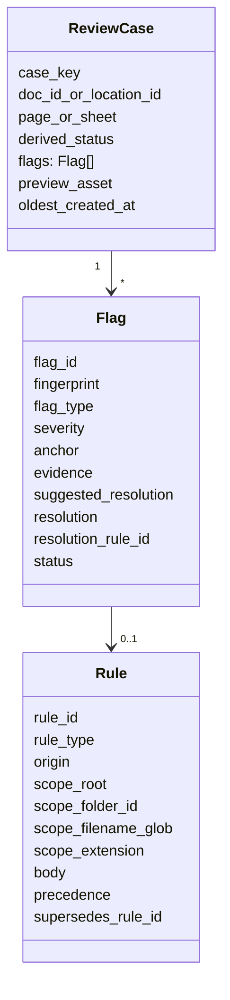
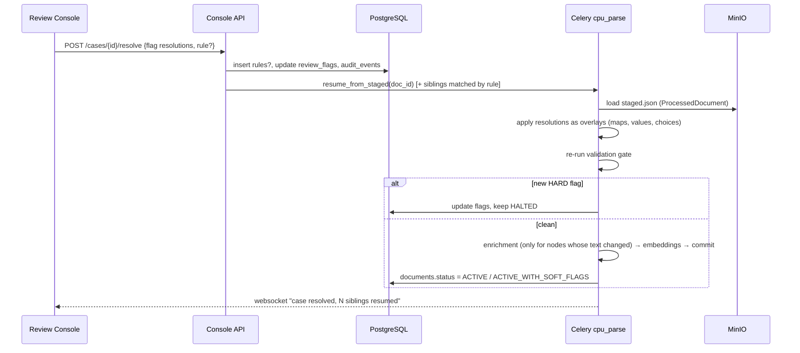

# 06 — Review Flags & the Halt-and-Queue Policy

A flag is a **structured question to a human that the pipeline could not answer safely by itself**. It is not a classification task, not a labeling chore, and not a notification. If the system can proceed without corrupting a number or exposing something it should not, it proceeds.

## 1. Principles

1. **Halt only what would corrupt.** A wrong unit on a pressure channel poisons every DuckDB answer about that run → HARD. An unreadable handwritten remark in the margin of page 23 of a report → SOFT: the report is useful now; the margin note is marked.
2. **Taxonomy is not a flag.** New terms are extracted and normalized automatically (file 04 §3). There is no `TAXONOMY_NEW_TERM`.
3. **One case per document-page, not one ticket per issue.** Three issues on page 4 → one review card with three items.
4. **Every flag carries its evidence and a suggested fix.** The reviewer confirms or corrects; they do not investigate from scratch.
5. **Every resolution can become a rule (user, 2026-10-24).** A telemetry channel unit stays a proposal: "This folder's `AIN0` is `psig` at sea level" fills in the units of the 116 files that wait on it, and a person checks and applies it on each one (§8). Every other rule acts: "in this folder an incomplete drawing is accepted", "`Mean` is in bar", "the folder's test plan id wins" answers the same finding on every file it matches, now and when files arrive, the way the person would (§8).
6. **Resolution never re-parses.** A HALTED document resumes from its staged payload (`documents.staged_payload_uri`, file 05 §4.2) in seconds.
7. **Nothing destructive happens on an error.** Auth failures, sharing changes, and parse failures never delete indexed content.
8. **Resolutions are authored data.** A human's decision is stored on the flag with a stable anchor (page + content hash, never a node id) and re-applied as an **overlay** every time the document is rebuilt (file 04 §7). A corrected value never disappears on re-index, and a re-index never duplicates a flag: flags are upserted by a deterministic fingerprint.

## 2. Severity model

| | HARD | SOFT |
|---|------|------|
| Effect on the document | `documents.status = HALTED`; **zero** rows in `document_nodes`, `telemetry_runs`, `numeric_facts` for this document version; staged payload saved | `documents.status = ACTIVE_WITH_SOFT_FLAGS`; everything indexed; affected nodes `needs_review = true` |
| Effect on answers | content invisible; if the user's question targets it (e.g., asks about TP07 and TP07's telemetry is halted), the Answer Engine says "TP07 pressure data is awaiting unit confirmation (review case #…)" | content used; any claim built on a `needs_review` node carries a caution marker in the answer; numeric claims from such nodes are not used for arithmetic unless the user accepts |
| Queue | Review Console, default sort by age × document importance | Review Console, separate tab, no SLA by default |
| Who decides severity | the route, per flag type, with `pipeline_config.flags.severity_overrides` able to promote/demote per route; `flags.strict_mode = true` turns every SOFT into HARD (the original design's behavior) | — |

## 3. The flag catalog

| Flag | Meaning | Default severity | Typical evidence | Typical resolution |
|------|---------|------------------|------------------|--------------------|
| `UNIT_AMBIGUITY` | a physical quantity has no unit, an ambiguous one (`psi` without g/a), or fails sanity bounds after conversion | **HARD** in Route C time-series and for critical fields; SOFT for numbers in prose/tables | header lines, column stats, sparkline, candidate units with plausibility scores, sibling-file units | choose unit + gauge/abs + ambient; or enter a conversion expression; save as rule for folder/pattern |
| `SCHEMA_UNKNOWN` | columns/keys without names or meaning (`.npy`, headerless CSV, pickle, unknown JSON) | **HARD** for arrays feeding telemetry; SOFT for unknown JSON/text tables (indexed generically) | shape, dtype, per-column stats, first rows, folder context, LLM-proposed mapping | map columns to canonical names + units; or mark junk; or map JSON keys to a known schema |
| `LOW_CONFIDENCE_EXTRACTION` | OCR/handwriting/table/vision output below threshold, `[ILLEGIBLE]`, or two extractors disagree | SOFT; **HARD** when the value is a critical field (calibration factor, tare mass, scaling) | crop(s), model value + alternatives + confidence, printed label, both table versions | type the value; accept the suggestion; mark illegible (stored as unknown); for tables choose A/B or edit cells |
| `PARSE_FAILURE` | file cannot be parsed (encrypted, corrupt, unsupported variant), or parse produced nothing usable | HARD (nothing to index) | error, magic bytes, size, partial output if any | upload a readable copy (Console → placed in `dcl-raw` as a derived blob); or skip file; or mark junk |
| `UNSUPPORTED_FORMAT` | no adapter for the detected type | HARD | magic bytes, extension, folder, first KB preview | skip; mark junk; or "notify me when an adapter exists" (re-dispatched automatically when the registry gains one) |
| `CONFLICT` | one flag type, three readings named by `evidence.relation` (`sources_disagree`: Source A / B; `check_failed`: found against what a limit or rule expects; `note`: a finding the system wants confirmed, no second side). Two sources disagree or a status is ambiguous: `.cfg` vs header units, two LaTeX masters, two test plan ids in one path, formula errors in a workbook, weak t0 alignment, DRAFT/SUPERSEDED watermark, near-duplicate reports with the same test id but different numbers, video/telemetry t0 mismatch | SOFT | both values with provenance | pick the authoritative one; mark a document superseded; accept both; or ignore |
| `SENSITIVE_CONTENT` | secrets in text; export-control/classification markings; (optional) faces as the subject of a photo | HARD; blob stored under `_restricted`, never sent to Gemini | matched pattern (redacted preview), page/line | redact and approve a derived copy; approve as-is for internal indexing (admin only); exclude permanently |
| `HELD_LARGE_FILE` | file above the download cap | SOFT (nothing downloaded yet) | size, type, folder | approve download; skip |
| `CLOUD_RESTRICTED` | root not allowed for cloud processing and no offline model configured | SOFT informational (document parsed deterministically, no enrichment/vision) | — | enable offline models or change policy |

### 3.1 What is deliberately **not** flagged

Unknown `doc_kind` (stored `unknown`), new entities/materials/propellants/part numbers, missing dates (fallback to OneDrive created date, marked), minor OCR confidence dips in prose (indexed with `source = ocr` and the confidence), duplicates (handled by hashing), near-duplicates (linked, ranked), generated code files, hidden spreadsheet sheets (tagged), unlabeled diagram edges below the threshold, empty pages.

## 4. Per-route trigger matrix

| Route | HARD triggers | SOFT triggers |
|-------|---------------|---------------|
| A1 PDF/Office | encrypted/corrupt; export-control marking; secret in text; critical handwritten field < 0.75 or illegible; numeric table feeding a catalog field without units | page `low_grade = POOR` after the second-engine retry; unsupported script transcribed by Gemini only; handwriting < 0.75 (non-critical); table A/B disagreement; DRAFT/SUPERSEDED watermark; two revisions active |
| A2 JSON/LaTeX | Pandoc fails entirely; secret | unknown JSON shape; no/two masters; unit-less numeric tabular in a results section |
| B Code | hard-coded credentials | syntax errors (indexed as text) |
| C Telemetry | unknown unit/quantity/gauge-abs on a time-series channel; bounds violation after conversion; unnamed columns; pickle/HDF5 without labels; corrupt file | cfg ≠ header units; formula errors; run id collision; weak t0; column count change; matrix table with unclear header |
| D Photos | export-control marking visible | top failure-mode confidence < 0.5; "component undetermined" |
| E Diagrams | invalid XML | > 30% unlabeled edges; > 20% orphan nodes; tag mismatch between XML and render |
| F Video | undecodable | ignition not detected; t0 mismatch > 1 s vs telemetry |
| G Archives | bomb-guard violation; encrypted | > 90% members junk (informational) |
| Dispatcher | unsupported type | ext/mime mismatch (recorded only) |

## 5. Anatomy of a flag and a case

A **case** is not a table: it is the group of flags sharing a deterministic `case_key` (`{doc_id or location_id}:{page_or_sheet}`), so two workers flagging the same page concurrently cannot create two cases; its status and assignee are derived from its flags. A **fingerprint** is `flag_type` + the CIR anchor (page, column, channel, bbox or content hash); it is unique per document, so a re-index upserts the flag and keeps its status and resolution instead of reopening it. A flag whose anchor no longer exists after a rebuild is closed as `AUTO_RESOLVED (anchor_gone)`.

The **suggested resolution** is computed by the route (deterministic heuristics first: sibling files' units, sensor ranges, header hints) and, when those are silent, by one Gemini call that is told it is proposing, not deciding. Suggestions with confidence ≥ 0.9 **and** a matching existing rule are applied automatically as `AUTO_RESOLVED` (still visible in the audit); everything else waits.

## 6. Resolution actions by flag type (what the Console offers, what the pipeline does)

| Flag | Controls | Pipeline effect |
|------|----------|-----------------|
| `UNIT_AMBIGUITY` (telemetry) | radio: standard unit list filtered by quantity (`psig`, `psia`, `bar(g)`, `bar(a)`, `kPa`, `kgf/cm²`, `mV raw`); ambient reference selector when gauge; "custom expression" box (`val * 0.0689476 + 1.01325`); scope checkbox: this file / this folder / this folder + filename pattern; preview of converted stats against sanity bounds before commit | writes a `rules` row (`rule_type = unit_mapping` or `channel_map`, `origin = operator`, scope columns as chosen); `resume_from_staged` re-runs normalization + stats + Parquet write + commit for this document and **every other HALTED sibling matched by the rule** |
| `UNIT_AMBIGUITY` (prose/table) | choose unit or "leave as text" | stored in the flag's `resolution`; applied as an overlay to the `numeric_facts` rows now and on every rebuild; clears `needs_review` |
| `SCHEMA_UNKNOWN` (array) | column mapper grid: for each column index → canonical name + unit + quantity; "this is the time column"; "mark as junk" | writes a `schema_mapping` rule; resume; junk → `QUARANTINED` |
| `SCHEMA_UNKNOWN` (JSON) | key → section mapper; "save as new report schema" | updates `report_json_schemas` config; re-run from CIR |
| `LOW_CONFIDENCE_EXTRACTION` (handwritten entry) | per entry: the page image, the printed label, the reading and its alternatives; text box prefilled with the reading, "illegible" (stored as unknown) | stored in the flag's `resolution` (value, unit, anchor = page + entry key); the indexer overlays it onto the node text (the reading or `[illegible]`) and `numeric_facts` with `source = human`, `needs_review = false`, now and on every future rebuild |
| `LOW_CONFIDENCE_EXTRACTION` (page, figure) | keep as read; junk this page / image | junk drops only that page or image from search (its nodes, numbers and mentions), on every rebuild; the rest of the file stays |
| `LOW_CONFIDENCE_EXTRACTION` (table) | side-by-side A (TableFormer) vs B (VLM), choose, or inline edit cells; junk this table | the chosen version or the edited cells are stored in the `resolution`; overlayed onto the table node and `cells_normalized` on every rebuild; junk drops only that table |
| `PARSE_FAILURE` | upload readable copy; skip; junk | uploaded copy stored as a blob, recorded in `blob_derivations(kind = replacement_upload)` and `document_sources(role = replacement)`; re-dispatch |
| `UNSUPPORTED_FORMAT` | skip; junk; watch | — |
| `CONFLICT` | pick A/B; mark superseded; accept both; ignore | updates `document_relations`/`documents.status`/`telemetry_runs`; no re-parse |
| `SENSITIVE_CONTENT` | redaction editor (page regions / line ranges); approve internal-only; exclude | redacted derived blob processed normally; original remains restricted |
| `HELD_LARGE_FILE` | approve; skip | enqueue download |

**Skip and junk act on what the flag is about (2026-10-27).** Each flag has a subject (`flag_subject`): the **file** (PARSE_FAILURE, UNSUPPORTED_FORMAT, HELD_LARGE_FILE, SCHEMA_UNKNOWN), one **page**, one **object** (a figure or table), or a **value** (a unit, a conflict, a handwritten entry). Only a file flag offers "Skip whole file" (the document leaves search) and "Junk whole file" (and its OneDrive locations are quarantined so it is never processed again), and the Console asks once, naming the file. A page or object flag offers "Keep as read" and "Junk this page / image / table", which drops only that. A value flag offers neither: its own actions answer it. There is no case-wide skip or junk button: a case groups the flags of one page, and a page question must never take the whole file out (two report files were junked that way on 2026-10-26 from crop flags).

**A decision reaches search at once.** Any decision on a committed file (ACTIVE or ACTIVE_WITH_SOFT_FLAGS) rebuilds it, so the overlays apply now and not at the next re-index; a file already being built applies it when that build commits, and a HALTED file resumes as in §7.

Every action writes an `audit_events` row (who, what, before/after) and is reversible for 30 days ("undo resolution" re-opens the flag as `REOPENED` and removes the overlay on the next rebuild of that document, which is triggered immediately).

## 7. Resume mechanics

Enrichment and embeddings are re-run **only** for nodes whose `embed_text_hash` changed, so resolving a unit on a 42-second run or a handwritten value on one page costs almost nothing.

## 8. Rules: scope, precedence, retroactivity

- Scope is four **columns** (`scope_root`, `scope_folder_id`, `scope_filename_glob`, `scope_extension`), because scope is the matching key and the specificity order. Specificity, most to least: the file's own folder, a farther ancestor folder, no folder; then a filename glob, then an extension, then a root; a global rule last (so "this folder" beats a root-wide `*.dat`). Ties: `origin = operator` beats derived rules (`cfg`, `header`, `config_json`, `tdms_props`), then `precedence`, then newest.
- Operator rules are **immutable and versioned**: a change inserts a new row with `supersedes_rule_id` and deactivates the old one. Derived rules are replaced when their source file (`source_blob_sha256`) changes.
- **Telemetry units: rules propose, people approve (DECISIONS 2026-10-24).** A `channel_proposal` rule fills in the suggestion of the open unit flags of the files it matches, the waiting ones and those that arrive later, and Route C never reads it as an answer. The only answer Route C reads is a `channel_map` rule scoped to one file, and only a person's "Apply" on that file writes it (`resolved_by` is the signed-in user, the flag keeps `proposed_by_rule_id`). Files approved by the old flow (a rule resumed them and the pipeline closed their flags) are shown in the Audit page as "Nobody checked it".
- **Every other rule acts (user, 2026-10-24, option A; `backend/review/rule_answers.py`).** A rule answers a flag the way a person would, and the flag records it (`AUTO_RESOLVED`, `resolved_by = rule`, `resolution_rule_id`): `source_choice` (`{subject, prefer}`: which side of a disagreement wins, e.g. the folder's test plan id) → `choose_source`; `schema_mapping` (`columns` or `key_to_section`) → `map_columns` / `map_json_keys`, which the route reads when it parses; `column_unit` (`{column, unit}`: a table or prose number's unit by column or label name, null = keep as text; never a telemetry channel) → `set_fact_unit`; `ignore_pattern` (`{reason, flag_type, relation, subject_contains}`) → `ignore` for CONFLICT and CLOUD_RESTRICTED, the model's own reading for LOW_CONFIDENCE_EXTRACTION. When several kinds match, the more specific answer wins in that order; within a kind, scope precedence as above. `origin_override` and `supersession` act on the documents they match at commit. The gate answers flags as a route raises them (the commit's own test-plan and run-label flags included); saving a rule answers the open flags of the files it matches at once and rebuilds or resumes them; switching it off opens those flags again (another rule may answer them) and rebuilds the files. A flag a person reopened is never answered by a rule; it waits for that person, and undoing one file's rule answer leaves the rule on for the others.
- **Decisions change the data (principle 8; `backend/indexing/overlays.py`).** On every commit the decided flags of the document (a person's or a rule's) are applied: `set_fact_unit` gives the flagged numbers their unit and clears `needs_unit`; `set_value` puts the person's value in the node text, the handwriting reading and its numbers (source `human`); `choose_table` writes version B or the edited cells into the table node; `choose_source` sets the document field the disagreement is about; `mark_superseded` supersedes the other document. `ignore` and `accept_both` change no data; their nodes lose `needs_review` because the flag is decided.
- Creating a proposal rule shows it on the waiting files it reaches at once (no re-processing, nothing approved); "Stop proposing" gives those files the pipeline's own hint back and never touches a file a person has already approved. The Console shows the count before saving ("12 waiting files will show these units"). A decision is corrected afterwards on the Audit page (below), not by editing or reverting a rule.
- **Editing a decision.** Audit › one file shows who approved each unit and when. A unit is edited in place: the new approval replaces the old (kept, switched off), the file is rebuilt, and each edited flag records the actor and a written reason (at least 3 characters) with before and after. Any other flag type is reopened from the same page (`POST /review/cases/{key}/reopen`, any age, unlike undo's 30 days) and decided again. Reviewer role is enough; admin is not required.
- "Files affected" and "applied count" are derived from `review_flags.resolution_rule_id` and `telemetry_runs.channel_map_rule_id` (view `v_rule_usage`), never stored on the rule.
- Operator rules are exportable as YAML (`config/rules/` in the repository) so a rebuilt environment starts with the team's accumulated knowledge.

## 9. Queue management

- Default queue sort: HARD first; within HARD, by (number of files unblocked by the likely rule) desc, then age. A single unit decision that unblocks 116 files is at the top.
- Filters: flag type, route, root, test plan, assignee, age, "has suggestion".
- Assignment: optional; unassigned cases are visible to all reviewers. Reviewer role is an Entra ID group.
- Aging alert: HARD cases older than 3 working days are highlighted on the Ops page and in the queue; **no Teams digest for now** (decision H6). The existing alert webhook is reserved for operational alerts (auth failure, 410 resync, queue stall, budget cap).
- Metrics: open by type/severity, median time to resolve, auto-resolve rate, rules created, files unblocked per rule.

## 10. How the Answer Engine treats flags

- HARD-halted documents are absent from retrieval; the engine knows they exist (it can query `v_review_cases`) and tells the user when a question clearly targets a halted item, with the case link.
- SOFT: a `needs_review` node can be cited; the rendered citation carries "⚠ unverified extraction" and the claim is phrased as such. Numbers from such nodes are excluded from the physics/telemetry tools' inputs unless the user explicitly says "use it anyway".
- `CONFLICT` relations: when two near-duplicate reports disagree, the engine presents both values with dates rather than choosing silently.
