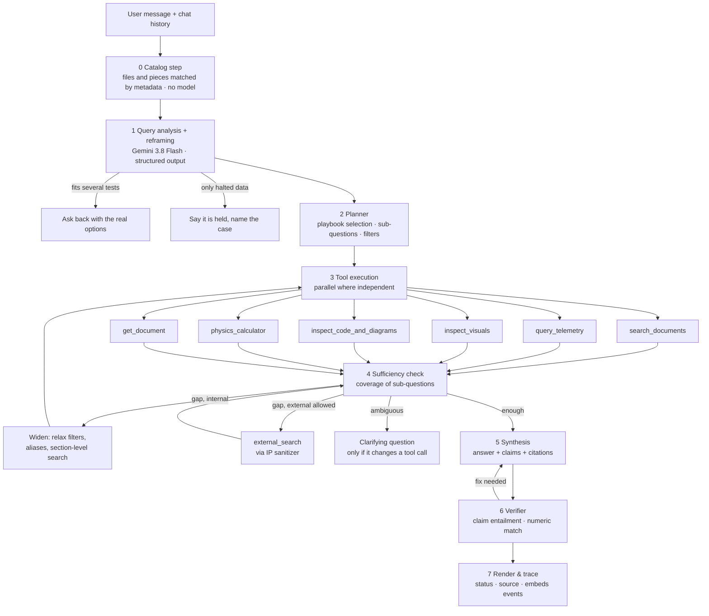

# 07 — Phase 3: The Answer Engine

The Answer Engine is a FastAPI service running a LlamaIndex Workflow. Open WebUI talks to it through a Pipe function (file 08). The reasoning model is Gemini 3.8 Flash with function calling; every number comes from a tool; every sentence that states a fact carries a citation that a verifier has checked against the evidence.

## 1. Principles

1. **Tools before tokens.** The model may not state a measurement, a material property from our data, or a code behavior without a tool result behind it.
2. **Deterministic for numbers.** Telemetry → DuckDB; physics → RocketCEA/SciPy; units → `pint`. The LLM formats and explains; it never computes.
3. **Internal first, external labeled.** The web is used only under the policy in §6, through the sanitizer, and external facts are visibly separated from internal evidence.
4. **Say what you could not find.** An answer that lacks evidence says so and lists what was searched; it does not fill gaps from pre-training.
5. **Every answer is a trace.** `answer_traces` stores the plan, tool calls, retrieved nodes, claims and verification, which is also what the benchmark suite replays.

## 2. Architecture



Implemented as Workflow steps with typed events (`QueryAnalyzed`, `PlanReady`, `ToolResults`, `Sufficiency`, `Draft`, `Verified`). Each step emits `status` events that Open WebUI shows above the message ("Searching 3 test reports…", "Running DuckDB on TP07_T01…", "Verifying 6 claims…"). The workflow runs under the **DBOS runtime** (decision H8): every step transition is persisted in PostgreSQL, so an engine restart mid-answer resumes the run by id instead of starting over, and a clarification pause (§10) or a "use unverified value anyway?" confirmation survives a process restart. Gemini is reached only through the Manastu gateway client (file 01 §7).

## 3. Step 0 — the catalog step, and Step 1 — query analysis with reframing

**Step 0, the catalog step** (`backend/llm_engine/engine/catalog.py`, user 2026-10-26; replaces the U2 `catalog_lookup` tool). Before any model reads the question it finds what the question refers to in the metadata of every file, halted ones included. Files are ranked five ways and fused by RRF: the file cards (file 04 §3.4) by keyword (`search_text`, `title`, `card_codes`) and by meaning (`card_embedding`); the pieces by meaning and by keyword with their headers (T1's legs, best piece per file); and the plan, run, hardware and date written in the question (the ingestion patterns). The top 15 files are grouped into **subjects**: one test (its owner, the test plan or else the hardware, and its run) or, for files without labels, their folder. Code computes the conflict signals: a run named without plan or hardware that exists under two or more owners; files of the name the question uses in different folders that the question does not tell apart; two subjects close at the top; labels that match nothing. The conversation's last catalog record (from its trace, same `chat_id`) carries an open ask-back and the subject chosen: an answer like "TP12" or "the second one" resumes the original question, and a follow-up that names nothing new may stay on the conversation's subject (offered to the model as `S0`). About 0.1–0.3 s; no model call.

**Step 1, query analysis**, reads the question with the catalog's subjects and conflicts and, besides the fields below, returns `reframed_question` (the question with the test, file and part named, from catalog facts only), `resolution` (`clear`, `ambiguous`, `not_found`) and `subject_ids`. Code checks that the subjects exist and that every identifier of the reframed question appears in the question, the conversation or the catalog (else the reframing is dropped). Then code decides: **ask back** when a conflict signal stands or the model reads the question as ambiguous with two or more subjects, with the options built from the catalog ("Which Test 04? 1. TP12 · Test 04: workbook and 3 plots 2. INJ14 · Test 04: pressure run, held for unit review (case …)"); **halted** when the question asks for a measured value and the subject's only measured data is held (the reply names the files and the case); otherwise **go on**: every tool works from the reframed question, searches are filtered to all files of the chosen subject (`doc_ids`, widened when that finds nothing), telemetry gets the subject's run labels, and the writer gets the chosen files' cards. The trace keeps the raw and reframed question, the subjects and the decision.

Input: the user message, the last 6 turns summarized, the conversation state, and the catalog. Output schema:

| Field | Values / meaning |
|-------|------------------|
| `intents[]` | multi-label from: `telemetry_metric`, `run_comparison`, `fact_lookup`, `procedure_lookup`, `failure_investigation`, `standards_compliance`, `code_walkthrough`, `diagram_traversal`, `design_synthesis`, `document_summary`, `navigational` ("what do we have on…"), `physics_calc`, `visual_lookup`, `chitchat_or_out_of_scope` |
| `entities[]` | `{type, surface}` resolved through `entity_aliases` → canonical ids (so "C103" → `C-103`) |
| `test_plan_ids[]`, `test_run_ids[]`, `hardware_items[]` | normalized (`TP7` → `TP07`) via the same regexes as ingestion |
| `filters` | `doc_kinds[]`, `date_from/to`, `standards[]`, `include_superseded`, `node_types[]` |
| `numeric_constraints[]` | `{quantity, op, value, unit}` parsed with `pint` (e.g., Isp > 230 s) |
| `needs_visuals` | true when the user asks to see photos/plots/diagrams |
| `external_allowed` | derived from user group policy + explicit ask ("search the literature") |
| `answer_format` | `number`, `short_fact`, `table`, `narrative`, `trade_matrix`, `code_explanation`, `timeline` |
| `language` | the user's language (BCP-47); the answer is written in it regardless of the sources' languages |
| `source_scope` | `internal_only`, `internal_and_library` (default: in-house material plus the kept brochures, datasheets and papers), `include_web` (only when `external_allowed` and the policy in §6 triggers) |
| `sub_questions[]` | decomposition for multi-part questions, each tagged with the tool it likely needs |
| `clarification_needed` | with the exact ambiguity, only when two different tool calls would result and neither the conversation nor the catalog settles it |
| `reframed_question`, `resolution`, `subject_ids` | the catalog step's reading (above) |

Thinking level `low`; this step must stay under ~1.5 s.

## 4. The tools

Six core tools plus two utilities. All tool interfaces are strict JSON schemas (function declarations); all return `{result, provenance[], warnings[]}`.

### T1 `search_documents` — hybrid retrieval over everything textual

**Inputs:** `query` (natural language), optional `sub_queries[]`, `filters` (L1 fields, `node_types`, `doc_ids`, `source_origin`, `trust_tier_max`, `languages`), `k` (default 8), `scope` (`child` default | `parent` | `tables_only` | `figures_only`), `include_needs_review` (default true, marked).

**Procedure:**
1. Expand the lexical query with alias surfaces from `entity_aliases` for every resolved entity, in every language the alias table knows (`HTP` → `HTP OR "hydrogen peroxide" OR H2O2 OR Wasserstoffperoxid`), and extract identifier tokens with the same `extract_identifiers()` function the indexer used for `content_codes`.
2. Dense leg: embed the query through the local embedding service (`task: search result | query: …`). If the filters select fewer than ~5,000 nodes (one test plan, one document, one run), **skip the ANN index** and compute exact cosine distances over the btree-filtered rows (milliseconds, perfect recall). Otherwise `ORDER BY embedding <=> q LIMIT 50` with `hnsw.iterative_scan = relaxed_order` and `ef_search = 200`, filters applied on the denormalized node columns. Includes `question_proxy` nodes (which resolve to their parent).
3. Lexical leg: BM25 over `content` (per-language fields: the user's language and English), `breadcrumb`, `content_codes`, `content_en` when present, with the same filters, `LIMIT 50`.
4. **RRF** (k = 60) on `node_id`; collapse children to their parent, keeping the best child score; keep top 30 parents.
5. **Rerank** parents' best children against the query with bge-reranker-v2-m3 → top `k`; record scores and the margin between rank 1 and rank 5 (a retrieval-confidence signal stored in the trace).
6. **Near-duplicate collapse** via `document_relations.NEAR_DUPLICATE` (keep the newer, list the other as "also in…").
7. Return for each hit: parent text (≤ 1,800 tokens), a **stable anchor** (`doc_id`, page/line/time, content hash), title, `doc_kind`, `source_origin`, `trust_tier`, `language`, breadcrumb, `page_no`, `web_url`, asset ids (page render), `needs_review`, `doc_date`, `test ids`. Node ids are used only inside the request.

**Failure behavior:** zero hits → the planner widens (drop `doc_kind`, then `test_plan_id`, then switch to `parent` scope); still zero → the answer states "no internal document mentions …" with the filters tried.

### T2 `query_telemetry` — deterministic numbers from Parquet

**Inputs:** `run_ids[]` or `test_plan_id` (+ optional run selector), `metrics[]` from a closed list (`peak_raw`, `peak_50ms`, `steady_mean`, `max`, `min`, `mean`, `p99`, `duration`, `time_to_peak`, `value_at_t`, `window_stats`), `channels[]` by **quantity** (`chamber_pressure`, `thrust`, `bed_temperature`, `mass_flow`, `heater_power`) — never raw column names, optional `window {t_from_ignition_ms_start, _end}`, `compare_runs` boolean, `plot` boolean.

**Procedure:**
1. Resolve runs via `telemetry_runs` (and `v_run_catalog`); if a requested run is HALTED, return a warning with the review case id instead of silently skipping it.
2. Resolve quantity → `telemetry_channels.canonical_name` per run; if a run lacks the quantity, say so.
3. Build SQL **from templates only** (no free-form SQL from the model): `MAX`, 50 ms rolling-window max via a window function on `t_rel_ms`, steady-state mean over the stored `steady_window_ms` or a user window, `QUANTILE_CONT`, comparisons across runs via `UNION ALL`. DuckDB reads `normalized.parquet` from MinIO.
4. Return numbers **with** unit, gauge/absolute, the exact time window used, `t0_method`, sampling rate, `n_rows`, and the Parquet URI. Optionally render a Matplotlib plot (PNG asset) of the channel with the windows shaded, returned as an embed.

**Guardrails:** result values are formatted to the channel's significant figures; if `saturated = true`, the result carries "sensor saturated at range limit"; if `ambient_condition = UNKNOWN` for a gauge channel, absolute values are not computed and the warning says why.

### T3 `inspect_visuals` — photos, plots, frames, diagram renders

**Inputs:** `query`, `kinds[]` (`hardware_photo`, `plot_figure`, `video_frame`, `diagram`), filters (`test ids`, `failure_modes[]`, `components[]`), `k` (default 6), `similar_to_asset_id` (image similarity), `relook_question` (optional).

**Procedure:** metadata filter on `documents`/`entity_mentions` → hybrid search over photo/figure nodes → optional image-embedding kNN on `document_nodes.image_embedding` (an uploaded image is embedded by the same local service) → return structured readings + presigned URLs (web + thumb) + folder context + the document that contains the figure. If `relook_question` is set (e.g., "is the catalyst screen visibly deformed?"), the top ≤ 4 images are sent to Gemini with that question; the fresh reading is returned as `source = relook` and is **not** persisted (it is an answer-time observation).

### T4 `inspect_code_and_diagrams`

**Inputs:** `mode ∈ {symbol_lookup, code_semantic, callers_callees, diagram_path, diagram_neighbors}`, `symbol`/`query`, `diagram_doc_id` or title, `from_tag`, `to_tag`, `direction`.

- Code: exact symbol lookup (`metadata.qualname`), semantic search restricted to `code_symbol`/`module_header`, and call-graph expansion one level each way; returns code with the context header and the module header (imports/constants), line ranges, `web_url`.
- Diagrams: the diagram document's `catalog` JSON (nodes, edges, groups) is loaded into a networkx graph in Python; BFS upstream/downstream, shortest path between tags and neighbors run there (six diagrams, a few hundred cells). Returns linearized paths (`Tank → F-101 → SV-1 → INJ-14`) with page and the render asset for embedding.

### T5 `physics_calculator`

**Inputs:** `operation ∈ {cea_performance, isentropic_sizing, scale_thruster, unit_convert, mass_flow_from_thrust}`, parameters with units (strings parsed by `pint`).

- `cea_performance`: RocketCEA with propellant definitions from a project file (`propellants.yaml`: HTP 90%, ADN LMP-103S class, HAN AF-M315E class, hydrazine, cold gas N2) → `Isp_vac`, `Isp_sl`, `c*`, `Tc`, `gamma`, `MW` at given `Pc`, `eps`.
- `isentropic_sizing`: throat area, exit area, mass flow, thrust from `Pc`, `Tc`, `gamma`, `MW`, `eps`, ambient.
- Returns inputs echoed in SI, equations used (names), results with units, and assumptions (frozen vs equilibrium, efficiency factors). Results are deterministic and cached by input hash.

### T6 `external_search` — only through the sanitizer (policy in §6)

**Inputs:** `purpose ∈ {cots_component, literature, standard_text, general_physics}`, `query_intent` (natural language written by the model **about the generic need**, never containing retrieved internal text).

**Procedure:** sanitizer → provider: (a) Gemini with Google Search grounding in an **isolated** call whose only input is the sanitized query (no conversation, no internal context), returning grounded snippets and URLs; (b) arXiv API for `literature`; (c) optional Tavily/SearXNG. Results are labeled `EXTERNAL`, logged in `answer_traces.external_queries` (sanitized text, hash of the original, provider, result count), and limited to 3 queries per answer.

### U1 `get_document`

`doc_id` or exact title → ordered parents (or a page range / a section / a table by id). Used for summaries and "read the whole report". For long documents the model receives sections progressively; Gemini context caching is used when the same document is read repeatedly in a session.

### U2 `catalog_lookup` (removed 2026-10-26)

Replaced by the catalog step (§3), which runs before the analysis instead of beside the other tools, searches the whole metadata layer (cards and pieces, not only labels), reports halted files with their review cases, and decides the ask-back in code.

## 5. Playbooks (Skills) — how each question type is executed

Server-side plan templates; the same content is published as Open WebUI **Skills** (markdown) so the model is primed with the procedure when a user toggles it, and so engineers can read and edit the playbook.

| Question type | Steps | Tools |
|---------------|-------|-------|
| **Telemetry metric** ("peak and steady-state pressure in TP07") | resolve run(s) → metrics → cross-check with the report's stated value if a report exists → answer with window and unit | catalog → T2 → T1(tables_only, subject files) |
| **Run comparison** ("compare TP07 T01 vs T02 bed temperature") | resolve runs → same metrics for both → align on `t_from_ignition` → table + optional overlay plot | catalog → T2(compare, plot) |
| **Fact / procedure lookup** ("what is the pre-firing checklist for Injector 14?") | search with `doc_kind` filter → parent read → answer with page cites | T1 |
| **Failure investigation** ("what went wrong in the INJ-14 flow test and what damage did we see?") | runs with `FAILED_RUN` → pressure anomaly metrics → failure report text → photos with failure modes → timeline if video exists → synthesize cause/effect only as stated in sources | catalog → T2 → T1 → T3 → T4(diagram neighbors of the failed component) |
| **Standards compliance** ("do our cooling-duct FMEA and C-103 data satisfy the ECSS thermal margin requirement for TP37?") | find the clause (standard, current revision) → find our FMEA/material rows (table_row nodes) → compare numbers via `pint` → verdict per requirement with both cites | T1(standard) → T1(tables/rows filtered by TP37, entities) → T5(unit_convert) |
| **Code walkthrough** ("how does our script compute expansion ratio and validate pressure columns?") | symbol/semantic lookup → callers/callees → explain with line cites | T4 |
| **Diagram traversal** ("what is upstream of the injector in Rev C?") | diagram path query → render embed → narrative | T4 |
| **Design synthesis / trade study** ("15 N green thruster, Isp > 230 s, < 20 W preheat, 1U") | decompose constraints → internal baselines (reports, catalyst tables, runs) → **kept library** (datasheets, papers; `source_origin = external_kept`) for components and published results → physics check of each candidate → gap detection → live web (sanitized) only for remaining gaps → trade matrix with a provenance label per cell (measured / internal report / vendor claim / literature / web) | T1(internal) → catalog/T2 → T1(library) → T5 → T6 |
| **Library lookup** ("what preheat power does the Moog valve datasheet give?", "what did the 2023 ADN paper measure?") | search restricted to `external_kept` → datasheet rows or paper sections → answer with the vendor/literature label, in the user's language, quoting the original | T1(library) |
| **Document summary** ("summarize the TP37 report") | `get_document` → section summaries (from enrichment) → key numbers verified against tables/runs | U1 → T2 |
| **Navigational** ("what tests used the ADN catalyst?", "where is the heater calibration?") | the catalog step's files → list with links | catalog → T1 |
| **Visual lookup** ("show me the burned injector mesh photos") | photo search → embeds | T3 |
| **Physics calc** ("mass flow for 5 N at Isp 225 s") | calculator | T5 |
| **Out of scope / chit-chat** | answer briefly without tools; no citations | — |

## 6. Web search policy

**When** (any one is required):
1. The user explicitly asks for external information ("search the literature", "what COTS valves exist").
2. The sufficiency check finds a sub-question that is about **general knowledge, standards text we do not own, COTS components, or published research**, and search over the internal material **and the kept library** (after widening) returned nothing relevant.
3. Never for anything that is a fact about our own hardware, tests, code or documents.

**How:**
- The planner writes a **generic need** ("low-power catalyst preheat for 5 N ADN-class thruster", "space-grade solenoid valve 1/4 inch 300 bar") — it is forbidden from copying retrieved text or internal identifiers into it.
- The sanitizer then removes/rewrites: organization names (`Manastu`, project codenames from a managed list), test identifiers (`TP\d+`, `T\d{2}`, `INJ-\d+`, `Run \d+`), drawing/part numbers, folder names, people's names, proprietary blend/catalyst names from `pipeline_config.proprietary_terms`, and precise internal measurements (a value like `12.37 bar` becomes a rounded range only if the model insists on including it; by default values are dropped). The rewritten query and the hash of the original are logged.
- Provider calls are isolated: no chat history, no system prompt content beyond "search and summarize with sources".
- Results come back as `EXTERNAL` evidence with URLs; the synthesis must render them in a separate "External sources" block and must not blend an external number into an internal comparison without labeling both.
- Limits: ≤ 3 external queries per answer; per-group toggle (`external_allowed`); a kill switch in config.

## 7. Synthesis and the citation contract

The synthesis step uses structured output:

```
{
  answer_markdown: string,            // what the user reads
  claims: [{ text, evidence: [{node_id | tool_call_id, quote?}], kind: numeric|factual|inference }],
  citations: [{ anchor: {doc_id, page?, line?, t_ms?, content_sha256}, label,
                provenance: measured | internal_report | standard | vendor_claim | literature | web,
                language, translated: bool, url_onedrive, url_asset?, needs_review: bool }],
  external_sources: [{ title, url, used_for }],
  caveats: [string],                  // halted data, superseded standards, unverified extractions
  followups: [string]
}
```

Rules enforced by prompt and checked by the verifier:
- Every claim carries the **provenance label** of its evidence. A vendor's or a paper's number is never combined with a measured value in one sentence without both labels ("measured 12.4 bar(a) in TP07; the datasheet claims 15 bar").
- The answer is written in the **user's language**. A quote from a non-English source is shown in the original with a "translated from German" marker on the rendered translation; the citation always points to the original page.
- Every `numeric` claim must correspond **exactly** (value + unit as strings) to a tool result in this trace. The verifier compares strings; a rounded value must be rounded by the tool, not by the prose.
- Pressure values always state gauge/absolute and the time window class (peak raw / 50 ms peak / steady-state). Temperatures state the sensor (bed, wall, plume).
- An `inference` claim ("this suggests catalyst poisoning") must be phrased as inference and cite the evidence it is inferred from.
- A claim built on a `needs_review` node carries "⚠ unverified extraction".
- When sources conflict, present both with dates; do not choose silently.
- If `claims` is empty for a question that needed evidence, the answer is the "insufficient evidence" template: what was searched (filters, runs, standards), what exists but is halted (case ids), and what the user could add.
- **Sufficiency decides the mode** (user 2026-10-26): an answer none of whose claims the verifier finds entailed is returned with mode `insufficient_evidence`, not `answered`; a sub-question whose searches found nothing adds the caveat "not covered by the files: …".

Citations are rendered in Open WebUI as `source` events: `source.name` = document title (page/slide/run), `metadata.url` = Console deep link that shows the page render with the bbox highlighted and offers "Open in OneDrive" (`web_url`) and "Open file" (presigned original). Photos and plots are rendered inline via `embeds`.

## 8. Verification

- Model: Gemini 3.8 Flash (thinking `low`) with a verification-only prompt, or Flash-Lite when the claim set is short. The verifier sees each claim with its cited evidence text only (not the whole context), and answers `entailed | contradicted | not_supported` with a one-line reason.
- Numeric claims are additionally checked by code (string match against tool outputs).
- `contradicted` → the synthesis step is re-run once with the verifier notes; `not_supported` after the second pass → the sentence is rewritten as "not found in the sources" or removed.
- The verifier result is stored in the trace and feeds the benchmark's faithfulness metric, so the metric is the same in production and in tests.

## 9. Worked examples

### 9.1 "What was the peak pressure in Test Run 04 and what was the mean after steady state?"

- **Analysis:** `telemetry_metric`; `test_run_ids = ['T04']`; no plan id → the catalog step finds run T04 under TP07 and TP12; ambiguity changes the tool call → **clarify once**: "Two runs match T04: TP07 (2024-03-12, nominal) and TP12 (2024-06-02, cold flow). Which one?" User: TP07.
- **Tools:** `query_telemetry(run_ids=['TP07_T04'], channels=['chamber_pressure'], metrics=['peak_raw','peak_50ms','steady_mean'])` → `{peak_raw: 52.4 bar_abs @ t+0.012 s, peak_50ms: 38.1 bar_abs, steady_mean: 12.4 bar_abs over t+1.0…t+9.8 s, ambient: VACUUM_CHAMBER, t0_method: dP/dt, sampling 1 kHz}`; `search_documents(query='T04 chamber pressure', filters={test_plan_id:'TP07'}, scope='tables_only')` → the report table says 12.5 bar.
- **Answer:** "TP07 run T04 (2024-03-12): instantaneous peak 52.4 bar(a) at ignition (+12 ms) — a water-hammer spike; 50 ms-filtered peak 38.1 bar(a); steady-state mean 12.4 bar(a) over +1.0 to +9.8 s. The test report table lists 12.5 bar for steady state (rounding). Sensor PT-101, 1 kHz, vacuum chamber. [cites: run TP07_T04 parquet; TP07 report p. 8 table 3]" plus the shaded plot embed.
- **Verifier:** three numeric claims match tool strings; the report comparison is `entailed`.

### 9.2 "Which coding methods do we use to model nozzle expansion?"

- **Analysis:** `code_walkthrough`; entity `nozzle expansion` (equation type).
- **Tools:** `inspect_code_and_diagrams(mode='code_semantic', query='nozzle expansion ratio computation')` → `NozzleSizer.compute_expansion_ratio` (nozzle_calc.py L88–142) and `isentropic.area_ratio_from_mach` (L12–40); `callers_callees` adds `validate_pressure_columns`.
- **Answer:** explains the Prandtl–Meyer/area-ratio method as implemented, the inputs (gamma, exit Mach), the validation (`MAX_CHAMBER_PSI = 300` guard), with line cites and the module header (imports).

### 9.3 "What went wrong during the Injector 14 flow test and what hardware damage did we see?"

- **Tools:** the catalog step resolves the Injector 14 flow test to its files and runs (`INJ14_FAIL_01`); `query_telemetry(... metrics=['max','time_to_peak','window_stats'])` → pressure drop at +3.2 s; `search_documents(query='Injector 14 post-test observations', filters={hardware_items:['INJ-14'], doc_kinds:['test_report','failure_report']})` → observations JSON section + report conclusions; `inspect_visuals(kinds=['hardware_photo'], filters={hardware_items:['INJ-14']})` → 4 photos (`burned_injector_mesh`, `broken_monolith_throat`) with failure modes; `inspect_code_and_diagrams(mode='diagram_neighbors', from_tag='INJ-14')` → upstream SV-1, F-101.
- **Answer:** timeline (pressure collapse at +3.2 s per telemetry), stated causes **as written in the report** (not invented), photo evidence inline with the model's failure-mode reading, and the P&ID neighborhood; caveats if the report is DRAFT.

### 9.4 "Do our cooling duct risk assessment and C-103 material data satisfy the ECSS thermal margin requirements for Test Plan 37?"

- **Tools:** `search_documents(query='thermal margin requirement', filters={doc_kinds:['standard'], standards:['ECSS-E-ST-31C']})` → clause rows (current revision only; the superseded one listed in caveats); `search_documents(query='cooling duct thermal margin', filters={test_plan_id:'TP37', node_types:['table_row','table']})` → FMEA rows + C-103 property table; `physics_calculator(unit_convert …)` to compare in K.
- **Answer:** a compliance table: requirement (clause, text), our value (source cell), margin, verdict; explicit "not assessed" rows where our data is missing.

### 9.5 "Find 5 candidate architectures for a 2–5 N green thruster, < 20 W preheat, fitting 1U."

- **Tools:** decomposition → the catalog step + `search_documents(source_origin='internal')` for in-house HTP/ADN/HAN baselines and catalyst beds → `query_telemetry` for measured Isp/preheat where runs exist → `search_documents(source_origin='external_kept')` over the library: a German catalyst-heater datasheet and two ADN papers answer part of the preheat question → `physics_calculator(cea_performance / scale_thruster)` per candidate → sufficiency still finds the monolith-preheat gap → `external_search(purpose='literature', query_intent='low-power preheat monolithic catalyst ADN-class 5 N thruster')` (sanitized; no test ids) → trade matrix.
- **Answer:** matrix with a provenance tag per cell (`measured: TP19 run`, `internal report: catalyst_specs.xlsx`, `vendor claim: Heater datasheet (DE, translated)`, `literature: ADN paper 2023`, `calc: CEA frozen`, `web: AIAA 2024…`) and an explicit list of what is unknown.

### 9.6 "Summarize the TP37 hot-fire report."

- `get_document(title≈'Test Report 37')` → section summaries from enrichment → key numbers checked with `query_telemetry` → 10-line summary with page cites and a "numbers verified against TP37 runs" note.

### 9.7 "Show me similar damage to this photo" (user attaches an image)

- The Pipe receives the attachment; `inspect_visuals(similar_to_asset=<uploaded image embedding>, kinds=['hardware_photo'])` → nearest photos with their test context; the uploaded image is **not** stored in the index (answer-time only).

### 9.8 "What is the ECSS requirement on proof pressure factor?" when only a superseded revision mentions it

- Default search returns the current revision without a hit; the widen step sets `include_superseded = true`; the answer cites the superseded clause **with the caveat** and recommends checking the current revision's corresponding clause (listed if found).

### 9.9 "How are you today?"

- `chitchat_or_out_of_scope` → a one-line reply, no tools, no citations, no trace beyond the classification.

### 9.10 "What preheat power does the catalyst heater datasheet specify?" (the datasheet is in German)

- **Analysis:** `fact_lookup`, `source_scope = internal_and_library`, `language = en`; entity `catalyst heater` resolves to the vendor product through its German alias.
- **Tools:** `search_documents(query='catalyst heater preheat power', filters={source_origin:'external_kept', doc_kinds:['datasheet','vendor_brochure']})` → the dense leg hits the German specification row directly (cross-lingual embedding); the lexical leg hits through the English `search_text` and the entity alias.
- **Answer (English):** "The vendor datasheet specifies 18 W nominal preheat at 28 V (vendor claim, not measured by us) [Heizelement Datenblatt, p. 2, translated from German]. Our own TP19 runs measured 28 W steady-state heater power with the standard bed [measured]." Both numbers are labeled; the citation opens the German page with the row highlighted and a translation toggle.

## 10. Conversation handling

- State carried per chat on the server: the catalog record of the chat's last answer (`answer_traces.query_analysis.catalog`, same `chat_id`): the subject chosen, its files and runs, and an open ask-back with its options. Follow-ups like "and the temperature?" stay on the chosen subject; "and test 5?" keeps its test plan or hardware. (Neither the pipe nor the API sends a separate state; the history text alone was the only memory before 2026-10-26.)
- Clarifying questions are asked only when two different tool calls would result **and** the catalog cannot disambiguate: the options are the catalog's real subjects or files, never invented, and the most recent run is not assumed silently. The user's reply ("TP12", "2", "the de-integration one") is matched to an option and the original question is answered for it.
- "Use it anyway" unlocks `needs_review` numbers for the rest of that chat (recorded in the trace).

## 11. Latency, budget, concurrency

| Question type | Target p95 | Notes |
|---------------|------------|-------|
| fact lookup | ≤ 6 s | analysis 1.5 s + retrieval 0.8 s + rerank 0.4 s + synthesis + verify |
| telemetry metric | ≤ 10 s | DuckDB on a 1-kHz, 60-s run is < 300 ms; plotting ~1 s |
| failure investigation | ≤ 25 s | tools in parallel |
| design synthesis with external | ≤ 60 s | streaming status keeps the user informed |

Per-answer token budget (default 150k input incl. cached, 8k output) enforced by the planner; context caching for documents read repeatedly; tool calls that are independent run concurrently (`asyncio.gather` inside the step).

## 12. Failure modes

| Situation | Behavior |
|-----------|----------|
| No internal evidence | insufficient-evidence template with what was searched |
| Requested data is HALTED | say so with the review case link; offer other runs |
| Sources conflict | present both, dated; no silent choice |
| Tool error (DuckDB, MinIO) | status event + partial answer with the error stated; trace records it |
| Gemini rate limit / outage | retries with backoff; after 30 s degrade to **extractive mode**: return the top reranked passages with citations and no synthesis |
| Reranker down | fall back to RRF order; trace notes it |
| Prompt injection inside a document ("ignore previous instructions…") | retrieved text is always wrapped as quoted data; tools never execute instructions from content; the verifier rejects claims not grounded in evidence; a regex monitor flags documents containing instruction-like text for the audit page |
| User asks for something outside the four roots | state the scope |
| Evidence exists only in a foreign-language document | answer in the user's language; quote the original with a translation marker; cite the original page |
| Internal data and a vendor datasheet disagree | present both with provenance labels; never average or silently prefer one |

## 13. Security

- Caller identity arrives from the Pipe as a signed header (user id, email, groups); the engine enforces `external_allowed` and (future) root-level ACL by filtering on the roots of a document's **live locations** (`v_doc_locations`), because one document can live in several roots; the most restrictive root wins. Decision H7: today every engineer sees all four roots, so the filter is a pass-through until a root is restricted.
- All MinIO links are presigned per request; no public buckets.
- Answers and traces are retained 365 days for audit; traces contain node ids, not full copies of documents.
