# 08 — Frontend: Open WebUI Integration and the DCL Console

## 1. What Open WebUI actually offers (verified against the repository and docs, v0.12.3)

| Capability | What it is | How we use it |
|-----------|------------|---------------|
| **Pipe function** | Python class registered as a *model* in the selector; `pipe(body, __user__, __event_emitter__, __event_call__, __files__, __metadata__, …)`; supports streaming generators, `Valves` (admin settings, reloaded per request) and `UserValves` | **The Answer Engine appears as the model "Manastu Propulsion Engine"**; the Pipe streams the engine's SSE into chat and translates engine events into Open WebUI events |
| **Event emitter types** | `status` (progress line), `source`/`citation` (citations under the reply with `document[]`, `metadata[{source,name,url}]`), `notification` (toast), `confirmation`/`input` (dialogs via `__event_call__`), `embeds` (sandboxed iframes: `allow-scripts allow-downloads`; same-origin off by default; `replace` flag), `files`, `execute` (JS) | status for each workflow step; `source` for citations; `embeds` for photo strips, plots, trace timelines, diagram renders; `confirmation` for "use unverified value anyway?" |
| **Action function** | A button under each assistant message; can open dialogs, return an `HTMLResponse` that renders as a Rich UI embed | "Show trace", "Add to benchmark", "Report an issue with this answer" |
| **Filter function** | `inlet/outlet/stream` hooks | attach user groups and policy (external search allowed, strict numbers) to the request; strip oversized attachments |
| **Tools / OpenAPI tool servers / MCP (Streamable HTTP)** | External functions the model can call; OpenAPI is the preferred path | Optional: expose read-only DCL tools (`catalog_lookup`, `query_telemetry`) as an OpenAPI server so *other* models in Open WebUI can use them; not needed for the main Pipe |
| **Skills** | Markdown playbooks, `$`-mentionable, toggleable per chat, or attached to a model with lazy `view_skill` loading (needs native function calling) | The playbooks of file 07 §5 are published as Skills attached to the engine model, so users can read/edit the procedure and toggle one explicitly |
| **Rich UI embedding** | HTML or URLs rendered in an iframe; `postMessage` for height (`iframe:height`) and prompt submission (`input:prompt:submit`); per-user "allow same-origin"/"allow forms" settings | Console mini-views inside chat (a review case card, a trace timeline) |
| **Artifacts key-value store** | `/api/artifacts/{store,get,list,delete}`, personal/shared scopes, JSON ≤ 1 MB | Not used for system data (PostgreSQL is the store); may hold per-user UI preferences |
| **Evaluations** | Arena / A-B / ELO leaderboard from thumbs feedback | Kept for model-vs-model comparisons; **not** a golden-set regression tool, hence our Benchmark UI |
| **Knowledge / built-in RAG** | Upload-based RAG with vector DB and hybrid search | **Bypassed**: our Pipe does its own retrieval; no Knowledge collections are attached to the engine model |
| **RBAC, groups, SSO (OAuth/OIDC, trusted headers), SCIM** | — | Entra ID SSO; group `dcl-reviewers`, `dcl-admins`, `dcl-external-search` |
| **OpenTelemetry** | traces/metrics | joined with our traces by `chat_id`/`message_id` |
| **Pipelines server** | separate worker; **marked legacy** by the docs | not used |
| **OneDrive/SharePoint file picker** | user-side import | not used (ingestion is server-side) |
| **Custom sidebar pages / tabs** | **not available** without forking the SvelteKit frontend | → the DCL Console is a separate app (see §2) |
| **Direct model connections** (OpenAI-compatible / Ollama) | Open WebUI can host many providers | Decision H3: **only Gemini credentials are configured**, pointing at the Manastu gateway's chat endpoint, so engineers also get a plain Gemini chat model next to the Pipe. No other provider keys are added. The knowledge base is reachable only through the Pipe |

## 2. Integration strategy

```mermaid
flowchart LR
    subgraph OWU[Open WebUI]
        P[Pipe: Manastu Propulsion Engine]
        A1[Action: Show trace]
        A2[Action: Add to benchmark]
        A3[Action: Report issue]
        F[Filter: user policy]
        S[Skills: playbooks]
    end
    subgraph ENG[Answer Engine API]
        E1["/v1/answer (SSE)"]
        E2["/v1/traces/{id}"]
    end
    subgraph CON[DCL Console]
        C1[Review UI]
        C2[Benchmark UI]
        C3[Configuration UI]
        C4[Entities · Audit · Ops]
        C5[Viewer: page render + bbox · player · plot]
    end
    P --> E1
    A1 --> E2 --> C5
    A2 --> C2
    A3 --> C1
    P -. embeds / source URLs .-> C5
    C1 & C2 & C3 & C4 --> API[(Console API → PostgreSQL · MinIO · Celery)]
```



Fork policy (revised 2026-10-21): the default remains the extension points (Pipe/Action/embeds/Skills), because Open WebUI ships frequently and a fork drifts within weeks. **When a needed feature is missing**, the team may clone Open WebUI and carry its own changes, kept as a thin patch set on top of upstream release tags, rebased at every upgrade, each patch documented on a wiki page with its reason; S3 proposes, the Lead approves per feature. Everything that is a *workflow* (review, benchmark, configuration) is a proper application with its own routes, tables and permissions, and lives in the Console. Chat deep-links into it.

### 2.1 The Pipe (model) — behavior

- Model id `manastu_engine.main`; display name "Manastu Propulsion Engine"; visible to the engineering groups.
- `Valves` (admin): `ENGINE_URL`, `ENGINE_SHARED_SECRET`, `DEFAULT_THINKING_LEVEL`, `SHOW_STATUS_EVENTS`, `MAX_EMBEDS_PER_MESSAGE`, `CONSOLE_URL`. (No external-search valve: the engine receives the signed group list and decides with `answer.external_allowed_groups`; a second copy in the Pipe could only disagree.) Open WebUI stores one file per function, so `frontend/openwebui/build_functions.py` inlines `config.py` and `api_endpoint.py` into `frontend/openwebui/bundled/manastu_engine.py`, the file that is installed; a test fails when the bundle is stale.
- `UserValves`: `strict_numbers` (never accept unverified values), `show_debug_trace`.
- On each message: build the request (messages, `chat_id`, `message_id`, user id/email/groups, attachments as presigned uploads), POST to `/v1/answer` with SSE, and map events:
  - engine `step` → `status` (`done=false` while running);
  - engine `citation` → `source` (one `source` event per document with all cited passages as `document[]` and `metadata[].url` pointing to the Console viewer deep link);
  - engine `embed` (photo strip, plot PNG, trace mini-timeline HTML) → `embeds` (HTML with the `iframe:height` script);
  - engine `token` → streamed text;
  - engine `needs_confirmation` → `__event_call__` confirmation dialog, reply forwarded to the engine (used for "use unverified value anyway?").
- Never emits `delta.tool_calls` (that would trigger Open WebUI's own tool loop); tool runs are rendered as `<details type="tool_calls">` blocks when `show_debug_trace` is on.
- Uses `httpx` async streaming; on engine errors raises so Open WebUI shows an error state.

### 2.2 Actions

| Action | What happens |
|--------|--------------|
| **Show trace** | returns an `HTMLResponse` (Rich UI) with the trace timeline: step durations, tool calls with arguments, retrieved nodes with ranks/scores, verifier verdicts; a link opens the full trace in the Console |
| **Add to benchmark** | `__event_call__` input dialog: suite selector, expected numbers/tolerances prefilled from the answer's verified numeric claims, expected citations prefilled from the actual citations; POSTs a *draft* benchmark case (status `draft` until a reviewer approves it in the Benchmark UI) |
| **Report issue** | dialog with reason (wrong number / wrong citation / missing document / wrong unit / wrong translation); appends to `answer_traces.feedback` and, if "wrong unit/extraction" is chosen, opens a SOFT `CONFLICT` flag anchored to the cited page and content hash so the Review queue sees it |

### 2.3 Authentication

- Open WebUI: Entra ID OIDC; groups mapped to Open WebUI groups.
- Pipe → Engine: a server-side shared secret plus the user's identity in signed headers (HMAC over user id, email, groups, timestamp). The engine never trusts a client-provided identity.
- Console: Entra ID OIDC (MSAL browser) → Console API verifies the JWT; roles from groups (`viewer`, `reviewer`, `admin`).
- Console deep links opened from chat work because the browser already has an Entra session; iframes from the Console are cross-origin to Open WebUI and therefore sandboxed (no cookies) — embeds that need no auth (public-safe renders) are served with short-lived signed URLs; embeds that need auth open in a new tab.

## 3. Configuration UI (where each setting lives)

### 3.1 In Open WebUI admin

Model visibility per group; Pipe `Valves`; Skills published but **not attached** to the model (attached skills with native function calling off are injected in full into every request; decided 2026-10-22; an explicit `$`-mention is forwarded as `playbook_hint` and steers the planner, nothing else does); native function calling left at default (the Pipe does not rely on Open WebUI's tool loop); per-user iframe settings documented for reviewers (same-origin **off** is fine for our embeds); one OpenAI-compatible connection to the Manastu Gemini gateway for plain chat (the only provider credentials in Open WebUI).

### 3.2 DCL Console → Settings (backed by `pipeline_config` with history)

| Section | Settings | Apply semantics |
|---------|----------|-----------------|
| **Sources** | roots (name, drive id, item id), auth status + "start device-code sign-in", cloud-allowed per root, default source origin and trust tier per root/folder, **download scope and processing scope** (allowlist editor with live counts: items held, blobs waiting; "download everything" / "process everything" actions with an estimated Gemini cost for the processing step), download concurrency, daily delta time, webhook status | hot; widening a scope enqueues the held items in batches |
| **Gate** | Tier-1 paths, Tier-2 extensions, quarantine patterns, large-file cap, secret patterns | hot; shows "N currently-indexed files would now be rejected" before saving |
| **Routes** | per route: **enabled** (a disabled route parks its files as `WAITING_FOR_ROUTE`; enabling re-dispatches them, count shown), parser version, OCR engine per script, page-triage model, thresholds (`ocr_low`, `handwriting_conf`, `table_agreement`, `plot_min_area`), critical field patterns, JSON report schemas, sanity ranges, time budgets | hot for new files; "re-process affected documents" button with count |
| **Models** | model id per task (reasoning, extraction, triage, vision, judge), thinking levels, Vertex project/region, daily token budget, batch windows; embedding model and dimensions (local service), reranker | embedding model change shows "requires re-embedding N nodes" and schedules it through the local service |
| **Translation & language** | translation mode (`none` / `enrichment_only` / `full`), doc kinds and languages eligible for full translation, installed OCR language packs and the per-script engine table | switching to `full` schedules translation jobs for matching documents; the count and cost are shown first |
| **Chunking & index** | parent/child token sizes, question-proxy on/off per doc kind, HNSW `ef_search`, RRF k, rerank top-n | changes to chunking require re-index from CIR (scheduled job) |
| **Flags & review** | severity overrides per flag/route, strict mode, auto-resolve threshold, aging SLA, notification channel | hot |
| **Answer engine** | external search on/off per group, proprietary-terms list for the sanitizer, token budget per answer, latency targets, extractive fallback | hot |
| **Prompts** | versioned prompt texts for enrichment, vision tasks, synthesis, verifier; diff viewer; "run on sample" preview | new version applies to new calls; `prompt_version` recorded in `llm_calls` |

Every change records actor/time/before/after; a "rollback to version" button exists per section.

## 4. Review UI — internal structure

### 4.1 Layout

```
┌──────────────────────────────────────────────────────────────────────────────────────┐
│ DCL Console   [Review ●12 HARD / 41 SOFT]  [Benchmark]  [Entities]  [Settings] [Ops]│
├───────────────┬──────────────────────────────────────────────────────────────────────┤
│ QUEUE         │ CASE  APU Heater / Test Plan 30 / T01.npy  — 1 HARD flag   age 2d  │
│ filters:      │ ┌───────────── EVIDENCE ──────────────┬──── RESOLUTION CONSOLE ────┐│
│ severity ▾    │ │ Array shape (10000, 4) float64      │ ⚠ SCHEMA_UNKNOWN (HARD)    ││
│ flag type ▾   │ │ col0 min 0.000 max 9.999 Δ≈0.001    │ Pipeline halted before     ││
│ route ▾       │ │ col1 min 1.000 max 1.013 …          │ Parquet write.             ││
│ root ▾        │ │ col2 min 0.02  max 11.42            │                            ││
│ test plan ▾   │ │ col3 min 293.1 max 812.4            │ Suggested (0.71):          ││
│ assignee ▾    │ │ first 10 rows ▸                      │ col0 time_s · col1 bar_abs ││
│ sort: impact  │ │ folder siblings: T01.cfg, T01.dat   │ col2 thrust_n · col3 K     ││
│               │ │ sparkline per column                │ [grid: col → name · unit]  ││
│ ▸ TP30/T01.npy│ └──────────────────────────────────────┤ scope: ○ file ● folder     ││
│   SCHEMA (1)  │   [Open folder in OneDrive] [Download] │ [Preview conversion]       ││
│ ▸ Pressure_…  │                                        │ [✓ Apply & resume (3 files)]││
│   UNIT (116)  │                                        │ [Mark junk] [Assign ▾]      ││
└───────────────┴────────────────────────────────────────┴────────────────────────────┘
```

### 4.2 Components

| Component | Responsibility |
|-----------|----------------|
| **QueueList** | virtualized list of `v_review_cases`; sort by impact (files unblocked by the likely rule), age, severity; saved filters; keyboard `j/k`, `enter` |
| **CaseHeader** | document title, path breadcrumb (clickable to OneDrive), route, status, age, assignee, "undo last resolution" |
| **EvidencePane** (polymorphic by flag type) | `PageViewer` (page render from assets with colored bbox overlays per flag, zoom, crop lightbox, OCR text toggle); `TablePreview` (A/B side-by-side, cell diff highlighting, editable grid); `ArrayPreview` (shape, dtype, per-column stats, sparklines, first rows); `HeaderLinesView` (`.dat` header with channel columns highlighted); `PhotoView`; `ConflictView` (two sources with provenance) |
| **ResolutionConsole** (polymorphic) | the controls of file 06 §6; validation before enable (unit must parse; converted stats inside sanity bounds shown in green/red); scope selector with live count of affected files; "preview conversion" calls the API dry-run |
| **RulesPage** | list/create/deactivate rules; scope editor; "simulate" shows which files a rule would touch; export YAML |
| **EntitiesPage** | search canonicals; merge/split aliases; counts per entity; no queue semantics |
| **AuditPage** | `audit_events` timeline with filters (flags, rules, entity merges, config changes, benchmark case edits); per-case history |
| **OpsPage** | sync status per root, queue depths, failed tasks with retry, token/cost today, halted/soft counts, last benchmark pass rate |

### 4.3 State machine (case)

`OPEN → IN_PROGRESS (assigned/opened) → RESOLVED (all flags resolved; resume task succeeded) | REJECTED_FILE (junk/skip) | REOPENED (undo or resume produced a new HARD flag)`. Websocket pushes resume results to the open case.

### 4.4 API (Console backend)

- `GET /review/cases?filters…` · `GET /review/cases/{id}` · `POST /review/cases/{id}/assign` · `POST /review/cases/{id}/resolve` (array of per-flag resolutions, optional rule) · `POST /review/cases/{id}/reject` · `POST /review/cases/{id}/undo`
- `POST /review/dry-run` (apply a candidate resolution to the staged payload and return converted stats/preview)
- `GET /review/rules` · `POST /review/rules` · `POST /review/rules/{id}/simulate` · `POST /review/rules/{id}/deactivate`
- `GET /assets/url?uri=s3://dcl-assets/…` (presign; viewer role; `dcl-assets` only, never `dcl-raw` or telemetry; path traversal refused) · `POST /assets/upload` (owner S3: returns a presigned PUT into the `dcl-exports/uploads/{user}/{uuid}` prefix with a 24-hour lifecycle, used by the Pipe for chat attachments; uploads are answer-time inputs and are never indexed) · `GET /docs/{id}/pages/{n}/render` · `GET /docs/{id}/viewer?anchor=…` (deep-link page used by chat citations; the anchor is `page` + `content_sha256`, resolved to the current node, falling back to the page)
- `GET /entities?query…` · `POST /entities/merge` · `POST /entities/split`
- `GET /audit?entity_type=&entity_id=&actor=&action=&since=&until=&cursor=&limit=` → `{items: [{event_id, at, actor, entity_type, entity_id, action, before, after}], next_cursor}`; reviewer role; read-only over `audit_events`; a case's history is `entity_type=case&entity_id=<case_key>` plus its flag ids (owner S3, `backend/api/audit.py`)
- `GET /ops/*`

## 5. Benchmark UI — internal structure

### 5.1 Purpose

Regression safety for the Answer Engine and the index: when a prompt, model, chunk size, parser or rule changes, run the golden suites and see exactly what moved, and where in the pipeline it broke (retrieval vs. tool vs. synthesis).

### 5.2 Data model (file 05 §4.7)

Cases (versioned, grouped by a `suite` column) → runs (git commit, model config, pipeline version, active document count, a snapshot of the case versions used) → per-case results with the trace id and a `metrics` JSON.

### 5.3 Case schema (what a reviewer fills in)

| Field | Notes |
|-------|-------|
| `test_id`, `category` | `TELEMETRY_MATH`, `FACT_LOOKUP`, `CODE`, `FAILURE_ANALYSIS`, `STANDARDS`, `DESIGN_SYNTHESIS`, `NAVIGATIONAL`, `VISUAL`, `OUT_OF_SCOPE`, `HALTED_DATA_BEHAVIOR`, `CONFLICT_BEHAVIOR`, `MULTILINGUAL` (gold evidence in a non-English document), `LIBRARY_VS_INTERNAL` (vendor/literature values must be labeled and kept apart from measured ones) |
| `question`, `language` | exact user phrasing and its language; variants allowed (`paraphrases[]`) |
| `expected_numeric[]` | `{metric, value, unit, tolerance_pct}`; the judge converts units with `pint` |
| `expected_citations[]` | match by `file_name`, `doc_id`, `standard_id`, optional page; `must_not_cite[]` (e.g., the superseded revision) |
| `expected_tools[]` | ordered or unordered set; e.g., `query_telemetry` must be used for `TELEMETRY_MATH` |
| `expected_entities[]` | must appear in the answer |
| `retrieval_gold_anchors[]` | stable anchors (`doc_id` + page/line + content hash) of the passages that *should* be retrieved; resolved to current node ids at run time, so a re-index or a chunk-size change does not zero the metric |
| `expected_behavior` | for behavior cases: `must_clarify`, `must_state_insufficient_evidence`, `must_mention_halted_case`, `must_label_external`, `must_present_both_conflicting_values` |
| `difficulty`, `notes`, `source_trace_id` | — |

### 5.4 Metrics (computed per case, aggregated per run)

| Metric | Computation | Pass |
|--------|-------------|------|
| Numeric exactness | parse numbers+units from the answer's verified claims; compare to expected within tolerance after unit conversion | all expected metrics within tolerance |
| Citation recall / precision | cited docs vs expected (and `must_not_cite`) | recall ≥ 0.85, no forbidden cite |
| Tool trajectory | tools actually called vs expected | exact set (ordered when specified) |
| Faithfulness | the production verifier's verdicts over all claims (entailed / total) | ≥ 0.95 |
| **Retrieval recall@8 / @30** | `retrieval_gold_anchors` resolved to current nodes ∩ retrieved (pre-rerank top-30 and post-rerank top-8) | ≥ 0.9 @30, ≥ 0.8 @8 |
| Provenance labeling | every claim whose evidence is `external_kept` carries the vendor/literature label; no sentence mixes a measured and a claimed value without labels | pass/fail (`LIBRARY_VS_INTERNAL`) |
| Reranker margin | score(rank1) − score(rank5) | informational; low margin flags weak retrieval |
| Behavior checks | regex/LLM-judge on the behavior expectations | pass/fail |
| Latency p50/p95, cost | from traces | thresholds per category |

Failure classification (automatic, from the metrics): `RETRIEVAL_MISS` (gold nodes not in top-30), `RERANK_MISS` (in top-30, not top-8), `TOOL_MISROUTE` (wrong/missing tool), `TOOL_ERROR`, `SYNTHESIS_ERROR` (evidence present, answer wrong), `VERIFIER_FALSE_NEGATIVE`, `UNIT_ERROR`, `BEHAVIOR_FAIL`.

### 5.5 Screens

| Screen | Content |
|--------|---------|
| **Suites** | list with version, case counts by category, last run pass rate; import/export JSON; clone |
| **Case editor** | form per schema; "run this case now"; history of edits; link to source trace; approve/reject drafts created from chat |
| **Runs** | start a run (suite, optional subset, config snapshot auto-captured), progress bar (cases run in parallel with a concurrency cap), cancel |
| **Results dashboard** | summary ribbon (pass rate, numeric exactness, citation recall, faithfulness, retrieval recall@8, p95 latency, cost) with **delta vs baseline run**; failure-class breakdown; per-category table; list of newly failing / newly passing cases |
| **Case drilldown** | expected vs actual side by side (numbers with tolerance bands, citations with ✓/✗); **trace timeline** (query analysis → plan → tool calls with durations → retrieval table with dense/lexical/RRF/rerank ranks and whether each node was gold → verifier verdicts); raw tool outputs (SQL executed, Parquet path, CEA inputs); judge rationale; buttons: "accept as new expected" (when the change is intended; creates a new case version), "open cited page in viewer", "create review flag" |
| **Compare runs** | two runs side by side; per-case diff; config diff (models, prompts, pipeline version, rules count) |
| **Retrieval lab** | run only retrieval for a query with adjustable `ef_search`, RRF k, rerank n; shows the candidate lists per leg — the tuning tool for retrieval parameters |

### 5.6 How benchmarks run

- Trigger: manual, nightly (scheduled), or CI (`POST /benchmark/runs` from the pipeline with the commit hash; the job fails the pipeline if pass rate < threshold or any `TELEMETRY_MATH` case regresses).
- Execution: the Console API calls the Answer Engine's `/v1/answer` in **benchmark mode** (same code path; `external_search` either mocked or allowed per suite; `clarification` auto-answered from `case.notes.clarification_answer`).
- Index snapshot note: the run records `pipeline_version` and the count of ACTIVE documents, so a drop caused by ingestion changes is distinguishable from an engine change.

### 5.7 Building the golden set

- Start with ~60 cases written by the propulsion team: 15 telemetry math (verified against Excel/Python), 12 doc/table lookups (page-cited), 8 code, 8 failure/visual, 5 standards, 6 library and multilingual (a German datasheet value, a paper's result, a question whose only evidence is non-English, internal-vs-vendor labeling), 6 behavior (halted data, conflict, insufficient evidence, external labeling, clarification).
- Grow from production: thumbs-up answers with verified numeric claims become **draft** cases via the "Add to benchmark" action; reviewers approve.
- Keep a hold-out subset not used for prompt tuning.

## 6. Shared viewer

`/docs/{id}/viewer?anchor=<kind>:<value>:<content_sha256>` (kinds `page`, `line`, `t`, `cells`; never a node id; built by `viewer_path()` in the backend) renders: left — page image (or table HTML, code with line highlight, photo, plot, diagram render, video player seeking to `t`); overlays — bbox of the cited passage (and handwriting regions with confidence); right — document metadata (kind, source origin and trust tier, language, test ids, date, status, flags), "Open in OneDrive", "Download original", "Open review case" if any, and a **Translate** toggle for non-English pages (shows `content_en` when it exists, otherwise requests an on-the-fly translation that is cached as derived data). The anchor is resolved to the current node by page and content hash; if the content changed, the viewer falls back to the page and says so. The same route is used by chat citations, by the Review UI and by Benchmark drilldowns.

## 7. UI technology

- **SvelteKit + TypeScript** (decided), one SPA under `frontend/console`, modular by screen area (`src/lib/components/{review,settings,benchmark,viewer}`).
- **One `src/lib/api_endpoint.ts`** holds every call to the backend (typed request/response per route of `backend/api/*`); **one `src/lib/config.ts`** shapes it (base URL, auth settings, feature flags from `VITE_*` variables). No other file fetches.
- **Open WebUI functions are Python** because Open WebUI executes Python; they live in `frontend/openwebui`, stay thin, and reach the backend only through `frontend/openwebui/api_endpoint.py` shaped by `frontend/openwebui/config.py`, mirroring the TypeScript pair.
- PDF/page rendering from pre-rendered PNG assets (no client PDF parsing), bbox overlays as absolutely positioned divs scaled to the image.
- Plotly for sparklines/overlays; a thin video player with `#t=` seeking.
- Websocket channel for case updates, run progress and ops counters.
