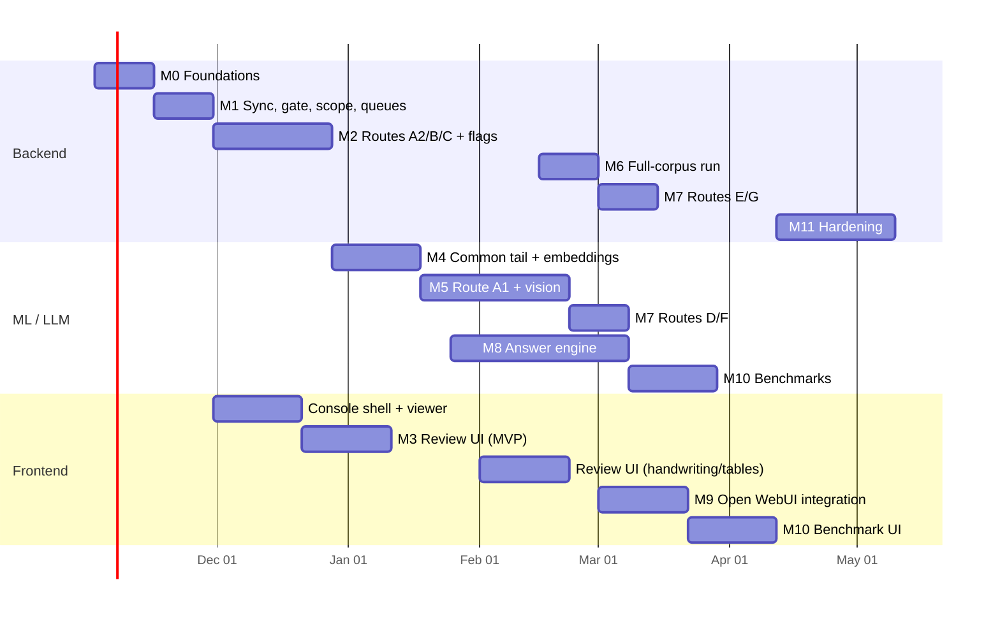

# 10 — Development Plan

## 1. Team and roles

| Role | Owns | Allocation |
|------|------|-----------|
| Backend / data engineer (lead) | Phase 1 sync, dispatcher, Route C, storage schema, Celery/ops | full time |
| ML / LLM engineer | Routes A1/D/F vision sub-pipeline, enrichment, embedding service, retrieval, Answer Engine, benchmarks | full time |
| Full-stack engineer | DCL Console (Review, Benchmark, Settings), Open WebUI Pipe/Actions, viewer | full time |
| Propulsion SME (part time) | golden benchmark cases, review rules, sanity ranges, propellant definitions, acceptance of answers, choice of the test folders for the allowlist | ~20% |
| DevOps (part time) | Docker Compose (GPU runtime for the embedding and reranker containers), secrets and the `.env` contract, Gemini gateway client hardening, monitoring, backups, CI | ~20% |

## 2. Repository layout (simple monolith)

One backend package with one FastAPI entry file, one frontend folder, one data-config folder. No microservices: every process (API, model server, Celery workers, beat) starts from the same `backend` package with a different role. Depth under `backend/` is at most three levels; a file's name says what it contains.

```
DCL_v2/
  backend/                        one Python package: `python -m backend.main`
    main.py                       THE FastAPI app. Mounts the routers from api/ according to ROLE
                                  (api | models | all); startup checks (env, DB, MinIO, GPU for models)
    config.py                     env contract (file 01 §7.1) only (S4)
    api/                          thin routers only, no business logic
      health.py  sync.py (webhook, ops)  review.py  settings.py  benchmark.py  viewer.py  assets.py
      entities.py  audit.py (read-only audit log)  engine.py (/v1/answer SSE, traces)
      models.py (/embed, /rerank; loaded when ROLE=models)
    celery_redis/                 app.py (Celery + Redis), queues.py (pools of §4), beat.py (schedules),
                                  tasks_sync.py  tasks_process.py  tasks_embed.py  tasks_review.py
    postgres/                     base.py (naming convention), enums.py (StrEnum → CHECK), session.py,
                                  pipeline_config.py (typed get/set over the config table + YAML seeding; S1),
                                  models/ (registry.py documents.py nodes.py entities.py telemetry.py
                                  review.py ops.py benchmark.py), views.sql, backend/postgres/migrations/ (Alembic)
    storage/                      minio.py (buckets, keys, presign), parquet.py (conventions of file 05 §2)
    sync/                         graph_client.py auth.py delta.py gate.py scope.py downloader.py resync.py
                                  retention.py
    dispatcher/                   type_resolution.py folder_context.py assembler.py contract.py routing.py
    routes/                       a1_office/  a2_source.py  b_code.py  c_telemetry/  d_photos.py
                                  e_diagrams.py  f_video.py  g_archives.py   (a folder only when > ~600 lines)
    llm_engine/                   everything that touches a model
      gemini_client.py            the only module that knows the gateway (S4)
      gemini_probe.py             capability probe
      local_models.py             EmbeddingGemma 2 + bge-reranker loaded once per process (GPU)
      vision/                     service.py schemas.py
      enrichment/                 extract.py entities.py numeric_facts.py translate.py
      prompts/                    versioned prompt files
      engine/                     workflow.py tools/ sanitizer.py verifier.py playbooks.py
    indexing/                     chunker.py anchors.py identifiers.py retrieval.py index_document.py
                                  commit.py bm25_ddl.sql
    review/                       models.py fingerprints.py staged.py rules.py resume.py api_models.py
    benchmark/                    runner.py metrics.py judge.py
    common/                       units.py hashing.py telemetry.py (OTel) logging.py
    devops/                       backend/devops/compose.yaml backend/devops/compose.dev.yaml docker/ grafana/ runbooks/ ci/ backup/
    backend/tests/                        unit/ integration/ schema/ fixtures/ benchmark/ acceptance/
  frontend/
    console/                      SvelteKit + TypeScript (the DCL Console)
      src/lib/config.ts           base URLs, feature flags, auth settings (from VITE_* env)
      src/lib/api_endpoint.ts     every call to the backend, in one file, shaped by config.ts
      src/lib/components/         modular components per screen area (review/ settings/ benchmark/ viewer/)
      src/routes/                 pages
      backend/tests/
    openwebui/                    Open WebUI functions (Python by platform constraint; thin)
      config.py  api_endpoint.py  pipe_manastu_engine.py  actions/  filter_policy.py  skills/
  config/                         data the pipeline loads (not secrets)
    gate.yaml  report_json_schemas.yaml  aerospace_synonyms.yaml  vendors.yaml  sanity_ranges.yaml
    units.txt  propellants.yaml  rules/
  docs/                           architecture manual, session briefs
  .wiki/                          the repository map (feature pages, plan sheets)
  .github/workflows/              CI (must live here for GitHub; scripts in backend/devops/ci)
  .env.example                    names only; the real .env is git-ignored
```

### 2.1 Coding principles (binding for every session)

1. **One entry file per side.** The backend has exactly one FastAPI app in `backend/main.py`; routers in `backend/api/` are thin and call domain modules. The frontend has one `api_endpoint.ts` that holds every backend call and one `config.ts` that shapes it (base URL, auth, flags). Nothing else in the frontend fetches.
2. **Roles, not services.** The same `backend` package runs as `ROLE=api` (routers), `ROLE=models` (loads the GPU models once and serves `/embed` and `/rerank`), Celery worker per queue, or beat. Workers that need vectors call the model role over HTTP on the internal network; the API role calls it for query embeddings and reranking. No separate codebases, no separate images beyond the GPU one.
3. **Flat and literal.** Folders by concern (`sync`, `dispatcher`, `routes`, `llm_engine`, `postgres`, `celery_redis`, `review`, `indexing`, `devops`); files named for what they contain; depth ≤ 3; a folder only when a module would exceed ~600 lines. Anyone must be able to trace a request from `main.py` to the row it writes by opening at most three files.
4. **One place per kind of thing.** Models in `postgres/models`, enums in `postgres/enums.py`, env in `config.py`, prompts in `llm_engine/prompts`, data files in `config/`, queue names in `celery_redis/queues.py`. Duplicates are bugs.
5. **No abstraction before the second use.** No base classes, plugin registries or layers until two concrete cases exist; the adapter registry of the dispatcher is the only sanctioned registry.
6. **Typed boundaries, plain insides.** Pydantic at the API and task boundaries, `StrEnum` for every status, SQLAlchemy models as the schema; inside a module, plain functions.
7. **Tests next to the concern.** `backend/tests/<concern>/…` mirrors the package; fixtures in `backend/tests/fixtures`.
8. **TypeScript for everything in `frontend/console`.** Open WebUI functions are Python because the platform executes Python; they stay thin and call the same backend endpoints through `frontend/openwebui/api_endpoint.py`, mirroring the TypeScript file.
9. **The wiki is updated in the same change** that adds or moves a file (`.wiki/README.md` §3).

## 3. Environments and the ingestion scope

- **dev**: Compose on the GPU workstation. The sync engine crawls the **real four roots** and, per decision H11, **downloads everything the gate accepts** (`sync.download_scope` empty), so the registry, dedup statistics and dispatcher run on real data from day one. **Processing** is limited by `processing.scope` to an allowlist of real folders the SME picks (one or two test-plan folders per root, a library folder with foreign-language brochures, the folder with handwritten run sheets); only Gemini spend is deferred. Gemini through the Manastu gateway with a low daily budget.
- **staging**: same host class as prod; scope lifted in M6 (the full-corpus run); shadow users.
- **prod**: internal host; PostgreSQL backups (daily base + WAL) and MinIO versioning on `dcl-raw` and `dcl-cir`.

Why not ingest everything at the start: the metadata crawl and even the downloads are cheap, but Gemini vision and enrichment on ~30,000 pages are not, and prompts and parsers change most during M2–M5. The CIR protects chunking and embedding changes, not vision calls, so the full run happens once, after Route A1 is accepted.

## 4. Celery queues and worker pools

| Queue | Workers | Memory limit | Tasks |
|-------|---------|--------------|-------|
| `io_light` | 4 (threads) | 1 GB | delta, downloads, webhook jobs, token health, presign, resume dispatch |
| `cpu_parse` | 1 (process; was 4, user decision 2026-10-23) | 6 GB, soft 3,600 s / hard 3,900 s per task | Docling, Route A1/A2/B/E/G, enrichment, index commit, resume_from_staged |
| `telemetry_stream` | 2 | 3 GB each, `--max-memory-per-child` | Route C Parquet streaming, DuckDB stats |
| `media` | 1 (was 2; two Whisper jobs exceeded 4 GiB, 2026-10-23) | 6 GB (user, 2026-10-24: meetings; 10-minute transcription parts peak at 3.5 GiB) | HEIC conversion, FFmpeg, whisper (CPU); long recordings continue across checkpoints |
| `vision_batch` | 2 (async) | 1 GB | Gemini vision/enrichment batch orchestration (I/O bound) |
| `embed` | 1–2 | 2 GB | batches to the embedding service (GPU) |
| `benchmark` | 1 (prefork) | 2 GB, child recycled past 1.5 GB | benchmark runner (`dcl.benchmark.*`), Answer Engine in process, soft 950 s / hard 1000 s (added 2026-10-23) |

Task time limits and retries per queue; dead-letter queue with a Console "Failed tasks" page. The queue layer is load-tested in M1 with synthetic tasks before any parser exists.

## 5. Milestones

Durations assume the team above; each milestone ends in a demo against real files and has explicit acceptance criteria. Tables are created in the milestone whose code writes them (file 05 §7).

### M0 — Foundations (week 1–2)
- Compose stack: PostgreSQL (ParadeDB image), MinIO, Redis, Celery, FastAPI skeletons, OTel/Grafana, LibreOffice, **embedding service** (EmbeddingGemma 2, text + vision encoders, bfloat16) and **reranker service**, both on the GPU (NVIDIA container toolkit; the two services share the card). Everything else CPU-only.
- `.env` contract loader (file 01 §7.1): refuses placeholders, refuses `GOOGLE_API_KEY`, validates `DCL_PERMISSION_OPTION`.
- OCR engines and language packs installed in the parse image: Tesseract with `osd` and the Latin, Cyrillic, Devanagari and Arabic traineddata; RapidOCR PP-OCRv5/v6 models for CJK.
- SQLAlchemy base with naming convention and enum→CHECK generation; Alembic wired with `include_object` exclusions; `pint` registry with aerospace and locale units and tests; DBOS runtime wired to PostgreSQL.
- Gemini client wrapper for the **Manastu gateway** (`GEMINI_BACKEND=gateway`), structured-output helper, `llm_calls` ledger, retry/backoff, budget guard; a capability probe that records which features the gateway passes through (file 09 §H.1).
- **Accept:** `docker compose up` yields a healthy stack with the GPU visible to the two model services; the embedding service returns a 768-d vector for a text and for an image; the reranker scores a pair; `alembic upgrade head` and `alembic check` pass in CI; a Gemini structured call through the gateway is logged with tokens; the capability probe's result is written into file 09 §H.1.

### M1 — Sync engine, gate, scope, queue load test (week 2–4)
- MSAL device-code sign-in, token cache, health check; root discovery; **metadata-only full crawl of all four roots**; delta; webhooks; 410 resync with `resync_gen`; gate tiers 1–4; `sync.download_scope` allowlist with `HELD_BY_SCOPE`; downloader with hashing and conflict-safe blob insert; `drive_folders` paths; `jobs` table; Ops page basics.
- **Queue load test:** 5,000 synthetic no-op tasks spread over all queues with injected failures, OOM simulation on `telemetry_stream`, and retries; dead-letter verified.
- **Accept:** the identity reads the four roots and gets 403/404 for `DCL_TEST_OUTSIDE_ITEM_ID`; the metadata crawl records ~110k items with ~105k gate rejections and ~5,200 accepted, each with a reason; all accepted items download (scope empty) while only the processing allowlist is dispatched; renaming a folder updates paths without downloads; modifying an allowlisted file creates a new blob and a `SUPERSEDES` relation; a forced 410 produces no deletions without per-item confirmation; re-running any job is a no-op; the load test shows correct routing, memory kills contained to one queue, and no lost tasks.

### M2 — Dispatcher + ground-truth routes A2, B, C (week 4–8)
- Type resolution and sniffers; folder context with `source_origin` defaults; assembler; adapter registry with **route gating** (`routes.<X>.enabled`; files of disabled routes park as `WAITING_FOR_ROUTE`); CIR writer.
- Route A2, Route B, Route C in full (channel-map pass, `.dat/.cfg`, TDMS, CSV triage, XLSX dual read + LibreOffice recalculation + islands, mystery formats, sub-runs, t0 detection, Parquet, catalog, three-tier metrics).
- Flags with fingerprints and staged payloads; `rules` table; `resume_from_staged`; Console API endpoints for cases and rules (no UI yet).
- **Accept:** every allowlisted `.dat` produces Parquet with SI columns or a `UNIT_AMBIGUITY` case with a correct suggestion; DuckDB reproduces the SME's Excel peak/steady numbers within 0.5%; `.tex`+`.json` reports assemble into one document with correct breadcrumbs; all `.py` symbols retrievable by name; the malicious-pickle fixture is never executed; re-indexing a document does not duplicate its flags.

### M3 — Review UI, minimum version (week 6–9, moved forward)
- Queue, case view with the evidence and resolution panes for `UNIT_AMBIGUITY`, `SCHEMA_UNKNOWN`, `CONFLICT`, `PARSE_FAILURE`; dry-run preview; rules with scope and simulation; audit; websocket updates. Handwriting and table panes follow in M5.
- **Accept:** the SME resolves a folder-wide unit case in one action and the siblings resume within two minutes; undo works; every action is in `audit_events`; a resolved value survives a forced re-index (overlay test).

### M4 — Common tail: enrichment, chunking, embeddings, hybrid search (week 8–11)
- Chunker with contextual headers and stable anchors; L2 enrichment in English with grounding checks; `entities`/`entity_aliases` normalization; `numeric_facts` with provenance; EmbeddingGemma 2 text and image vectors; BM25 with per-language fields and Python-computed `content_codes`; RRF + reranker; index commit with delete-by-document, vector reuse and overlays; re-index from CIR.
- **Accept:** retrieval lab shows recall@30 ≥ 0.9 on a 40-query SME set over M2 content, including 5 queries whose gold chunk is non-English; identifier queries hit lexically; changing chunk size re-indexes from CIR without touching Gemini vision; the 250k-chunk embedding backfill estimate is measured on the real hardware.

### M5 — Route A1 (PDF/Office) and the vision sub-pipeline (week 10–15)
- Pre-flight, page triage with language/script, OCR engine selection by script, Docling settings, tables QA with VLM A/B, equations, figure classification, handwriting regions and transcription, DOCX/PPTX specifics, section tree, PDF twin page map, external-literature specifics; `VisionService` with the MinIO cache; assets; Review UI panes for handwriting and tables.
- **Accept:** on a 30-document SME-selected set (digital, scanned, handwritten run sheets, table-heavy, slides, two non-English brochures, one paper): page types correct ≥ 95%; handwritten values ≥ 90% correct with calibrated confidence; non-English scanned pages OCR'd with the right engine and `low_grade` ≥ FAIR; tables preserve spans; citations open the right page and bbox; cost per PDF page within the envelope of file 01 §8.

### M6 — Full-corpus ingestion run (week 15–17, new)
- Lift `sync.download_scope` and `processing.scope` root by root; routes D–G still disabled, so their files park as `WAITING_FOR_ROUTE`.
- Observe live ingestion: queue depths, Graph throttling, worker memory, Gemini spend per day (`llm_calls`), flag rates per route.
- Clear the HARD backlog with the SME in the Review UI; tune rules; produce the first cost report.
- **Accept:** every accepted file is in a terminal state (`ACTIVE`, `ACTIVE_WITH_SOFT_FLAGS`, `HALTED` with an open case, `WAITING_FOR_ROUTE`, or `QUARANTINED`) within 10 working days; HARD backlog below 50 cases; measured cost per 1,000 pages recorded in the manual.

### M7 — Routes D, E, F, G (week 17–20)
- Photos (classify, cluster, inspect, image embeddings), draw.io graphs into `documents.catalog` + renders, XSD, videos, archives + ANSYS. Enabling each route re-dispatches its parked files automatically.
- **Accept:** photo classification separates plots from hardware ≥ 97%; burst clusters cut vision calls ≥ 40%; P&ID path queries answer correctly for the Rev C diagram; test videos yield ignition timestamps within 0.5 s of telemetry t0 where both exist; all parked files leave `WAITING_FOR_ROUTE`.

### M8 — Answer Engine (week 12–19, overlaps from M4 onward)
- Workflow steps; query analysis with language and source scope; tools T1–T6, U1–U2 with templates; playbooks; sanitizer; synthesis contract with provenance labels; verifier; traces with stable anchors; `/v1/answer` SSE; extractive fallback.
- **Accept:** the 60-case golden suite passes: numeric exactness 100% on telemetry math, citation recall ≥ 0.85, faithfulness ≥ 0.95, behavior cases pass (halted data, conflict, insufficient evidence, external labeling, clarification, library-vs-internal labeling, a non-English source answered in English with a translation marker); p95 latencies within file 07 §11.

### M9 — Open WebUI integration (week 18–21)
- Pipe with event mapping; Actions (trace, add to benchmark, report issue); Filter for policy; Skills published; SSO; viewer deep links with anchor resolution and page fallback; photo/plot embeds; translate toggle in the viewer.
- **Accept:** pilot engineers work only in Open WebUI; citations open the viewer at the right page even after a re-index; "Show trace" renders; feedback lands on `answer_traces`.

### M10 — Benchmark UI + CI gating (week 20–23)
- Suites/cases/runs/results/drilldown/compare/retrieval lab; benchmark mode in the engine; nightly runs; CI gate; draft cases from chat; `MULTILINGUAL` and `LIBRARY_VS_INTERNAL` categories seeded.
- **Accept:** a deliberate regression (disabling the reranker) is caught with the right failure class; a re-index with a new chunk size does **not** zero the retrieval metric (anchors resolve); CI blocks a merge that drops telemetry exactness.

### M11 — Hardening and production (week 23–27)
- Full-corpus re-validation in staging after M7; load test of 20 concurrent chats; backup/restore drill; runbooks (re-auth, 410 resync, worker OOM, Gemini outage, embedding service restart); security review (secrets, presign TTLs, sandboxing of LibreOffice/FFmpeg/archive extraction in separate containers); retention jobs; go-live with the pilot group, then all engineers.

## 6. Parallelization



Critical path: M1 → M2 → M4 → M5 → M6 → M8 → M10. The Review UI starts as soon as M2 emits flags (its API contract is fixed by file 06), so the SME clears unit and schema cases while A1 is still being built, and the full-corpus run in M6 lands on a working review loop.

## 7. Test strategy

| Layer | What | How |
|-------|------|-----|
| Unit | gate and scope decisions, path reconstruction, hashing, unit parsing/conversion (incl. locale), sanitizer, number grounding, SQL templates, bbox scaling, alias normalization, identifier extraction (indexer and query side share one fixture), anchor resolution, flag fingerprints | pytest with fixtures; property tests for `pint` conversions |
| Schema | migrations apply cleanly; `alembic check`; FK-without-index query returns nothing; CHECK constraints reject every value not in the Python enums; overlay re-application after re-index | CI on the pinned ParadeDB image |
| Route golden tests | one real sample per format plus synthetic edge cases (rotated scan, merged cells, headerless CSV, two LaTeX masters, zip bomb, malicious pickle, `.pdf` that is HTML, German datasheet, Japanese scanned page, a paper with a DOI) | CIR snapshot comparison; flag expectations; parser version bump requires snapshot review |
| Integration | end-to-end on the allowlisted folders with real Graph, MinIO, PostgreSQL, Gemini (recorded cassettes for CI, live nightly) | docker compose test profile |
| Queue | synthetic load, failure injection, OOM containment, dead-letter | M1 harness, re-run on every queue config change |
| Retrieval | recall@k on the SME query set incl. cross-lingual queries | Retrieval lab + CI threshold |
| Answer quality | golden suites | Benchmark runs nightly + on PR |
| Load | 20 concurrent chats; the M6 full-corpus burst | locust / scripted |
| Security | secret scan fixtures, archive guards, presign TTL, header signing, prompt-injection fixtures in documents, the outside-share negative test (`DCL_TEST_OUTSIDE_ITEM_ID`), image layer scan for secrets, `GOOGLE_API_KEY` refusal | dedicated tests + review |
| Chaos | kill a worker mid-document; expire the delta token; revoke the refresh token; stop Gemini; stop the embedding service | runbook drills in staging |

## 8. Definition of done (per feature)

Code + tests + CIR/flag fixtures where applicable + metrics emitted + config keys documented in `pipeline_config` descriptions + runbook entry if operational + benchmark cases added when answer behavior changes + table tier label on every new model.

## 9. Risk register

| Risk | Likelihood | Impact | Mitigation |
|------|-----------|--------|-----------|
| Delegated token revoked during long absence | medium | ingestion stops | health check + banner; pursue application permissions |
| Gemini quota/price changes | medium | cost/latency | ledger + budgets; Batch API; Flash-Lite for triage; embeddings already local |
| Gateway does not pass through a needed capability (context caching, Batch, Files, bounding boxes) | medium | higher cost or a design change | capability probe in M0; feature flags per capability; caching and batch are optimizations, not prerequisites |
| GPU shared by embedding and reranker services saturates during the M6 burst | low | slower backfill | run the backfill off-hours; the reranker is idle during ingestion; vector reuse by text hash |
| Handwriting accuracy below 90% on messy sheets | medium | reviewer load | crops + context labels; HARD only for critical fields; rules; calibration study in M5 |
| Cross-lingual retrieval weaker for some languages | medium | missed library content | English enrichment layer; `MULTILINGUAL` benchmark; `translation.mode = full` for affected kinds |
| OCR engine choice wrong for a script | low | garbage text | per-script engine table; Gemini VLM fallback on low confidence |
| pg_search upgrade breaks DDL | low | search down | pinned version; DDL isolated; native FTS fallback switch |
| Open WebUI API changes for Pipes/events | medium | chat integration breaks | thin Pipe; version pin; integration test on upgrade |
| Corpus contains sensitive/export-controlled material | medium | compliance | Tier-4 markings scan; restricted prefix; cloud-allowed per root |
| SME time for golden set | high | weak benchmarks | start with 60 cases; grow from chat feedback; drafts auto-prefilled |
| Docling CPU throughput | low | slow M6 | windowing; more `cpu_parse` workers; GPU optional |

## 10. First two weeks, concretely

1. The SME picks the **allowlist folders**: one or two test-plan folders per root (with `.dat`+`.cfg` pairs and a `.dat_fail`), the folder with scanned run sheets with handwriting, a `.tex` project with its PDF, an `.xlsx` FMEA, a photo folder with `.heic`, the Rev C `.drawio`, one short test video, one `.npy`, and a library folder containing at least two non-English brochures and one paper with a DOI.
2. Reuse `dcl-reader-delegated`, complete the device-code sign-in once, confirm the four folder ids from `.env` resolve and the outside-share item does not. Confirm the **gateway API contract** with whoever operates it (endpoint shape, auth header, streaming, structured output, image/PDF input, thinking level, caching, batch) and record the answers in file 09 §H.1.
3. Stand up M0 on the GPU host; verify pgvector + pg_search; verify the embedding and reranker services see the GPU; verify OCR language packs.
4. Write the gate config from the inventory and run the **crawl against all four real roots** to confirm the ~5,200 / ~105k split; leave `sync.download_scope` empty and set `processing.scope` to the SME's folders.
5. Have the SME write the first 15 telemetry benchmark cases with Excel-verified numbers while M1 is built.
